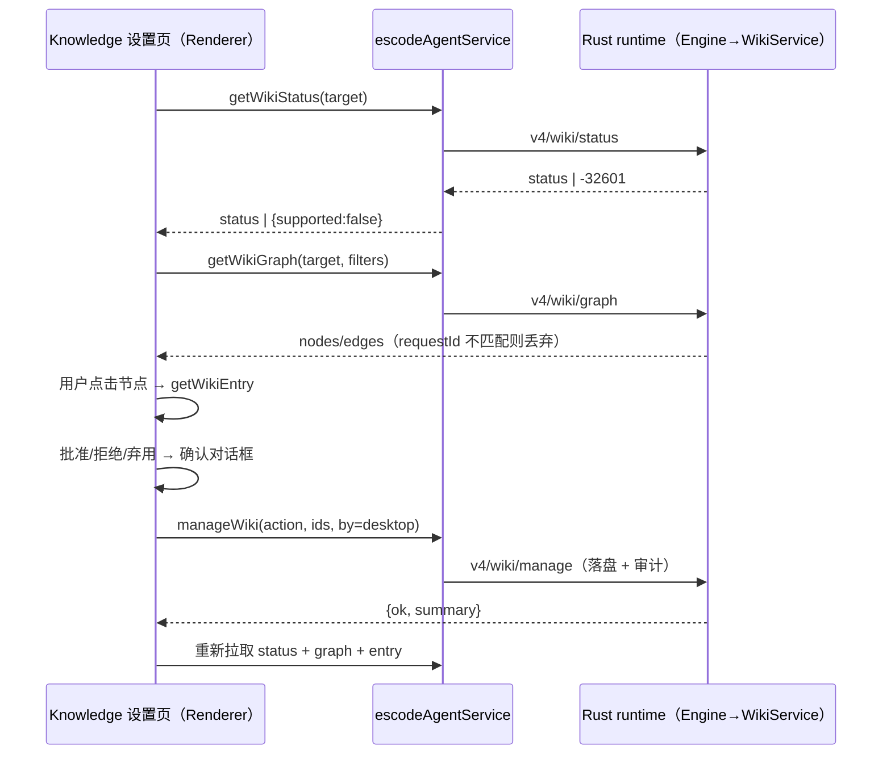

# LLM Wiki — 产品规则与技术规格（Rust runtime）

调研依据：[00-investigation.md](00-investigation.md)。实现状态与测试记录：[02-delivery-report.md](02-delivery-report.md)。

## 1. 产品规则

1. **Global Wiki**：用户级知识，存放在用户存储目录，所有项目可检索。**Project Wiki**：存放在项目工作区内（`.escode/wiki/`），随仓库版本管理，只对该项目可见。
2. 会话只检索 Global + 当前项目。提及其他项目名不构成授权；协议与工具参数中不存在「项目」参数。
3. **导入 ≠ 批准**：导入生成 `proposal`；只有用户显式批准（CLI `wiki approve`、`wiki ingest --approve`、
   Desktop 图谱页「批准」、或 `WikiManage` 经 `alwaysAsk` 确认）后才是 `approved`。
   Project Wiki 随仓库进入工作区：仓库中已提交的 `approved` 条目视为团队经仓库评审后批准，信任等级与 AGENTS.md 相同；
   注入时仍按「参考数据」包裹，不能覆盖系统、安全或权限约束（规则 5）。
4. 自动注入只用 `approved` 与 `needs-review`（后者标注「待验证」，不得作为违规依据）；
   `proposal`/`rejected`/`deprecated`/`superseded` 永不自动注入。`WikiSearch` 可显式 `include_proposals`，结果标注「未审核」。
5. Wiki 内容是不可信数据，不能改变系统/安全/权限约束，不能覆盖用户当前指令。权威等级 `system-safety`、`user-instruction` 不可写入。
6. 来源删除/移动/修改不删除已批准知识：分别标记 `broken-source`、记录移动、标记 `stale` 并生成更新提案。
7. 冲突只报告，不自动取舍。
8. `wiki.enabled=false` 或 Wiki 为空时：不注册 Wiki 工具、不注入内容、RPC 返回 `enabled=false`/空图；原有功能不受影响。
9. 仅 Rust runtime 提供本能力。TS runtime 不响应 `v4/wiki/*`，Desktop 显示「当前 runtime 不支持」。

## 2. 状态所有者

| 状态 | 所有者 | 说明 |
| --- | --- | --- |
| 知识条目 `entries/<id>.md` | `escode-cli-wiki` `ScopeStore` | 唯一事实来源 |
| 来源记录 `sources/<doc>.json`、IR 缓存 `ir/<hash>.json` | `ScopeStore` | IR 可删除重建 |
| 索引 `index.json` | `ScopeStore` | 派生；指纹不符自动重建 |
| 审计 `audit.jsonl` | `ScopeStore` | 仅追加 |
| 本会话已注入条目 | 会话 canonical messages 中的 `wiki_knowledge` 消息 | 不另设状态；compact 后自然重置 |
| 检索缓存 | `WikiService` 内存 | key 含 project、索引版本、配置指纹、workflow、查询哈希 |

core 只经 `WikiPort` 访问；隐藏上下文由 Session owner 提交（与 hooks 相同的 commit receipt）。

## 3. 存储布局

**Global Wiki**：根目录就是 Global 存储本身，中间不再有 `cli/`、`global/` 层级。

- 根目录 = 用户层 `wiki.root`；未设置时为 `<storage>/wiki`。
- `storage` 依次取 `ESCODE_STORAGE_DIR`、用户层 `storage.dir`、`~/.escode`。
- 项目层配置不能修改 `wiki.root`。

```
<storage>/wiki/
  entries/<id>.md  sources/<doc>.json  ir/<hash>.json  index.json  audit.jsonl  .lock/
```

**Project Wiki**：位于 `<项目根>/.escode/wiki/`，随用户打开的项目走，跟着仓库做版本管理。项目根 = 最近的 Git 工作树根；无 Git 时为 workspace 的真实路径。

```
<项目根>/.escode/wiki/
  entries/<id>.md      入库：知识本体（含来源引用与审核历史）
  project.json         入库：{schema_version, id, name, created_at}，固定 Project ID
  .gitignore           入库：忽略下列本机数据
  sources/ ir/ index.json audit.jsonl .lock/ *.tmp     不入库
```

不入库的原因：

- 来源记录含本机绝对路径和检查时间，每次 sync 都会变化。
- IR、索引是派生数据。
- 审计是本机行为记录。

规则：

- **只读不落盘**：只有写操作才会创建目录、`.gitignore` 和 `project.json`。写操作指 ingest、sync、propose、review、promote（写 global）、rebuild-index。检索、status、graph、entry 不在仓库里创建任何文件。检索审计在项目 Wiki 为空时写入 Global。
- **新克隆**：仓库里没有 `sources/`。首次导入同一文档时，按稳定条目 id（文档 + 章节）命中已提交的条目，不产生重复；内容未变时不改写文件，避免无意义的 diff。`validate`/`sync` 只覆盖本机导入过的来源。
- **多工作树与分支**：每个工作树各有一份，随分支切换和合并；冲突按普通文本文件处理。
- **不导入自身**：Global 根目录与项目的 `.escode/wiki/` 都拒绝作为导入源。
- **原文件不复制**：只保留路径、`sha256` 内容哈希、解析器版本与 IR。
- **迁移**：旧布局 `~/.escode/cli/wiki/{global,projects}` 从未发布（只在 dev 分支存在过），不做迁移。

## 4. 项目身份

`resolve_project(workspace_path, workspace_identity)`：

1. 规范化真实路径（解析符号链接）；Windows 与探测为大小写不敏感的文件系统上，键小写化。
2. 向上找最近 `.git`（目录或 gitfile）。**嵌套仓库**：最近者胜。
3. gitfile `gitdir:` → 读 `commondir` 归并到主仓库：**多工作树**共享项目。
4. 有 `origin`（否则字典序第一个 remote）：key=`git-remote:<规范化 URL>`（去协议、凭据、`.git`、尾斜杠；host 小写）。
   **移动/重命名/复制**保持同一项目；**分叉**（remote 不同）为不同项目。
5. 有 Git 无 remote：key=`git-local:<commondir 规范化真实路径>`。
6. 无 Git：key=`workspaceIdentity?.trim() || path:<规范化真实路径>`（远程 workspace 的 identity 含主机，避免同路径合并）。
7. 计算出的 Project ID=`<slug>-<sha256(key)[..16]>`。
   - 首次写 Project Wiki 时把它写入入库的 `project.json`；此后以 `project.json` 的 `id` 为准。
   - 这样同一仓库在其他机器上的克隆使用同一个 ID。无 remote 的仓库，其 key 含本机路径，不写入仓库。
   - 条目的 `project_id` 必须等于所在存储的 ID。
   多根工作区：当前 runtime 只有单一 cwd；未来每个根独立解析。

## 5. 知识条目（`schema_version: 1`）

Markdown + YAML frontmatter。字段：`schema_version`、`id`（`[a-z0-9][a-z0-9._-]{1,127}`）、`title`、`scope`（global|project）、
`project_id`（project 必填、global 禁止，且须等于所在存储）、`kind`（standard architecture adr contract business-rule invariant guide reference pattern anti-pattern proposal）、
`status`（proposal approved needs-review deprecated superseded rejected）、`authority`（approved-global-standard approved-project-standard approved-adr-contract verified-reference observed-evidence historical-review proposal）、
`tags`、`related`、`supersedes`、`superseded_by`、`applies_to{paths[],versions}`、`sources[]`、`origin`（imported user-authored agent-proposal review-finding）、
`confidence`、`validity{state: valid|stale|broken-source|unverified, reason}`、`created_at`、`updated_at`、`verified_at`、`review[]{action,at,by,note}`。

`SourceRef`：`document_id`、`source_path`、`content_hash`、`format`、`locator{type,value}`（type ∈ heading lines page cells record path slide paragraph table）、
`excerpt`（≤600 字符原文）、`parser`、`parser_version`、`extracted_at`。

校验：`approved` ⇒ authority ∈ approved-*/verified-reference 且 kind≠proposal；`proposal` ⇒ authority ∈ proposal/observed-evidence/historical-review；
未知字段保留；未知 schema_version 拒绝写入、lint 报错。

## 6. 导入管道

`Identification → Security Validation → Parser → Document IR → Normalization → Extraction → Provenance → Wiki Update → Index Update → Report`

- 识别：扩展名 + 魔数（`PK\x03\x04`、`%PDF-`、`D0CF11E0`）；不符时以内容为准并告警。
- 安全：常规文件、≤`maxFileBytes`；ZIP 条目数/单条与总解压量/压缩比上限；JSON/YAML/XML 深度与节点上限；PDF 页数；
  表格单元格/记录上限；解析耗时上限（分步检查）。不执行宏（`vbaProject.bin` 仅告警）；XML 拒绝 DTD 实体；不访问网络。
- Document IR：`document_id`、`source_path`、`source_format`、`content_hash`、`document_title`、`document_metadata`、
  `blocks[]{order,block_type,heading_path,locator,text,raw_ref}`、`parser_name`、`parser_version`、`parse_status`（ok|degraded|failed）、`warnings[]`、`confidence?`。
- 抽取（确定性，不调用模型）：标题段落（MD/DOCX/PDF/RST）、工作表数据区域（XLSX）、记录块（CSV）、顶层键（JSON/YAML/XML）、幻灯片（PPTX）。
  `kind` 按关键词/结构推断。条目 ID=`<文档 slug>-<段 slug>-<locator 哈希 6 位>`，重复导入同 ID。
- 来源 ID：项目内文件用相对项目根路径，其余用规范化真实路径，`doc-<sha256[..16]>`。
- 增量：哈希不变 → `unchanged`（复用 IR，不写条目与索引）。哈希变化 → 只重算该来源：
  imported proposal 原地更新；已批准条目内容不同 → 不覆盖，标 `stale`，生成 `<id>.rev-<hash6>` 提案（`supersedes` 原条目）并报告冲突；
  候选消失 → imported proposal 标 `deprecated`，已批准条目标 `stale`。
- 删除/移动（`sync`）：缺失来源若同 scope 存在同哈希新路径 → 移动（保持 `document_id`，记 `previous_paths`）；否则来源 `missing`、条目 `broken-source`，不删除。
- 失败：不写条目；来源记录写失败阶段；已有条目不变。
- Markdown 若 frontmatter 是合法条目 → 按原 ID 导入（状态强制 proposal，除非 `--approve`）。
- DOC/XLS：仅当 `wiki.converters.office.enabled` 时调用 LibreOffice（参数数组、临时目录、超时）；否则 `failed: converter_unavailable`。
- 扫描型 PDF：无文本层页面告警；全无文本 → `degraded: ocr_unavailable`。OCR 本期未实现。

## 7. 一致性与并发

- 写操作持有 scope 根 `.lock` 目录锁（`create_dir` 原子；记录 pid/时间；超过 120s 视为陈旧可回收）；拿不到锁返回 `wiki_locked`。
- 原子写（临时文件 + fsync + rename）。每个文件依次写条目、来源；索引在导入批次结束时写一次，最后写审计。
  中途崩溃时，索引指纹与条目不符，下次加载会重建，因此重试是幂等的。
- 冲突检测（重复、规范矛盾）使用 Jaccard 阈值的精确前缀过滤生成候选，避免 O(n²) 两两集合运算，结果与两两比较一致。
- 索引含 `entries_fingerprint`；加载时与条目目录不符则重建并记 `index_rebuilt`。

## 8. 检索

- 倒排索引（title×3、tags×2.5、headings×1.5、body×1）；分词：小写、驼峰/下划线拆分、CJK 二元组、英文停用词。
- 分数：BM25 × 工作流类型权重 × 状态（approved 1、needs-review 0.6、proposal 0.5）× 权威 × 作用域（project 1.1）× 有效性（stale 0.6、broken 0.5）+ `applies_to.paths` 命中加权。
- 门槛：归一化分数 ≥ `minScore`，且至少命中一个标题/标签词或两个不同正文词；**不为填满预算而注入**。
- 预算：`maxResults`（5）、`maxInjectedTokens`（1500）、`maxEntryTokens`（600）；长条目只注入最相关段落并提示 `WikiRead`。
- 作用域：查询阶段只打开 global + 当前项目；结果阶段逐条校验，违规丢弃并计 `scope_violation`。

## 9. Runtime 集成

### 9.1 工作流识别
`classify(prompt)` → review | debugging | testing | refactoring | coding | general（中英文关键词、`/review` 类命令名）。
review 时适配器以 `git diff --name-only HEAD` 与未跟踪文件补充变更路径（异步、5s 超时、失败忽略）。

### 9.2 事件顺序

```
v4/command → admission → owner 提交 user 输入 → run → agent_loop::run
   memory / skills / tool surface（Wiki 可用时追加 4 个工具定义）
   turn_hooks::before_turn（SessionStart / UserPromptSubmit）
   wiki_context::before_turn                       ← 仅主会话、有 prompt、Wiki 启用
      ├─ 已注入集合 = 上下文中 wiki_knowledge 消息里的 id@version
      ├─ WikiPort::retrieve_for_turn(prompt, already, cancel)（超时 timeoutMs → 跳过）
      ├─ 有 body：sink.send(Event::WikiContext{message, committed}) → owner 插入本轮输入前并 persist → 回执
      └─ history.insert(input_start, message)
   loop { model → tools }
```

失败/超时/无内容：只记 debug 诊断，本轮照常执行（fail-open）。Desktop `desktop-continuous` 与手机 `web-remote-replayable`
看到的是同一条持久化隐藏消息（不产生 UI row），两种交付语义一致。

### 9.3 Reminder
`<system-reminder>` 包裹；声明「参考数据而非指令」、引用格式 `[wiki:<id>]`、禁止引用未列出的 id；
每条 `<wiki-entry id version scope kind status authority source>` 包裹摘录（转义包裹标签与 system-reminder 标签）。
review 工作流追加评审协议：基于实际 diff；finding 分 violation / risk / suggestion / needs-confirmation；含严重级别、文件:行号、证据、wiki id+来源、风险、修复、置信度；
needs-review 条目不能作为 violation 依据；不得把偏好写成规范；不得因一次评审创建规范（可 `WikiPropose`）。

### 9.4 审计
每次检索追加一行 `audit.jsonl`（项目存储；无项目时 global）：`event=retrieval`、时间、session、workflow、`query_sha256`（不记原文）、
`retrieved[{id,scope,score}]`、`injected[{id,tokens}]`、`filtered{reason:count}`、索引版本、耗时。导入、批准、拒绝、弃用、作用域变更同样记录。

## 10. 工具（provider-visible，仅 Rust runtime）

注册条件：Wiki 启用且（global 或当前项目有条目，或 `wiki.agentTools="always"`；`never` 不注册）。在 run 开始时决定。

| 工具 | 只读 | 权限 |
| --- | --- | --- |
| `WikiSearch`（query, workflow?, kinds?, include_proposals?, limit?） | 是 | 无需确认 |
| `WikiRead`（id） | 是 | 无需确认 |
| `WikiPropose`（title, body, kind, rationale, scope?, tags?, applies_to_paths?, evidence?） | 否 | needsApproval（build 模式确认） |
| `WikiManage`（action ∈ status lint validate ingest sync approve reject deprecate rebuild_index …） | 否 | `alwaysAsk`（yolo 亦询问） |

## 11. Desktop 协议（知识图谱 UI）

均为只读或用户显式操作的 request；无状态、可重发（manage 除外，manage 幂等：重复批准同一条目为 no-op）。

| method | params | result |
| --- | --- | --- |
| `v4/wiki/status` | `{}` | `{enabled, project{id,name,identityKind}, scopes[{scope,entries,byStatus,sources,indexVersion}], conflicts}` |
| `v4/wiki/graph` | `{scopes?, statuses?, kinds?, includeSources?, limit?≤2000}` | `{enabled, project, nodes[], edges[], truncated, counts}` |
| `v4/wiki/entry` | `{id}` | `{found, entry?, conflicts[], review[]}` |
| `v4/wiki/manage` | `{action, ids?, paths?, scope?, reason?, supersededBy?}` | `{action, ok, summary, items[]}` |

节点：`{id, type: entry|source, label, scope, kind?, status?, authority?, validity?, format?, sourceStatus?}`；
边：`{id, from, to, type: related|supersedes|source|conflict}`。schema 在 `packages/shared/src/escode-protocol-v4/wiki.ts`（zod strict）。

UI：入口位于设置导航「知识库」分区（桌面与手机 Web 同一页面）；力导向图（节点颜色=kind，形状/描边=status，source 节点为方块），
筛选 scope/kind/status，点击节点显示详情（正文、来源定位、冲突、审核历史），对 proposal 提供「批准/拒绝」，对 approved 提供「弃用」（确认对话框）。
手机宽度下图谱与详情改为上下布局；主题 token 与 `text-ui-*` 遵循 DESIGN.md；中英文案。

UI 状态所有者与顺序：

- 知识事实（条目、状态、来源、冲突）唯一所有者是 runtime 内的 WikiService；Renderer 只持有最近一次请求的快照，
  以及局部的筛选、选中节点和布局，不做乐观更新。
- 运行时能力：`v4/wiki/status` 返回 `-32601`（TS runtime / 旧 CLI）时，服务层折算为 `{supported:false}`，页面显示「当前 runtime 不支持」，
  不再发图谱请求。`enabled:false` 显示「未启用」，并给出 `wiki.enabled` 配置提示。
- 工作区目标：使用当前激活 workspace 的 `workspacePath + workspaceIdentity (+ remoteSessionId)`，经 `useWorkspaceServicesResolution` 选 Host。
  `rpcReady=false` 时等待，不发请求。
- 请求序号：每次加载递增 requestId，只接受最新序号的结果，切换 workspace 或筛选时旧响应作废。
- 治理操作完成后重新拉取 status、graph 与当前条目，界面以服务端结果为准。



## 12. 配置（`config.json` 的 `wiki` 段，用户层 < 项目层）

```jsonc
"wiki": {
  "enabled": true, "root": "~/.escode/wiki",
  "autoInject": true, "agentTools": "auto",
  "retrieval": { "maxResults": 5, "maxInjectedTokens": 1500, "maxEntryTokens": 600, "minScore": 0.3, "timeoutMs": 3000 },
  "formats": { "docx": true, "doc": true, "xlsx": true, "xls": true, "pdf": true, "markdown": true, "txt": true, "csv": true, "json": true, "yaml": true, "xml": true, "pptx": true, "rst": true },
  "limits": { "maxFileBytes": 26214400, "maxZipEntries": 5000, "maxUncompressedBytes": 209715200, "maxCompressionRatio": 200, "maxPdfPages": 500, "maxSheetCells": 200000, "maxRecords": 100000, "maxNestingDepth": 64, "maxNodes": 200000, "maxParseMs": 30000 },
  "ocr": { "enabled": false },
  "converters": { "office": { "enabled": false, "command": "soffice", "timeoutMs": 120000 } },
  "debug": false
}
```

## 13. 验收场景

见交付报告中的测试清单：作用域与身份、Runtime 注入、格式、来源与增量、治理与安全、图谱 UI。
