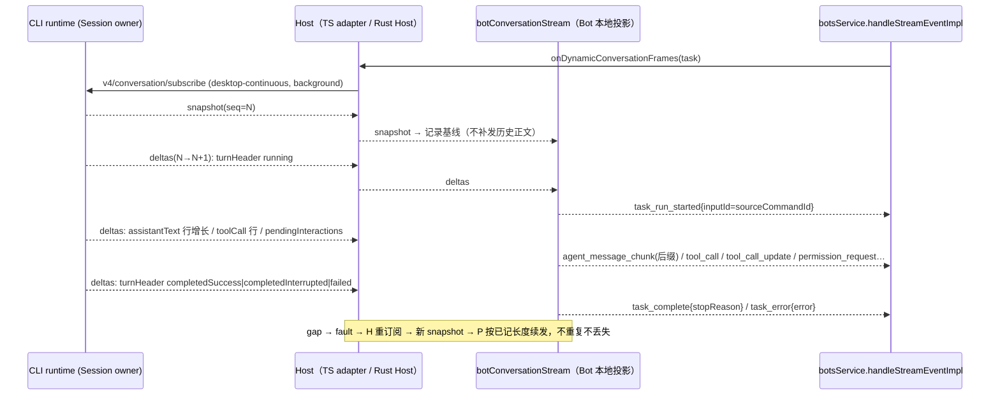

# Bots 回复流改为消费 V4 conversation 帧（2026-10-18）

## 1. 背景与决策

- Bots 是 `ESCodeStreamEvent` 唯一仍在使用的消费方（`botsService.handleStreamEvent`）。手机端走 V4
  `web-remote-replayable`，不消费 `stream_event` 镜像。
- 旧来源是 `escodeTaskService.onDynamicTaskEvent` → `escodeAgentService.onDynamicSessionEvent` → legacy
  `session/subscribe`。Rust runtime 不提供 `session/subscribe`（`rust-parity-remaining.md` 记为无活跃调用点，
  实际 Bots 仍在用），所以 Rust runtime 下 Bot 收不到正文、工具、权限事件。Rust Host 的
  `onDynamicStreamEvent`/`onDynamicTaskEvent` 也只有生命周期事件。
- 已记录的架构决策（`packages/desktop/src/host/index.ts` 镜像注释）否决“帧 → `ESCodeStreamEvent` 通用薄映射”，
  正解是消费方直接吃 V4 帧。本 spec 落实这一点：**Bots 只从 V4 帧取数据**，投影是 Bots 本地的、只覆盖
  Bots 需要的信号，不成为第二套通用流协议。
- `onError`：TS adapter 的 `errorEmitter` 从未 `fire`，全仓没有消费方；Rust Host“只登记监听、不投递”
  已与 TS 对等，不属于缺口，本 spec 不新增错误源。

## 2. 所有者与接口

| 状态 | 唯一所有者 | 其他层 |
| --- | --- | --- |
| 正文/工具/交互/轮次事实 | CLI runtime Session（V4 snapshot + deltas） | Host 只转发帧，不缓存业务状态 |
| 帧序列连续性（seq/gap） | 订阅方的 `TopicWireFrameAssembler` | gap → fault → 重新订阅取新 snapshot |
| Bot 回复进度（已发送长度、已见工具/交互、当前 run） | `botConversationStream` 投影实例（每个 Bot 订阅一个） | `handleStreamEventImpl` 只消费投影输出 |

新增 escode-task 事件方法（TS adapter 与 Rust Host 各实现一份，远端经 RPC 代理）：

```ts
onDynamicConversationFrames(params: {
  taskId: string; workspacePath: string; workspaceIdentity?: string; remoteSessionId?: string;
}): Event<ConversationTopicFrame>;
```

- 语义：为该任务建立一条 **desktop-continuous、visibility=background** 的 V4 conversation 订阅（独立连接身份，
  不复用 Renderer 订阅表），投递装配后的帧：首帧 `snapshot`，之后 `deltas`。
- gap/fault：实现方丢弃当前订阅并重新订阅，下一帧是新的 `snapshot`（投影据此重定基线）。
- 监听者全部 dispose 后退订；迟到 ACK 也要释放。不 replay 历史（continuous 语义，与旧 Bot 订阅一致）。
- 身份 key：`workspaceIdentity?.trim() || workspacePath`，远端贯穿 `workspaceIdentity` 与 `remoteSessionId`。

## 3. 事件顺序



Desktop UI 的 `desktop-continuous` 与手机 `web-remote-replayable` 不受影响：Bot 订阅是独立连接，
不改变它们的 owner、seq 或恢复语义。

## 4. 投影规则（V4 → Bot 信号）

所有输出的 `traceId` 与 `inputId` 取当前轮 `turnHeader.sourceCommandId`（`sendText` 的 `commandId = traceId`，
automation 的 runId 即该值）；`taskId` 为订阅任务。

| V4 来源 | 输出 |
| --- | --- |
| `turnHeader` 首次以 `state=running` 出现（appended/upserted），`executionKind != controlOnly` | `task_run_started` |
| 同一 `turnHeader` 迁移到 `completedSuccess` | `task_complete{stopReason:"end_turn"}` |
| 迁移到 `completedInterrupted` | `task_complete{stopReason:"cancelled"}` |
| 迁移到 `failed` | `task_error{error: control.lastError.message ?? "Task failed"}` |
| `assistantText` 行文本增长（按 rowId 记已发送长度；新文本以旧文本为前缀时发后缀，否则按新行处理） | `agent_message_chunk{content:后缀, messageId:assistantResponseId}` |
| `reasoning` 行文本增长 | `agent_thought_chunk` |
| `toolCall` 行首次出现 | `tool_call{toolId:toolCallId, toolName, kind:toolName, title:toolName, input}` |
| `toolCall` 行 `status` 变化 | `tool_call_update{status}`：`inputStreaming/pendingApproval→pending`、`running→in_progress`、`success→completed`、`error→failed`（带 `error.message`）、`cancelled→stopped` |
| `pendingInteractions` 新出现 `permission` | `permission_request{requestId:interactionId, options(optionId,name=label,kind=allow_once/allow_always/reject_once/…), title/description:summary, kind:toolName, display, freeText, origin, raw:payload}` |
| 新出现 `userInput` | `elicitation_request{requestId:interactionId, …}`（字段沿用 TS `userInputRequestToElicitationStreamEvent`） |
| 已投递的交互从 `pendingInteractions` 消失 | `permission_response` / `elicitation_response{requestId}` |
| `snapshot`（首帧或 gap 重订阅） | 不输出；记录所有行的当前长度/状态与当前交互集合为基线。若当前有 running 轮，基线后续增长照常输出 |

- 只投影主会话行（`parentToolUseId = null`）；子代理内容在子会话里，Bot 不订阅。
- `interactionId ≡ requestId`，Bot 的 `/approve`、`/deny`、表单回执沿用现有 `respondPermission`/`respondElicitation`
  （V4 `resolveInteraction`）。
- 本期不映射：`turn_steer_status`（排队输入被删除/拒绝的提示，由 `cancelBotGroupInput` 结果和队列快照处理）、
  `plan`、`usage`、`config_option_update` 等 Bot 不消费的事件。

## 5. 迁移范围

1. 契约：`IESCodeTaskService.onDynamicConversationFrames`；TS adapter 用 `subscribeConversationV4` +
   `onDynamicConversationFrame` + `TopicWireFrameAssembler` 实现；Rust Host 用 Host 内部 V4 观察器的持续版实现；
   inventory 更新为 77 个成员。
2. Bots：新增 `botConversationStream.ts`（纯投影 + 单测），`botsService` 的任务流订阅改为
   `onDynamicConversationFrames` → 投影 → `handleStreamEventImpl`。服务不提供该方法时（旧远端）退回旧订阅。
3. 删除路径：Bots 不再依赖 `onDynamicTaskEvent` 的正文事件；`task_stream_mirror_batch` 分支保留给旧远端 Host。

## 6. 验收

- 单元：投影的正文后缀、思考、工具首见/状态迁移、权限/表单出现与消失、终态三类、snapshot 基线不补发、
  gap 重 snapshot 后不重复不丢失、controlOnly 轮不发 run_started、traceId/inputId 取 sourceCommandId。
- Rust Host 端到端：真实 runtime + fixture 模型，`onDynamicConversationFrames` 收到 snapshot 与后续 deltas，
  退订后不再投递。
- TS 端到端（Rust runtime）：Bot 私聊发送 → 收到正文分段与完成；工具调用产生工具回复；权限请求出现审批选项。
- 负向：去掉后缀计算（整段重发）→ 重复正文用例失败；去掉基线 → snapshot 补发历史用例失败。
