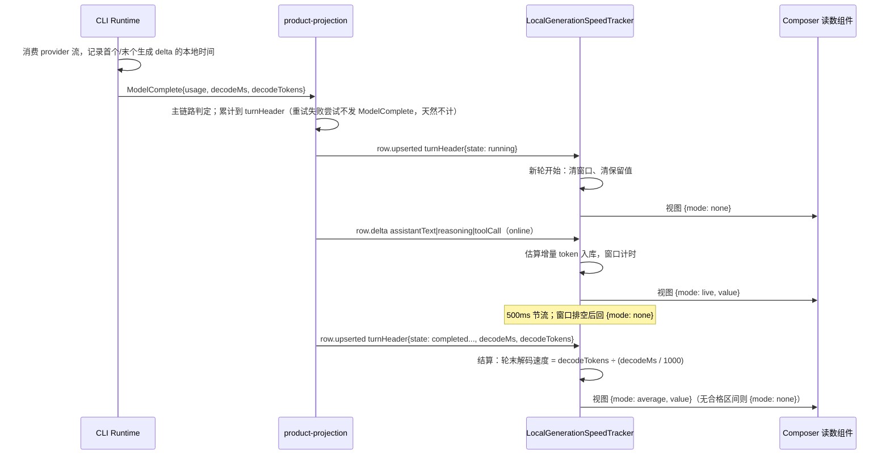

# 会话 Token 生成速度（Composer 读数）

| 字段     | 值                                                                                                                                                            |
| -------- | ------------------------------------------------------------------------------------------------------------------------------------------------------------- |
| 状态     | Draft（规格先行，实现与验证随本规格同步落地）                                                                                                                 |
| 日期     | 2026-10-13                                                                                                                                                    |
| 适用范围 | ESCode Desktop Renderer、手机/Web 远控 Renderer、`packages/ui`、`packages/shared`、CLI core 与 bootstrap 投影、CLI 上下文预算                                 |
| 主要对象 | 实时接收速率（v4 帧流上的在线 delta）；轮末解码速度（`turnHeader.decodeMs` / `decodeTokens`）；Composer 工具条读数                                            |
| 关联 ADR | [0007 生成速度拆分为两个量、两个所有者](../adr/0007-generation-speed-split-ownership.md)（取代 [0006](../adr/0006-generation-speed-observed-in-renderer.md)） |
| 关联文档 | `DESIGN.md`；`docs/specs/rust-request-context.md`（估算器来源）；E2E：`docs/test-cases/e2e/conversation-generation-speed.feature`                             |
| 非目标   | 历史图表、跨会话总览、按请求逐 step 的明细视图、设置开关                                                                                                      |

## 1. 摘要

在会话输入框工具条、上下文容量指示的左侧，常驻显示当前对话的生成速度。用户看到的读数分别是**两个不同的量**，各有独立的所有者与口径：

| 量           | 含义                        | 所有者                                         | 何时显示                       |
| ------------ | --------------------------- | ---------------------------------------------- | ------------------------------ |
| 实时接收速率 | 本机此刻收到多少 token / 秒 | Renderer 本地观测（`localGenerationSpeed.ts`） | 生成中                         |
| 轮末解码速度 | 本轮模型解码多少 token / 秒 | CLI 投影（`turnHeader.decodeMs/decodeTokens`） | 本轮结束后保留，直到下一轮发送 |

- 生成中显示 3 秒滑动窗口的实时值（`42 tok/s`），窗口排空时显示占位符 `—`；
- 一轮结束后在同一位置保留本轮解码速度并弱化显示，直到下一次发送被新读数替换；
- 手机远控重连、桌面投影 resync 造成的投递缺口只影响实时值的累积，**不影响轮末解码速度**——后者由
  CLI 投影从权威事件累计而来，与客户端是否漏帧无关。

**为什么拆开。** 轮末值要回答"这一轮的模型解码有多快"，这是**会话事实**：权威输入是 provider 的
output usage 与 runtime 对 provider 流的观测，两者都在 CLI 侧；它必须跨设备一致、不随分页与压缩变化。
实时值没有对应的权威输入——流式阶段协议只下发文本 delta，没有任何逐 chunk token 计数，任何一层都只能估算；
它就是"本机体感"，由 Renderer 观测量诚实。见 ADR 0007。

## 2. 产品规则

### 2.1 显示矩阵

| 会话状态                                                        | 显示                           |
| --------------------------------------------------------------- | ------------------------------ |
| 尚未有会话（草稿态）                                            | 不渲染读数                     |
| 已发送、本轮首个 delta 未到（含 TTFT 阶段）                     | `—`                            |
| 生成中（窗口内有 delta）                                        | 实时值，整数，如 `42 tok/s`    |
| 生成中但窗口已排空（工具执行 / 等待授权 / 等待回答 / 模型停顿） | `—`                            |
| 本轮结束（完成 / 中断 / 失败）                                  | 本轮解码速度，弱化显示         |
| 本轮无可计量的解码区间（如 `controlOnly` 轮）                   | `—`（不留读数）                |
| 下一轮开始（新的 running turnHeader）                           | 清空保留值，回到 `—`，重新累积 |

- 实时窗口不足 3 秒时按实际已生成时长归一，避免起步低估。
- 数值小于 1 时保留一位小数（`0.8 tok/s`），否则取整。
- 单位固定为 `tok/s`，两个语言共用；不随语言本地化，不加图标。
- 更新节流 500 ms；读数变化不得触发 Composer 其余子树重渲染（组件自订阅，不进入 Composer 的 memo 依赖）。

### 2.2 位置与可见性

- 位置：输入框工具条内 `ChatContextUsage`（上下文容量环）的左侧，与模型/思考深度同簇。
- 该读数为独立渲染，**不跟随** `ChatContextUsage` 在 `modelLocked`（Highspeed 轮）时的隐藏逻辑。
- 移动端窄屏同一位置、同一组件；仅数值与单位，不新增标签文本。
- 不做设置开关、不做点击/悬浮以外的交互。

### 2.3 文案与可访问性

- 可见文案只有数值与单位；hover `title` 与 `aria-label` 区分两种口径：
  - 实时：`实时生成速度` / `Live generation speed`
  - 保留：`上一轮解码速度` / `Last turn decode speed`
  - 未知：不带数值的描述性文案，屏幕阅读器不读出一个假的 0。
- 样式遵循 `DESIGN.md`：`text-ui-xs`、等宽数字；实时态 `text-foreground-subtle`，保留态 `text-foreground-subtlest`。

### 2.4 E2E 锚点

读数元素暴露 `data-generation-speed-mode`（`none` / `live` / `average`）与
`data-generation-speed-value`（数值或空），与 `data-usage-used` / `data-usage-max` 同类的稳定锚点。

## 3. 架构

### 3.1 所有者

| 对象                                      | 唯一所有者                                                                     |
| ----------------------------------------- | ------------------------------------------------------------------------------ |
| 实时窗口、会话状态（工具执行 / 等待交互） | `packages/ui/src/v4/telemetry/localGenerationSpeed.ts`（模块级单例 tracker）   |
| 保留值（按 `sessionId`）                  | 同一模块内的内存注册表（不落盘、有界，不随投影 store 释放丢失）                |
| 轮末解码区间与 output token 累计          | CLI 投影：runtime 采集 → `ModelComplete` → `product-projection` → `turnHeader` |
| 会话事实（phase、usage、turnHeader rows） | 既有 `ConversationProjectionStore` / 服务端投影（本特性只读）                  |
| 实时值的文本估算口径                      | `packages/shared` 的 `estimateTokens`（CLI 上下文预算复用同一函数）            |

读数组件不写入任何会话状态；tracker 不写协议、不写 store，只消费帧流并对外发布只读视图；CLI 投影不感知 UI。

```text
                                  ┌─ 实时接收速率 ────────────────────────────────────────┐
v4 帧流 ──▶ LocalGenerationSpeedTracker ──▶ 视图缓存 ──▶ useLocalGenerationSpeed ──▶ 读数组件
   │                    │                                                              ▲
   │                    └─ 只读 rows 的 status/state、state patch 的 pendingInteractions│
   │       online delta 是唯一计数来源；recovery / resync / initial 只用于丢弃不计入   │
   │                                                                                   │
   └─ turnHeader.decodeMs / decodeTokens ──────────────────────────────────────────────┘
      （轮末解码速度：CLI 投影写入，Renderer 只读，不做任何本地结算）
```

### 3.2 事件顺序（生成 → 结束）



## 4. 计算口径

### 4.1 实时接收速率（Renderer）

- 窗口长度 3 秒；每个计数样本记录本地单调时钟时间戳，超窗即淘汰。
- 只统计在线 delta，按 path 计入：`assistantText.text`、`reasoning.text`、`toolCall.inputText`
  （工具参数也是模型生成的 token）。
- 不按 `row.upserted` / `row.appended` 的整段文本计数：upsert 是状态对账、可以重复出现（含 output-token Continue
  重新打开同一 row），按整段计数会重复计入。
- 估算使用 `estimateTokens`（CJK 字符按两个估算字符，除数为 `ESTIMATED_TOKEN_CHAR_DIVISOR`）。
- 窗口内计数为 0（无生成活动）时视图为未知，显示 `—`，不得显示 0。
- 窗口时长取 `min(3s, 本轮当前生成段已有时长)`，用于起步阶段归一。

实时值是**估算值**，不会在轮末被修正：它是"此刻收到的速率"，不是一个可回溯结算的事实。分子与分母同源
（同一批 delta 的估算量与本地时间），因此不存在跨口径混合。

### 4.2 轮末解码速度（CLI 投影）

对一轮内**每一次主链路模型调用** `i`：

```text
spanᵢ   = 该次调用的末个非空生成 delta 时间 − 首个非空生成 delta 时间   （runtime 本地时钟）
tokensᵢ = provider 上报的 usage.outputTokens
```

```text
轮末解码速度 = Σ(tokensᵢ − 1) / (Σ spanᵢ / 1000)
```

- **唯一的调用内区间**：`span` 起于首个非空生成 delta、止于末个非空生成 delta。生成 delta 指
  `text_delta`、`reasoning_delta`、`tool_input_delta`；空 delta 与非生成事件
  （`start` / `*_start` / `*_end` / `finish` / `tool_call`）不计。不用"消息装配完成"或"turnHeader 离开 running"作终点——
  那会把 provider 收尾 chunk 与落库时间算进分母，系统性低估速度。
- **`tokens − 1`**：`span` 覆盖的是 N 个 token 之间的 N−1 个间隔，用 N 作分子会高估 N/(N−1)。
- **剔除规则**：本次调用无生成 delta、`spanᵢ ≤ 0`、`tokensᵢ < 2`、或缺 usage 时，该次调用的**分子与分母一起剔除**，
  不得只钳时间保留 token。剔除后若一轮内无任何合格调用，则本轮无解码速度，显示 `—`。
- **重试天然不计**：adapter 的 attempt 重试在构造上只能发生在任何可见生成 delta 之前（失败 attempt 的
  prelude 事件被暂存后随重试丢弃，且一旦越过生成边界即禁止再次重试），失败尝试也不发 `ModelComplete`；
  core 级断流恢复是新的 `runModelTextRequest`，即新的区间。因此不需要额外的重试识别逻辑。
- **主链路口径**：与既有 `turnHeader.outputTokens` 一致，取 `product-projection` 的 `isMainTurn`
  （`payload.querySource === "main_turn"`，缺省时以 `stopReason !== "tool_internal"` 兜底）。subagent / workflow child 不计入主会话水位。
- **冷却语义**：`span` 内部不排除任何停顿。区间内的等抖与停顿属于模型自己的解码过程，剔除它们会变成另一个量。
- **口径一致性**：区间起点取首个生成 delta（含思考、工具参数），与 provider 的 output 口径对齐；provider 的
  `outputTokens` 是否含思考 token 取决于 provider，跨 provider 的数值不可直接横向比较。

协议只下发原始和值 `decodeMs`（毫秒）与 `decodeTokens`（个），派生速率留在展示层，未来消费者可自行重算。

### 4.3 分母为零与退化

- `decodeMs ≤ 0` 或缺字段时无解码速度，显示 `—`，不显示 0。
- 旧 CLI 不下发 `decodeMs` / `decodeTokens`：轮末显示 `—`，**不回退**到本机估算口径——同一标签下静默切换含义
  比缺少读数更糟。

## 5. 链路与恢复语义

### 5.1 实时值

- 只采信 `deliveryKind === "online"` 且 `payload.kind === "deltas"` 的帧；`initial` 忽略（订阅起点）。
- `deliveryKind === "recovery"` 或 `payload.kind === "snapshot"`（桌面连续订阅在缓冲溢出/投影重建后用快照代替
  delta）→ 帧内容不计入窗口且清空当前窗口与生成段：重放的内容不是"刚刚生成的"。
- 缺口只影响实时值：恢复后约 3 秒内重新累积并回到实时读数。桌面与手机共用同一实现。
- 若某轮次发生行文本回退（重试重开同一 row），被丢弃内容已计入的样本会在窗口（≤3 秒）内自然淘汰，
  不做额外回滚逻辑。

### 5.2 轮末值

- 轮末解码速度由 CLI 投影累计，不依赖任何客户端帧：手机断线、桌面 resync、分页与压缩都不改变它。
- Desktop `desktop-continuous` 与手机 `web-remote-replayable` 在同一轮上得到**相同**的轮末读数。
- 保留值仍只在 Renderer 内存中：冷恢复/重启后，最后的 turnHeader 由 transcript 重新合成，不含
  `decodeMs` / `decodeTokens`，读数回到 `—` 直到下一轮结束。本特性不做持久化统计。

## 6. 日志

- 观测失败不得阻断内容投影：tracker 的调用点与既有 TTFT 观测一致，异常只走 `logger.debug` 高频诊断级。
- 不新增 `info` 级日志，不记录正文内容。

## 7. 验收

### 7.1 单元测试

- 实时窗口：3 秒内多次 delta 的实时值、跨窗淘汰、窗口排空回未知、起步归一、工具执行与
  `pendingInteractions` 区间回 `—`（后台化工具不阻塞）、recovery/snapshot 帧不计入。
- 轮末值：`decodeTokens` / `decodeMs` 结算；缺字段回未知；`decodeMs ≤ 0` 回未知；新轮清空保留值；
  中断 / 失败同样结算。观测器与读数呈现分两个文件：`packages/ui/test/localGenerationSpeed.test.ts`（口径与语义）
  与 `packages/ui/test/v4ComposerGenerationSpeed.test.ts`（格式、占位符、无障碍标签、data-\* 锚点）。
- CLI 采集：单次调用的 `span` 由首个与末个非空生成 delta 界定（空 delta 与非生成事件不计入）；
  无 delta / `span ≤ 0` / `tokens < 2` / 缺 usage 的调用被整段剔除。
- CLI 投影：主链路多次 `ModelComplete` 累计 `decodeMs` / `decodeTokens` 到 `turnHeader`；
  subagent 与非主链路不计入；与快照 schema 往返一致。
- 估算器：`estimateTokens` 由既有 CLI 回归
  （`apps/escode-cli/packages/core/tests/token-estimation-regression.test.ts`）证明与 CLI 上下文预算引用同一实现。

### 7.2 E2E（`docs/test-cases/e2e/conversation-generation-speed.feature`）

覆盖：流式中出现实时读数、工具执行期间回 `—`、一轮结束后保留解码速度、下一轮清空重来。

### 7.3 检查

- `pnpm --filter @escode/desktop typecheck:e2e`、`pnpm typecheck`、`pnpm lint`、`pnpm architecture:check --changed`。
