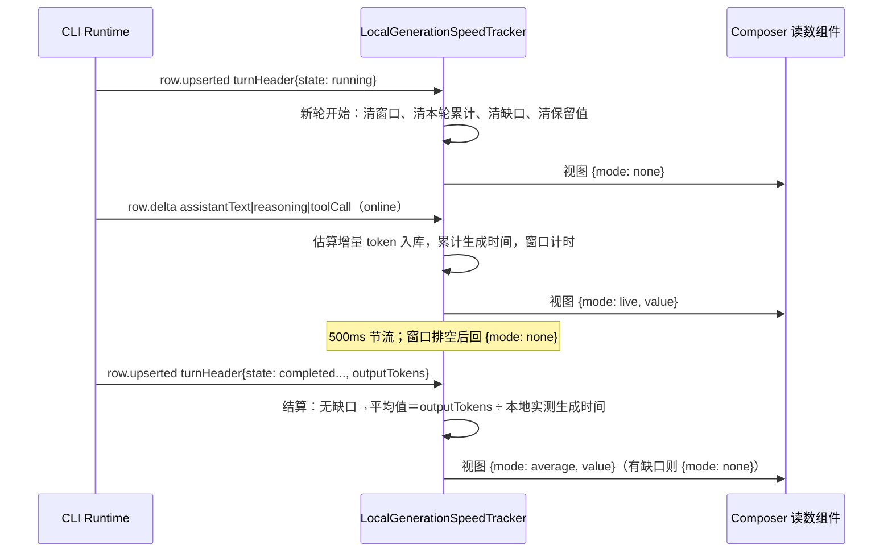

# 会话实时 Token 生成速度（Composer 读数）

| 字段       | 值                                                                                                   |
| ---------- | ---------------------------------------------------------------------------------------------------- |
| 状态       | Draft（规格先行，实现与验证随本规格同步落地）                                                        |
| 日期       | 2026-10-12                                                                                           |
| 适用范围   | ESCode Desktop Renderer、手机/Web 远控 Renderer、`packages/ui`、`packages/shared`、CLI core 上下文预算 |
| 主要对象   | v4 conversation topic 帧流上的在线 delta；`turnHeader.outputTokens`；Composer 工具条读数              |
| 关联 ADR   | [0006 生成速度由 Renderer 本地观测](../adr/0006-generation-speed-observed-in-renderer.md)             |
| 关联文档   | `DESIGN.md`；`docs/specs/rust-request-context.md`（估算器来源）；E2E：`docs/test-cases/e2e/conversation-generation-speed.feature` |
| 非目标     | 历史图表、持久化统计、跨会话总览、协议字段、按请求精确 TPS、设置开关                                   |

## 1. 摘要

在会话输入框工具条、上下文容量指示的左侧，常驻显示当前对话的生成速度：

- 生成中显示 3 秒滑动窗口的实时值（`42 tok/s`），窗口排空时显示占位符 `—`；
- 一轮结束后在同一位置保留本轮平均值并弱化显示，直到下一次发送被新读数替换；
- 手机远控重连、桌面投影 resync 造成的投递缺口不计入观测；出现缺口的轮次不显示平均值。

速度是**本机视角的观测事实**，不是会话事实：Desktop `desktop-continuous` 与手机 `web-remote-replayable`
使用同一观测器与同一投递语义，但两台设备在同一轮上的读数允许不同（见 ADR 0006）。

## 2. 产品规则

### 2.1 显示矩阵

| 会话状态                                             | 显示                                  |
| ---------------------------------------------------- | ------------------------------------- |
| 尚未有会话（草稿态）                                 | 不渲染读数                            |
| 已发送、本轮首个 delta 未到（含 TTFT 阶段）          | `—`                                   |
| 生成中（窗口内有 delta）                             | 实时值，整数，如 `42 tok/s`           |
| 生成中但窗口已排空（工具执行 / 等待授权 / 等待回答 / 模型停顿） | `—`                          |
| 本轮结束（完成 / 中断 / 失败）且无缺口               | 本轮平均值，弱化显示                  |
| 本轮出现投递缺口                                     | `—`（不留平均值）                     |
| 下一轮开始（新的 running turnHeader）                | 清空保留值，回到 `—`，重新累积        |

- 实时窗口不足 3 秒时按实际已生成时长归一，避免起步低估。
- 数值小于 1 时保留一位小数（`0.8 tok/s`），否则取整。
- 单位固定为 `tok/s`，两个语言共用；不随语言本地化，不加图标。
- 更新节流 500 ms；读数变化不得触发 Composer 其余子树重渲染（组件自订阅，不进入 Composer 的 memo 依赖）。

### 2.2 位置与可见性

- 位置：输入框工具条内 `ChatContextUsage`（上下文容量环）的左侧，与模型/思考深度同簇。
- 该读数为独立渲染，**不跟随** `ChatContextUsage` 在 `modelLocked`（Highspeed 轮）时的隐藏逻辑。
- 移动端窄屏同一位置、同一组件；仅数值与单位，不新增标签文本。
- 不做设置开关、不做点击/悬浮以外的交互。

### 2.3 文案与可访问性

- 可见文案只有数值与单位；hover `title` 与 `aria-label` 区分两种口径：
  - 实时：`实时生成速度` / `Live generation speed`
  - 保留：`上一轮平均生成速度` / `Last turn average generation speed`
  - 未知：不带数值的描述性文案，屏幕阅读器不读出一个假的 0。
- 样式遵循 `DESIGN.md`：`text-ui-xs`、等宽数字；实时态 `text-foreground-subtle`，保留态 `text-foreground-subtlest`。

### 2.4 E2E 锚点

读数元素暴露 `data-generation-speed-mode`（`none` / `live` / `average`）与
`data-generation-speed-value`（数值或空），与 `data-usage-used` / `data-usage-max` 同类的稳定锚点。

## 3. 架构

### 3.1 所有者

| 对象                                       | 唯一所有者                                                  |
| ------------------------------------------ | ----------------------------------------------------------- |
| 实时窗口、本轮累计、缺口标记               | `packages/ui/src/v4/telemetry/localGenerationSpeed.ts`（模块级单例 tracker） |
| 保留值（按 `sessionId`）                   | 同一模块内的内存注册表（不落盘、有界，不随投影 store 释放丢失） |
| 会话事实（phase、usage、turnHeader rows）  | 既有 `ConversationProjectionStore` / 服务端投影（本特性只读） |
| 文本估算口径                               | `packages/shared` 的 `estimateTokens`（CLI 上下文预算复用同一函数） |

读数组件不写入任何会话状态；tracker 不写协议、不写 store，只消费帧流并对外发布只读视图。

```text
v4 帧流 ──▶ LocalGenerationSpeedTracker ──▶ 视图缓存 ──▶ useLocalGenerationSpeed ──▶ 读数组件
   │                    │
   │                    └─ 只读 rows 的 status/state、state patch 的 pendingInteractions
   └─ online delta 是唯一计数来源；recovery / resync / initial 只用于标记缺口
```

### 3.2 事件顺序（生成 → 结束）



## 4. 计算口径

### 4.1 实时窗口

- 窗口长度 3 秒；每个计数样本记录本地时间戳，超窗即淘汰。
- 窗口内计数为 0（无生成活动）时视图为未知，显示 `—`，不得显示 0。
- 窗口时长取 `min(3s, 本轮当前生成段已有时长)`，用于起步阶段归一。

### 4.2 分子：估算与修正

- 在线 delta 是唯一计数来源，按 path 计入：`assistantText.text`、`reasoning.text`、`toolCall.inputText`
  （工具参数也是模型生成的 token）。
- 不按 `row.upserted` / `row.appended` 的整段文本计数：upsert 是状态对账、可以重复出现（含 output-token Continue
  重新打开同一 row），按整段计数会重复计入。
- 估算使用 `estimateTokens`（CJK 字符按两个估算字符，除数为 `ESTIMATED_TOKEN_CHAR_DIVISOR`）。
- 轮末修正：`turnHeader.outputTokens`（当前 product turn 内主链路 ModelComplete 的 output 累计）在
  **无缺口**时替换本轮估算分子，分母仍用本地实测生成时间。该值是 provider 的 output 口径，思考 token 是否计入
  取决于 provider，因此修正后数值与实时估算可能存在小幅差跳变——这是接受的服务端口径优先取舍。

### 4.3 分母：本轮平均

- 起点为本轮首个 delta，终点为本轮 turnHeader 离开 `running`。
- 排除区间（不计入分母）：`pendingInteractions` 非空的等待（授权 / 用户回答 / Hook 审核），以及存在
  `toolCall` 行处于 `running` 状态的工具执行区间。不使用时间阈值猜测停顿。
- 平均值的 0 分母或 0 分子一律视为无平均值（例如 `controlOnly` 轮），不显示 0。

## 5. 链路与恢复语义

- 只采信 `deliveryKind === "online"` 且 `payload.kind === "deltas"` 的帧；`initial` 忽略（订阅起点）。
- `deliveryKind === "recovery"` 或 `payload.kind === "snapshot"`（桌面连续订阅在缓冲溢出/投影重建后用快照代替
  delta）→ 标记本轮缺口，且这些帧内的内容不计入窗口。
- 缺口轮次：实时值在恢复后重新累积（约 3 秒内显示 `—`），本轮结束不留平均值。
- 桌面与手机共用同一实现；本特性不新增任何 Host / 中继职责。

## 6. 日志

- 观测失败不得阻断内容投影：tracker 的调用点与既有 TTFT 观测一致，异常只走 `logger.debug` 高频诊断级。
- 不新增 `info` 级日志，不记录正文内容。

## 7. 验收

### 7.1 单元测试

- 窗口：3 秒内多次 delta 的实时值、跨窗淘汰、窗口排空回未知、起步归一。
- 分母：工具执行与 `pendingInteractions` 区间被排除；后台化工具不阻塞；无这类区间时等于实际生成时长。
- 结算：无缺口用 `outputTokens` 修正；有缺口不留平均；中断/失败同样结算；新轮清空保留值。
- 观测器与读数呈现分两个文件：`packages/ui/test/localGenerationSpeed.test.ts`（口径与语义）与
  `packages/ui/test/v4ComposerGenerationSpeed.test.ts`（格式、占位符、无障碍标签、data-* 锚点）。
- 估算器：`estimateTokens` 迁移到 `packages/shared` 后由既有 CLI 回归
  （`apps/escode-cli/packages/core/tests/token-estimation-regression.test.ts`）证明引用同一实现。

### 7.2 E2E（`docs/test-cases/e2e/conversation-generation-speed.feature`）

覆盖：流式中出现实时读数、工具执行期间回 `—`、一轮结束后保留平均值、下一轮清空重来。

### 7.3 检查

- `pnpm --filter @escode/desktop typecheck:e2e`、`pnpm typecheck`、`pnpm lint`、`pnpm architecture:check --changed`。
