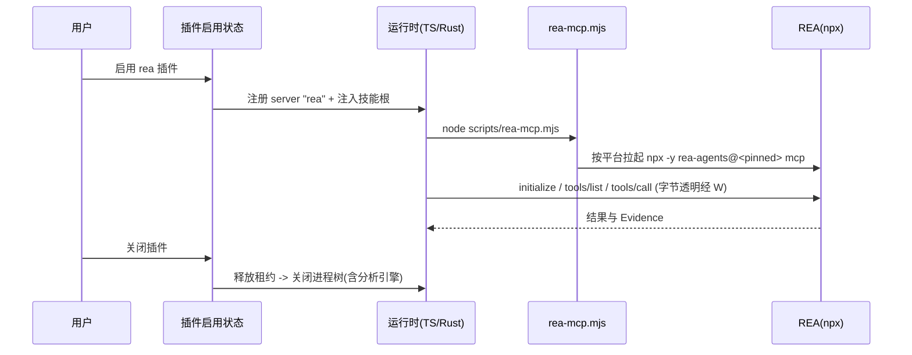

# REA 逆向分析插件

2026-10-13。内置官方插件 `rea`：把 REA（[morluto/rea](https://github.com/morluto/rea)，npm 包 `rea-agents`）
以官方插件形式接入 ESCode —— 一个 MCP server 加一份配套技能，让 Agent 能对二进制、应用与运行时行为做逆向分析。

本 spec 同时记录两处结论的来历：启动形态为什么不是 `npx` 直连，工具面为什么默认压缩。

## 范围

- 插件 `rea@zcode-plugins-official`，进官方商店**公共段**，**默认不启用**（`defaultEnabled` 不设）。
  用户主动安装/开启后才注入工具；关闭后技能与工具一起消失。
- REA 的 MCP server 由用户机器上的 Node 与 npm 拉起，ESCode 不分发 REA 本体。
- 不新增产品侧前置检查、专属失败提示或 E2E；失败走现有 MCP 状态展示。
- 不新增 `docs/` 使用指南；前置条件与平台差异写在插件 README 与商店条目里。

## 启动形态

REA 官方注册方式是 `npx -y rea-agents@<version> mcp`（Windows 上它自己包成 `cmd.exe /d /c`）。
ESCode 不能照抄，原因是两个运行时的启动路径不同：

- TS 运行时（`escode-cli` CLI、Node 模式 agent）经 `@modelcontextprotocol/client@2.0.0` 的
  `cross-spawn`（`shell: false`）启动，它按 PATHEXT 解析并把 `.cmd` 包进 `cmd.exe /d /s /c`，
  所以 `command: "npx"` 在 Windows 上可用。
- Rust 运行时（打包桌面自 2026-10-03 起的默认，见 `docs/specs/rust-packaging.md`）是裸
  `Command::new(command)`（`apps/escode-cli-rust/crates/tools/src/mcp_connection.rs`），没有 shell、
  没有 PATHEXT 解析；Windows 的 `CreateProcessW` 无法执行 `.cmd`，`command: "npx"` 必然失败，
  `npx.cmd` 同样不行。该路径还把子进程 stderr 丢进 `Stdio::null()`，失败信息不可见。

反向的 `cmd.exe /d /c` 包装也不可行：macOS/Linux 没有 `cmd.exe`；且桌面 UI 经
`convertToESCodeAgentMcpServer`（`packages/shared/src/mcp.ts`）下发 `mcpServers` 时会按 win32
**剥离** `cmd`/`cmd.exe /c` 包装，假设 agent 侧会用 shell —— 两个方向互相矛盾。
仓库也没有任何按平台分支声明 MCP server 的机制（`.mcp.json` 与 manifest 的解析器均无平台分支）。

因此采用**插件内包装脚本**：

```json
{
  "mcpServers": {
    "rea": {
      "type": "stdio",
      "command": "node",
      "args": ["${ESCODE_PLUGIN_ROOT}/scripts/rea-mcp.mjs"],
      "env": { "REA_MCP_INPUT_SCHEMA_PROFILE": "compact" },
      "timeoutMs": 90000
    }
  }
}
```

- `command: "node"` 在两个运行时都能解析：TS 侧 cross-spawn 解析 `node` → `node.exe`；
  Rust 侧 `CreateProcessW` 补 `.exe` 后按 PATH 搜索，实测裸 spawn `node -v` 正常。
- 包装脚本不假设自己由谁启动：按平台拉起 `npx -y rea-agents@<pinned> mcp`
  （win32 经 `cmd.exe /d /s /c`，其余平台直接 spawn npx），用 `stdio: "inherit"` 做**字节透明**透传
  （不解析、不缓存 JSON-RPC），把子进程退出码/信号原样传播。
- 升级路径：若实测发现桌面态下 `node` 不在子进程 PATH，或 Rust 侧失败信息不可用成为实际问题，
  改为宿主注入、经 Host 启动器（`ESCODE_PLUGIN_HOST_EXEC_PATH`/`ENTRYPOINT`，与 serial/circuit 同构，
  见 `crates/tools/src/mcp_serial.rs`）运行同一个脚本 —— 只换启动器，脚本不动。

`isolation` 与 `protocolVersion` 不写入：插件 `.mcp.json` 的解析器只认
`command/args/cwd/env/enabled/timeoutMs`（`adapters/src/plugins/mcp.ts`），前两者会被静默忽略。
默认 isolation 恰好是 `session`（`adapters/src/mcp/pool.ts`），对 REA 这种在服务端持有 binary session
的服务器是正确语义 —— 每个会话独占一个 REA 进程，进程退出即回收其拉起的分析引擎。
`timeoutMs: 90000` 沿用 image-search 先例（默认 30000 对 Ghidra/JADX/浏览器类操作偏短）。

## 工具面

REA 6.4.0 广告 170 个工具。官方测量（172 工具）为：默认 `full` profile 约 496 KB、约 12 万 token；
`compact` 约 290 KB、约 6.8 万 token。且部分 provider 在默认 profile 下**每个请求都失败**
（Moonshot/kimi-cli 拒绝单个 schema 超过约 13.7 KB 的工具；compact 的 13,312 字节预算压在这条线以下）。

所以：**全量 170 个工具 + 默认 `REA_MCP_INPUT_SCHEMA_PROFILE=compact`**，插件默认不启用。
compact 只裁剪广告出去的输入 schema（去掉嵌套属性描述、示例、默认值），工具集合、输出 schema
与服务端校验不变；被裁掉的引导由 vendored 技能承担 —— 这是整包 vendor 上游技能的另一个理由。

预算检查：`REA_MCP_MAX_RESPONSE_BYTES` 不预设（默认即 SDK stdio 的 10 MiB 接收缓冲）。

### 工具池应急方案（本次不实现）

触发条件：在目标模型上实测 6.8 万 token 的工具定义仍不可接受，或模型选工具明显退化。

降级路径只有两条，触发时二选一，`mcp.servers` 配置**做不到**（`mcpServerBaseSchema` 是 `.strict()`
且无工具字段，写 `tools` 会让整个 server 被丢弃）：

1. 会话层 `toolAllowlist`（`session/create` 可传，CLI 只有 `--disallowedTools`，即只支持禁用）；
2. 插件内在包装脚本里过滤 `tools/list`（脚本届时从透传升级为 MCP 代理）。

`permission.disallowedTools` 不算降级路径：它按精确名硬拒调用，但工具仍在模型工具列表里。

## 技能

整包 vendor 上游技能 `reverse-engineer-anything`（`SKILL.md` 约 16.5 KB + 6 个 reference，
MIT，Copyright (c) 2026 morluto），放在插件包的 `skills/reverse-engineer-anything/`，
**内容不做任何修改**。frontmatter 只有 `name`/`description`/`metadata`，落在
`SAFE_FRONTMATTER_KEYS` 内，可自动加载。

技能与插件同生命周期：插件作用域技能只在插件启用时进入技能列表。不做常驻技能 ——
工具不在时列出一个用不了的技能只会制造误导状态。

## 署名与许可

REA 是 MIT。按仓库机械强制的路径署名，不靠约定：

1. `third-party/copied-components.json` 增加条目：`license: "MIT"`、钉住上游 `source` URL 与
   `referenceRevision`、`roots` 指向 vendored 的 `skills/reverse-engineer-anything/` 与插件 `LICENSE`、
   `importRevision: null`（未记录）与 provenance 说明；
2. 上游许可原文存入 `third-party/upstream/<sha256>.txt` 并回填 `file` + `sha256`；
3. 插件包根放 `LICENSE`（`superpowers-plugin` 是同一先例）；
4. 跑 `node scripts/licenses.mjs notices` 重新生成 `THIRD-PARTY-NOTICES.md` 与
   `third-party/inventory.json`（生成器会在 root 缺失、许可哈希不符时硬失败）。

技能文件无改动，因此不需要 `modifiedFiles` 与 `Modified by ESCode:` 标记。

## 版本与升级

REA 版本硬固定。单一事实源是插件包 `package.json` 的自定义字段
（`package.json` 已在 seed 顶层白名单内，且现有版本对齐测试本来就读取它），
测试断言 `.mcp.json` 中 `rea-agents@<版本>` 与该字段一致。不引入生成器 —— 两处对齐不值得多一条生成链。

升级流程（spec 记录，人工执行）：改 `package.json` 版本字段 → 重新 vendor 技能（含 frontmatter 版本）
→ 跑插件测试 → 人工跑一次验收。

## 所有者与事件顺序

- REA 进程与它的 binary session 状态由 REA 自己持有，ESCode 不镜像、不缓存、不转发分析状态。
  ESCode 侧只有一条连接（`session` isolation，每会话一个进程），租约释放后经空闲宽限关闭。
- 包装脚本是无状态转发者：不解析消息、不重排、不改写，只负责平台差异与退出传播。
- 插件启用状态是唯一开关：`enabledPlugins["rea@zcode-plugins-official"]` 决定 server 是否注册，
  也决定技能是否进入技能列表 —— 技能与工具不存在第二个所有者。



## 前置条件与失败语义

- 用户需自备 Node 与 npm；包装脚本在启动前比对 Node 版本与 REA 的 `engines`
  （`^22.19.0 || ^24.11.0 || >=26.0.0`），不符时向 stderr 输出可读原因并以非零码退出。
- 失败一律走现有 MCP 状态展示：`process_start_failed` + 原始错误串。已知限制：**Rust 运行时丢弃
  子进程 stderr**，TS 运行时只把 stderr 尾巴写进脱敏日志（不进 `status.error`）。因此 REA 自身的
  诊断在打包态下不可见 —— 前置条件因此必须写在 README 与商店描述里。
- 平台差异由 REA 自己判断（ELF/EVM/固件/抓包等能力仅 Linux x64 等），ESCode 不做能力探测。

## 交付清单

| 位置                                               | 动作                                     |
| -------------------------------------------------- | ---------------------------------------- |
| `docs/specs/rea-plugin.md`                         | 本文件                                   |
| `apps/escode-cli/packages/rea-plugin/`             | 新增插件包                               |
| `bootstrap/src/app/official-plugin-definitions.ts` | 新增 definition（含 listing）            |
| `bootstrap/tests/plugins.test.ts`                  | `pluginCount` 14 → 15；新增 REA 断言     |
| `scripts/generate-escode-cli-rust-official-plugins.mjs` 生成物 | 重跑 `official_plugins.json`   |
| `scripts/generate-escode-cli-rust-tool-schemas.mjs` 生成物     | 重跑 `plugin_defaults.json`    |
| `packages/services/src/plugins/officialPluginCache.ts`         | 同步手工副本（无机械检查）     |
| `third-party/copied-components.json` + `notices`   | 署名登记与重新生成                       |

打包清单（`packages/desktop/scripts/prepare-agent-node-bundle.mjs`、`scripts/prepare-prebuilds.mjs`、
`packages/server/src/remote/escodeAgentOfficialPluginAssets.ts`、SEA 资产）按现有内置插件同样处理；
插件的顶层目录只用 `.escode-plugin`、`.mcp.json`、`scripts`、`skills`、`README.md`、`package.json`，
不新增顶层白名单项。

## 验收场景

1. 服务器能连上：`~/.escode/cli/config.json` 的 `mcp.servers.rea` 按上述形态写入后，
   工具能被列出且数量与 REA 广告一致。
2. `compact` 生效：同一目标下 `tools/list` 的序列化体量显著小于默认 profile。
3. 技能可加载：`~/.escode/skills/reverse-engineer-anything/` 就位后，技能能被 `Skill` 工具加载。
4. 免引擎目标真跑一次：对一个 JavaScript/Electron 目标执行分析并拿到证据（不依赖 Hopper/Ghidra/IDA）。
5. **Rust 有界 codec 对大结果的接受度**（未验证假设）：REA 按 10 MiB 预算产出结果，
   而 Rust 宿主用有界 codec 读取（`mcp_connection.rs` 注释："SDK 默认读行无界；使用有界 codec"）。
   需在 Rust 运行时下跑一次会产生大结果的分析，确认不会因编码器上限被拒。

native 反编译（Hopper/Ghidra/IDA）不在本次验收范围。

### 验收记录

（本机验证执行后填写：实际命令、观察结果、未能验证的部分。）
