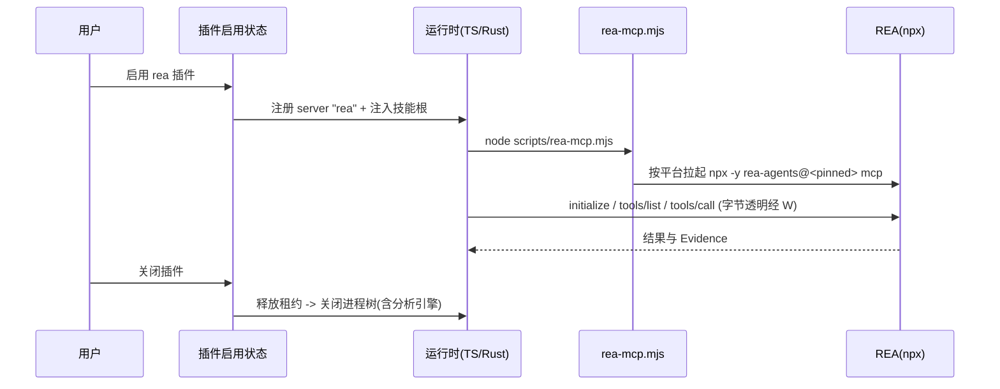

# REA 逆向分析插件

2026-10-13。内置官方插件 `rea`：把 REA（[morluto/rea](https://github.com/morluto/rea)，npm 包 `rea-agents`）
以官方插件形式接入 ESCode —— 一个 MCP server 加一份配套技能，让 Agent 能对二进制、应用与运行时行为做逆向分析。

本 spec 同时记录两处结论的来历：启动形态为什么不是 `npx` 直连，工具面为什么默认压缩。

## 范围

- 插件 `rea@zcode-plugins-official`，进官方商店**公共段**，**默认不启用**（`defaultEnabled` 不设）。
  用户主动安装/开启后才注入工具；关闭后技能与工具一起消失。
- REA 的 MCP server 由用户机器上的 Node 与 npm 拉起，ESCode 不分发 REA 本体。
- 不新增产品侧前置检查、专属失败提示或 E2E；失败走现有 MCP 状态展示。
- 不新增 `docs/` 使用指南；前置条件与平台差异写在插件 README 与商店条目里。

## 启动形态

最终形态是**宿主注入**，与 serial/circuit 同构：server 不在 manifest/.mcp.json 里声明，由
`bootstrap/src/app/built-in-rea.ts`（TS）与 `crates/tools/src/mcp_rea.rs`（Rust）在插件启用时注入，
经 `createBundledMcpRuntimeConfig` / `host_plugin_server` 用自带 Node 拉起
（`ELECTRON_RUN_AS_NODE=1`，打包态是 ESCode Helper），入口是 `<pluginRoot>/dist/mcp/server.js`。

**为什么不照抄 REA 官方的 `npx` 注册方式**：TS 运行时（`@modelcontextprotocol/client` 经 cross-spawn）
能启动 `npx`，但打包桌面默认的 Rust 宿主是裸 `Command::new(command)`
（`crates/tools/src/mcp_connection.rs`，无 shell、无 PATHEXT 解析），Windows 的 `CreateProcessW`
执行不了 `.cmd`，`command: "npx"` 必然失败；反向包 `cmd.exe /d /c` 又会在 macOS/Linux 失效，且桌面 UI
下发 `mcpServers` 时按 win32 剥离该包装（`packages/shared/src/mcp.ts`）。仓库也没有按平台分支声明
MCP server 的机制。宿主注入绕开了整类问题，并且顺带满足「用户无需装 Node/npm」。

**manifest 不声明 `mcpServers`**：seed 会把内置插件 manifest 里的该段无条件改写成
`<root>/dist/mcp/server.js`（`official-plugin-runtime.ts` 的 `writeOfficialPluginRuntimeManifest`），
那样注入的 env（compact profile、运行时路径）就丢了。

### 运行时安放（不进插件 seed）

REA 运行时约 100 MB / 6,555 文件，**刻意不列入 `runtimeTopLevelPaths`**：seed 每次启动都会
walk + sha256 全部插件文件，首次填缓存还会整棵复制。实测：哈希该树 915 ms；把它列入白名单后
bootstrap 的 `plugins.test.ts` 从约 3 s 变为 5 s 超时。因此运行时由打包/开发链路单独 stage
（`prepare-agent-node-bundle.mjs` 的 `stageReaRuntime`，照 sharp/koffi 先例直接写入
`<glm>/rea-runtime/node_modules`，实测搬运 6.5 s），宿主把路径注入给 server。

查找顺序（TS 与 Rust 必须一致）：

1. `REA_RUNTIME_ROOT` —— 宿主注入（`built-in-rea.ts` 按下面两条规则算好后传给 server env）；
2. `<ESCODE_PLUGIN_HOST_ENTRYPOINT 所在目录>/rea-runtime/node_modules` —— 打包/远端：
   插件从缓存运行，运行时留在 resources；
3. `<pluginRoot>/node_modules` —— 开发态：插件直接从仓库目录解析，运行时装在这里。

入参固定：`REA_MCP_INPUT_SCHEMA_PROFILE=compact`（170 个工具的输入 schema 从 425 KB 压到 253 KB；
部分 provider 会直接拒收大 schema）、`timeoutMs: 90000`（Ghidra/Hopper 启动、JADX、浏览器抓取偏慢，
默认 30 s 不够）。

`isolation` 不写：插件/host 注入以外没有该键的入口，而默认就是 `session`
（`adapters/src/mcp/pool.ts`）—— REA 在服务端持有 binary session，按会话独占一个进程，
会话结束即可回收它拉起的分析引擎。Rust 侧 `host_plugin_server` 目前硬编码 `workspace`，
镜像时必须参数化，否则两个运行时语义不一致。
`timeoutMs: 90000` 沿用 image-search 先例（默认 30000 对 Ghidra/JADX/浏览器类操作偏短）。

### 分发范围

| 目标 | 是否随包 | 理由 |
| --- | --- | --- |
| 桌面（Electron，含 Node 与 Rust 运行时） | 是 | 主场景；`stageReaRuntime` 把运行时放进 agent bundle |
| 独立 SEA CLI | 否 | 100 MB / 6,555 文件嵌进单文件二进制不可接受；已在 `build-sea.test.mjs` 加断言防回归（与 superpowers 同） |
| 远端（SSH/WSL/Docker） | 否（本阶段） | 远端资产合同把路径表达为 `packages/<plugin>/...`，而运行时按设计位于 `packages/` 之外（`glm/<platform>/rea-runtime`）。要带上它得给合同新增一类路径并补部署侧校验；与 serial/circuit 一样先只在桌面可用。后续项：新增路径类后接入 `prepare-prebuilds.mjs`、`REMOTE_AGENT_OFFICIAL_PLUGIN_REQUIRED_RELATIVE_PATHS` 与 `prepare-bundled-remote-assets` |

远端不部署插件目录本身，因此 `rootCandidates` 解析不到 rea → `resolveBuiltInReaMcpServers` 不会注册任何 server（不是"注册了但起不来"）：远端是干净的能力缺席，与 serial/circuit 一致。

## 工具面

REA 6.4.0 广告 170 个工具。官方测量（172 工具）为：默认 `full` profile 约 496 KB、约 12 万 token；
`compact` 约 290 KB、约 6.8 万 token。且部分 provider 在默认 profile 下**每个请求都失败**
（Moonshot/kimi-cli 拒绝单个 schema 超过约 13.7 KB 的工具；compact 的 13,312 字节预算压在这条线以下）。

所以：**全量 170 个工具 + 默认 `REA_MCP_INPUT_SCHEMA_PROFILE=compact`**，插件默认不启用。
compact 只裁剪广告出去的输入 schema（去掉嵌套属性描述、示例、默认值），工具集合、输出 schema
与服务端校验不变；被裁掉的引导由 vendored 技能承担 —— 这是整包 vendor 上游技能的另一个理由。

预算检查：`REA_MCP_MAX_RESPONSE_BYTES` 不预设（默认即 SDK stdio 的 10 MiB 接收缓冲）。

### 工具池应急方案（本次不实现）

触发条件：在目标模型上实测 6.8 万 token 的工具定义仍不可接受，或模型选工具明显退化。

降级路径只有两条，触发时二选一，`mcp.servers` 配置**做不到**（`mcpServerBaseSchema` 是 `.strict()`
且无工具字段，写 `tools` 会让整个 server 被丢弃）：

1. 会话层 `toolAllowlist`（`session/create` 可传，CLI 只有 `--disallowedTools`，即只支持禁用）；
2. 插件内在包装脚本里过滤 `tools/list`（脚本届时从透传升级为 MCP 代理）。

`permission.disallowedTools` 不算降级路径：它按精确名硬拒调用，但工具仍在模型工具列表里。

## 技能

整包 vendor 上游技能 `reverse-engineer-anything`（`SKILL.md` 约 16.5 KB + 6 个 reference，
MIT，Copyright (c) 2026 morluto），放在插件包的 `skills/reverse-engineer-anything/`，
**内容不做任何修改**。frontmatter 只有 `name`/`description`/`metadata`，落在
`SAFE_FRONTMATTER_KEYS` 内，可自动加载。

技能与插件同生命周期：插件作用域技能只在插件启用时进入技能列表。不做常驻技能 ——
工具不在时列出一个用不了的技能只会制造误导状态。

## 署名与许可

REA 是 MIT。按仓库机械强制的路径署名，不靠约定：

1. `third-party/copied-components.json` 增加条目：`license: "MIT"`、钉住上游 `source` URL 与
   `referenceRevision`、`roots` 指向 vendored 的 `skills/reverse-engineer-anything/` 与插件 `LICENSE`、
   `importRevision: null`（未记录）与 provenance 说明；
2. 上游许可原文存入 `third-party/upstream/<sha256>.txt` 并回填 `file` + `sha256`；
3. 插件包根放 `LICENSE`（`superpowers-plugin` 是同一先例）；
4. 跑 `node scripts/licenses.mjs notices` 重新生成 `THIRD-PARTY-NOTICES.md` 与
   `third-party/inventory.json`（生成器会在 root 缺失、许可哈希不符时硬失败）。

技能文件无改动，因此不需要 `modifiedFiles` 与 `Modified by ESCode:` 标记。

## 版本与升级

REA 版本硬固定。单一事实源是插件包 `package.json` 的自定义字段
（`package.json` 已在 seed 顶层白名单内，且现有版本对齐测试本来就读取它），
测试断言 `.mcp.json` 中 `rea-agents@<版本>` 与该字段一致。不引入生成器 —— 两处对齐不值得多一条生成链。

升级流程（spec 记录，人工执行）：改 `package.json` 版本字段 → 重新 vendor 技能（含 frontmatter 版本）
→ 跑插件测试 → 人工跑一次验收。

## 所有者与事件顺序

- REA 进程与它的 binary session 状态由 REA 自己持有，ESCode 不镜像、不缓存、不转发分析状态。
  ESCode 侧只有一条连接（`session` isolation，每会话一个进程），租约释放后经空闲宽限关闭。
- 包装脚本是无状态转发者：不解析消息、不重排、不改写，只负责平台差异与退出传播。
- 插件启用状态是唯一开关：`enabledPlugins["rea@zcode-plugins-official"]` 决定 server 是否注册，
  也决定技能是否进入技能列表 —— 技能与工具不存在第二个所有者。

## 前置条件与失败语义

- 用户需自备 Node 与 npm；包装脚本在启动前比对 Node 版本与 REA 的 `engines`
  （`^22.19.0 || ^24.11.0 || >=26.0.0`），不符时向 stderr 输出可读原因并以非零码退出。
- 失败一律走现有 MCP 状态展示：`process_start_failed` + 原始错误串。已知限制：**Rust 运行时丢弃
  子进程 stderr**，TS 运行时只把 stderr 尾巴写进脱敏日志（不进 `status.error`）。因此 REA 自身的
  诊断在打包态下不可见 —— 前置条件因此必须写在 README 与商店描述里。
- 平台差异由 REA 自己判断（ELF/EVM/固件/抓包等能力仅 Linux x64 等），ESCode 不做能力探测。

## 交付清单

| 位置                                               | 动作                                     |
| -------------------------------------------------- | ---------------------------------------- |
| `docs/specs/rea-plugin.md`                         | 本文件                                   |
| `apps/escode-cli/packages/rea-plugin/`             | 新增插件包                               |
| `bootstrap/src/app/official-plugin-definitions.ts` | 新增 definition（含 listing）            |
| `bootstrap/tests/plugins.test.ts`                  | `pluginCount` 14 → 15；新增 REA 断言     |
| `scripts/generate-escode-cli-rust-official-plugins.mjs` 生成物 | 重跑 `official_plugins.json`   |
| `scripts/generate-escode-cli-rust-tool-schemas.mjs` 生成物     | 重跑 `plugin_defaults.json`    |
| `packages/services/src/plugins/officialPluginCache.ts`         | 同步手工副本（无机械检查）     |
| `third-party/copied-components.json` + `notices`   | 署名登记与重新生成                       |

打包清单（`packages/desktop/scripts/prepare-agent-node-bundle.mjs`、`scripts/prepare-prebuilds.mjs`、
`packages/server/src/remote/escodeAgentOfficialPluginAssets.ts`、SEA 资产）按现有内置插件同样处理；
插件的顶层目录只用 `.escode-plugin`、`.mcp.json`、`scripts`、`skills`、`README.md`、`package.json`，
不新增顶层白名单项。

## 与 serial / circuit 的同构对齐

宿主注入的既有约定逐条对齐，不新增机制：

| 约定 | serial / circuit | rea |
| --- | --- | --- |
| server 由宿主注入，不写进 manifest | `resolveBuiltIn*McpServers` | `resolveBuiltInReaMcpServers`（已实现），展开进 `create-app.ts` 的 `builtInMcpServers` |
| 用自带 Node 启动 | `createBundledMcpRuntimeConfig`：`process.execPath` + `ELECTRON_RUN_AS_NODE=1` | 同（默认入口 `<root>/dist/mcp/server.js`） |
| Rust 侧镜像 | `mcp_serial.rs` 的 `host_plugin_server` + `mcp_config.rs` 注册 | 待补 `mcp_rea.rs`，复用同一 helper，入口同约定 |
| 设置页归属插件 | definition 的 `hostMcpServerNames` | 待补 `hostMcpServerNames: ["rea"]` |
| 只读工具免审批 | definition 的 `defaultAllowedTools`（serial 列了 3 个） | 已实现：113/170 个读语义工具（其余 57 个写、执行、运行时附加、驱动界面、网络与会话启动类保持逐次审批），由 `scripts/generate-rea-auto-approved-tools.mjs` 生成，TS 与 Rust 共用同一份（Rust 随 `official_plugins.json` 下发） |
| 仅插件启用时注册 | 按 plugin id 查 `enabled` | 同（已实现） |
| 打包 / 远端 / SEA 三处清单 | 三处平行清单；SEA 各有取舍 | 待补；SEA 排除 rea |
| 宿主能力门禁 | serial/circuit 有 broker，按 `ESCODE_HOST_SERIAL=1` 等门禁 | rea 无 broker：门禁即「Host 启动器可用 + 插件启用」，`createBundledMcpRuntimeConfig` 无启动器时返回 undefined |

## REA 能力矩阵

「归属」只有三类：**随包可用**（装完插件即可用）、**可选增强**（检测到外部工具就用，由用户提供）、**平台受限**（上游限制，如实报错）。

| 能力 | 外部依赖 | 平台 | 归属 |
| --- | --- | --- | --- |
| 原生二进制反编译（伪代码/汇编/符号/引用） | Hopper、Ghidra 或 IDA | 各平台，引擎各自限定 | 可选增强 |
| ELF 离线布局 | pwntools | Linux x64 | 可选增强 |
| Go 二进制 | 无 | 各平台 | 随包可用 |
| WASM 制品 | WABT 1.0.42 | 各平台 | 可选增强 |
| EVM 字节码 | evmole（随包）+ Linux x64 | Linux x64 | 随包可用 |
| SQLite | Node ≥24.15 或 26+ | 各平台 | 随包可用：Electron 41.0.3 → 41.10.7 把自带 Node 从 24.14.0 升到 24.18.0，实测 `ELECTRON_RUN_AS_NODE=1 <helper> -e "import('node:sqlite')"` 可建库查询 |
| 记录的 Linux 崩溃 | pwntools；可选 GDB/pwndbg | Linux x64 | 可选增强 |
| JavaScript / Electron | Node 与 npm | 各平台 | 随包可用：自带 Node 满足 REA engines；实测 REA 运行期不调用 npm，无需随包带 npm |
| 网站 | Chrome 系浏览器 | 各平台 | 可选增强：REA 按 `REA_BROWSER_EXECUTABLE` 定位，未指定时用系统已装浏览器；无需复用 browser-use 的浏览器 |
| 已保存抓包（HAR/SAZ） | 无（本机 mitmproxy 抓包需 Linux mitmdump） | 各平台 / Linux | 随包可用（HAR/SAZ） |
| .NET 程序集 | 无（ILSpy 可选） | 各平台 | 随包可用 |
| Android APK | headless JADX + 完整 JDK | Linux/macOS/Win x64 | 可选增强（体积原因不随包） |
| Android 设备 | adb | 各平台 | 可选增强（考虑与 android-emulator 插件的 adb 复用） |
| JEB 项目 | 用户启动的 JEB 客户端 | 各平台 | 可选增强（`REA_JEB_MCP_URL`） |
| Android 资源 | Apktool | 各平台 | 可选增强 |
| Flutter 应用 | 无 | 各平台 | 随包可用 |
| 固件 | Binwalk / Unblob | Linux | 可选增强 |
| 报文与报文摘要 | TShark 4.x + prlimit / tshark + capinfos | Linux | 可选增强 |
| 记录的逻辑信号 | sigrok-cli 0.7.2 + prlimit | Linux | 可选增强 |
| 包与资源（zip/apk/ipa/msix/dmg/plist） | 无 | 各平台 | 随包可用 |
| 进程行为观察 | 本机 PTY | Linux/macOS（Windows 不可用） | 随包可用（平台受限） |
| 证据/会话/分析视图（Evidence、binary session、import/export） | 无 | 各平台 | 随包可用 |

## 实施计划

### P0 机制（已完成）

插件包（manifest 不声明 mcpServers、`dist/mcp/server.js` 入口、`scripts/install-rea-runtime.mjs`、vendored 技能、LICENSE、README）、TS 宿主注入、definition 条目、`package.json` 版本单一事实源。已实测：vendored 安装 102 MB/132 包且只含本平台原生包；安装幂等（复跑 176 ms）；端到端 MCP 会话 170 个工具、模型面 253,143 字节；`@escode/bootstrap` typecheck 通过。

### P1 同构对齐（serial/circuit 平齐）

1. definition 补 `hostMcpServerNames: ["rea"]`，让设置页把 host 注入的 server 归属到 rea。
2. `defaultAllowedTools`：边界是「有没有副作用」而不是按数量挑。放行 113 个读语义工具（读语义前缀
   `list_/inspect_/get_/read_/search_/procedure_/current_/address_/decode_/compare_/project_/verify_/resolve_/build_`
   + 例外表 + 点名清单 + REA 自标的 `readOnlyHint`），保持审批 57 个（破坏性 7、写类、设备操作、
   运行时附加与驱动、网络与浏览器、会话/引擎启动、会移动 Hopper GUI 光标的导航）。清单由
   `scripts/generate-rea-auto-approved-tools.mjs` 从已安装版本生成（带版本号），definition 引用生成物，
   Rust 侧随 `official_plugins.json` 下发同一份；`bootstrap/tests/rea-plugin.test.ts` 断言版本与 pin 一致、
   且清单里没有任何命中「必须审批前缀」的名字。
3. Rust 镜像：`mcp_rea.rs`（复用 `mcp_serial.rs` 的 `host_plugin_server`）、`mcp_config.rs` 注册、`tools.rs` 的 default allowed 合并、按 `mcp_serial.rs` 的 tests 写同名单测；重跑 `official_plugins.json` 与 `plugin_defaults.json` 生成物。
4. 三处打包清单：desktop `officialPluginPackages`（`requiresRuntime` + `requiredRuntimePaths` + `stagedPath`）、`prepare-prebuilds.mjs` 的远端清单、`packages/server` 的远端资产清单；dev 侧 `requiredDevPluginRuntimeBuilds`。
5. SEA 排除 rea（把 87 MB 嵌进独立 CLI 二进制不可接受），并加断言防回归。
6. 同步 `packages/services/src/plugins/officialPluginCache.ts` 手工副本（无机械检查）。
7. 测试：`pluginCount` 14 → 15、REA 的 seed 断言、插件包版本三方对齐。

### P2 全部能力的运行时面

1. **npm 随包**：JS/Electron 静态分析需要 Node 与 npm，而打包态的自带 Node 不含 npm。确认 REA 是否在运行期调用 npm；是则把 npm 装进 vendor 并在入口注入 PATH。
2. **Node 版本缺口**：SQLite 能力要求 Node ≥24.15，自带 Node 是 24.14.0。三选一并与你确认：等 Electron 升级、为 REA 单独带一个 Node、或把该能力如实标为不可用。
3. **配置入口**：在插件 `userConfig` 声明可配项（Ghidra/Hopper/IDA/JDAP/JDK/adb/apktool/wabt/tshark/sigrok/JEB/ILSpy/浏览器路径），由 `built-in-rea.ts`（TS）与 `mcp_rea.rs`（Rust）读同一份 `plugins.options` 映射为 REA 的 env。两条运行时路径必须读同一份配置，不做第二份状态。
4. **浏览器复用**：确认 browser-use 插件的浏览器能否被 REA 的 playwright-core 复用（需要 Chrome 系可执行路径）；不能复用则在 userConfig 里留浏览器路径。
5. **平台门控如实上报**：Linux-only 与 Windows 不可用的能力写进 README 与商店条目，不在 ESCode 侧伪造探测。

### P3 诊断与可观测（已完成）

1. 失败落盘：入口把 REA 的 stderr tee 到插件数据目录（`ESCODE_PLUGIN_DATA`，两个宿主都注入：
   TS 走 `PluginMetadata.dataPath`，Rust 走 `data_root + sanitize_plugin_id`），并写
   `rea-runtime-report.txt`（运行时根、REA 版本、Node 版本与模式、schema profile、可选引擎 env 是否就位）
   与 `rea-mcp.log`（每次启动一行会话分隔 + REA 自身 stderr，单会话上限约 1 MB）。
   实测：故意用非法 `REA_MCP_INPUT_SCHEMA_PROFILE` 启动（stderr 被丢弃的情况下），REA 的原文
   `REA configuration is invalid: ... expected one of "full"|"compact"` 仍被落进日志。
2. 自检入口即上面那份报告：只报告事实（路径、版本、env 是否设置），不猜能力 —— 平台限制由 REA 自己
   在工具调用时报错并写进同一份日志，不在 ESCode 侧伪造探测。

### P4 许可与合规

`third-party/copied-components.json` 登记 REA 本体、vendored 技能与 vendored 依赖树；`node scripts/licenses.mjs notices` 重新生成 `THIRD-PARTY-NOTICES.md` 与 `third-party/inventory.json`；REA 自带的 `licenses/`、`third_party/*/LICENSE` 一并纳入。

### P5 测试、验收与文档

单测（definition/seed/版本对齐/只读表/bundled build 幂等）；E2E（装插件 → 会话里跑一次 JS/Electron 分析拿到证据；Rust 与 TS 行为一致）；跨平台（Windows 必验，macOS/Linux 不阻断）；回填本 spec 的验收记录；升级流程（改 pin → 重新 vendor 技能 → 重跑测试 → 人工验收）文档化。

### P6 升级 Electron（已解锁 SQLite，停留在 41 线）

**已落地**：`packages/desktop/package.json` 的 electron 从 `41.0.3` → `41.10.7`（同一 major，零破坏性变更），
自带 Node 从 24.14.0 → **24.18.0**。实测证据：`ELECTRON_RUN_AS_NODE=1 <helper> -e "import('node:sqlite')"`
可建表插入查询；REA 运行时在 **Electron-as-node**（宿主真实启动形态）下起来并列出 170 个工具，
且与 plain Node 26 下**工具名与 schema 逐字节一致**（所以免审批清单不必按 Node 版本重新生成）。

**决定（2026-10-14）**：**不继续升级到 44.x**。41.10.7 已满足 REA 的全部要求（engines `^24.11.0` 与 SQLite 的
Node ≥24.15），升级到最新大版本带来的收益只有 Chromium 版本，而代价是下面三处产品代码改动；等有独立需求时再说。

下面三条**保留为勘察记录**（真要升 44 时照此施工即可，均为实测确认而非猜测）：

1. `packages/desktop/src/main/pluginSandbox/host.ts:274` 用了 Electron 44 **已删除**的 `clipboard.writeImage`
   （44 的剪贴板模块重构为 W3C 风格、读写改异步并删掉 `readImage`/`writeImage`/`readHTML`/`writeHTML`/
   `readBuffer`/`writeBuffer`/`availableFormats` 等 helper）。这条路径是**插件沙箱截图进剪贴板**，且
   Windows 分支叠加了 43 的 `nativeImage.toBitmap()` sRGB 归一化变化 —— 需要照新 API 重写并实测。
2. `ELECTRON_SKIP_BINARY_DOWNLOAD` 在 Electron 42+ 失效（postinstall 不再下载、改为首次运行二进制时下载）。
   仓库有两个 workflow 设置它（`.github/workflows/rust-runtime-ci.yml:22`、`release.yml:201`），
   而 `packages/desktop/test/e2e/helpers/e2e-electron-binary.ts` 的**二进制修复逻辑直接执行 `install.js`
   并读 `path.txt`**，测试还断言错误文案里含该变量名（`test/e2eElectronBinary.test.ts:115`）——
   新版本的下载机制换了，这套探测/修复要重写。
3. 连带项：macOS 12 支持被移除（44 起要求 macOS 13+，需同步支持声明）；ANGLE 改为静态链接、
   `libEGL.*`/`libGLESv2.*` 不再分发（通知/打包清单若引用需更新）；Linux 上 `setBadgeCount`/`setProgressBar`
   失效（`packages/desktop/src/main/desktopWindowLifecycle.ts:324` 调用了 `app.setBadgeCount`）。

## 验收场景

1. 服务器能连上：`~/.escode/cli/config.json` 的 `mcp.servers.rea` 按上述形态写入后，
   工具能被列出且数量与 REA 广告一致。
2. `compact` 生效：同一目标下 `tools/list` 的序列化体量显著小于默认 profile。
3. 技能可加载：`~/.escode/skills/reverse-engineer-anything/` 就位后，技能能被 `Skill` 工具加载。
4. 免引擎目标真跑一次：对一个 JavaScript/Electron 目标执行分析并拿到证据（不依赖 Hopper/Ghidra/IDA）。
5. **Rust 有界 codec 对大结果的接受度**（未验证假设）：REA 按 10 MiB 预算产出结果，
   而 Rust 宿主用有界 codec 读取（`mcp_connection.rs` 注释："SDK 默认读行无界；使用有界 codec"）。
   需在 Rust 运行时下跑一次会产生大结果的分析，确认不会因编码器上限被拒。

native 反编译（Hopper/Ghidra/IDA）不在本次验收范围。

### 验收记录

2026-10-14，Windows x64 开发机。命令与观察结果如下。

**1. 免引擎目标真跑一次（通过）**
目标：自建的最小**解包** Electron 应用（`main.js` + `preload.js` + `renderer/`，含 `ipcMain.handle`
与 `contextBridge.exposeInMainWorld`，共 5 个文件）。
调用：`analyze_javascript_application { input_path, detail: "summary" }`（compact profile）。
结果：**1,096 ms / 23 KB / `isError: false`**。Evidence 信封含 subject sha256 与
`parsed_javascript_files: 3`、`visited_ast_nodes: 195`、`findings: 15`；Electron 结构识别到
`browser_windows: 1`、`explicit_web_preferences: 3`、`preload_entrypoints: 1`、
`context_bridge_apis: 1`、`exposed_api_members: 1` 以及 `ipc` 段 —— main / preload / IPC 的关系
确实被静态恢复出来了。顺带印证 P3：REA 往 stderr 写 pino 结构化日志（`MCP tool execution completed`），
打包态 Rust 宿主丢弃 stderr 时，tee 落盘是唯一线索。

**2. 同一份运行时能在应用自带的 Node 下运行（通过）**
`ELECTRON_RUN_AS_NODE=1 <Electron helper> <插件入口>` → server `rea 6.4.0`、**170 个工具**；
与 plain Node 26.7 下**工具名与 schema 逐字节一致（0 差异）**，因此免审批清单不必按 Node 版本重生成。

**3. SQLite 能力（通过）**
`ELECTRON_RUN_AS_NODE=1 <helper> -e "import('node:sqlite')"` 建库、建表、插入、查询成功
（Electron 41.10.7 → Node 24.18.0 ≥ 24.15）。

**4. Rust 宿主结果上限（发现缺口并修复，已实测）**
读代码定位：Rust 侧 stdio 帧上限原为 **8 MiB**（`crates/tools/src/mcp_connection.rs` 两处
`new_with_max_length`），而 REA 按 **10 MiB** 预算产出结果、其 `REA_MCP_MAX_RESPONSE_BYTES` 的下限
就是 10485760（不可调小），TS 侧 SDK 的 stdio 缓冲也正好是 10 MiB。已把上限提到 **16 MiB**
（具名常量 + 注释写明契约与单帧内存代价）。

实测复现（400 模块 / 1.9 MB 源码的合成应用，401 个文件解析、412,021 AST 节点、913 findings）：
- 分析本身（`detail: summary`）响应 **530 KB**，`isError: false`；
- 取全量证据包（`get_evidence_bundle { detail: "complete" }`）时，REA **自己**返回
  `resource_constraint`：*"the complete MCP response exceeds the stdio response budget. The analysis result
  was not truncated. Use a larger MCP response budget with a matching client receive buffer…"*，
  `retryable: false`。

结论（缺口的确切形状）：REA 永不发出超过自身预算的帧，而是优雅降级 —— 所以旧上限的问题不是"REA 会发大帧"，
而是存在一个 **8–10 MiB 的窗口**：REA 认为合规、Rust 侧却因帧校验失败丢弃连接（不是干净报错）。
16 MiB 上限消掉了这个窗口；两侧的稳定配置是「REA 保持默认 10 MiB + Rust 16 MiB 余量 + TS SDK 10 MiB」，
即超过约 10 MiB 的完整证据包在**两个运行时上都**由 REA 以可读错误拒绝，行为一致。

`get_evidence_bundle` 的入参语义（踩过两次，记下来）：带 `filters.evidence_id` 这类记录过滤时
`detail` 只能是 `summary`；`complete` 是**全量 canonical bundle**（不带 filters）专用的。

**5. 本机未能验证的部分（如实记录，已按项交接）**
- **未跑真实桌面应用**（需要显示环境），也没跑 **Rust 宿主端到端起 MCP 的完整链路**；Rust 侧验证到
  编译、单测（90 passed）与 codec 上限的代码比对，REA 与 Node 的交互是在 Electron-as-node 下单独验证的。
- **受影响单测与 bootstrap 套件 → 交给 CI**（`.github/workflows/unit-tests.yml`）：新增 `affected` job
  （`test:unit:affected`，`fetch-depth: 0` + PR/push 基线校验，拿不到基线回落全量）与 `bootstrap` job
  （`pnpm --filter @escode/bootstrap exec vitest run tests` —— 该套件此前在 CI 里没有任何覆盖，
  rust-runtime-ci 的三个 job 都不含它）。本机只跑到：`lint` 退出码 0（89 既有 warning）、
  `architecture:check --changed` violations 0、`typecheck` 退出码 0；受影响单测本机 28 分钟未跑完
  （被自己的超时 SIGTERM，非失败），bootstrap 整包套件在本机（Node 26.7，非仓库要求的 24.14.0）
  有 210 个用例失败、多为环境依赖类且未逐条归因 —— 两者都以 CI 在 24.14.0 上的首跑结果为准。
  两个 job 都刻意不设 `continue-on-error`：静默门禁正是 notices 流水线此前烂掉的原因。
- **打包链路端到端核对 → 交给一次真实打包**（CI 的 desktop 任务或本地 `pnpm bundle:desktop`）：
  `resources/glm/packages/rea-plugin/` 是否含 `dist/mcp/server.js`、`skills/`、`node_modules/rea-agents/**`，
  以及安装包体积是否在 500 MiB 门限内；本机只单独验证过 `stageReaRuntime` 的搬运（6,555 文件 / 6.5 s）。
- **macOS / Linux** 未在本机验证（按约定不阻断），由 CI 矩阵覆盖。
- **20 项待补齐/核验材料**是发布前的合规门（`licenses.mjs check --strict`），不是代码问题。
