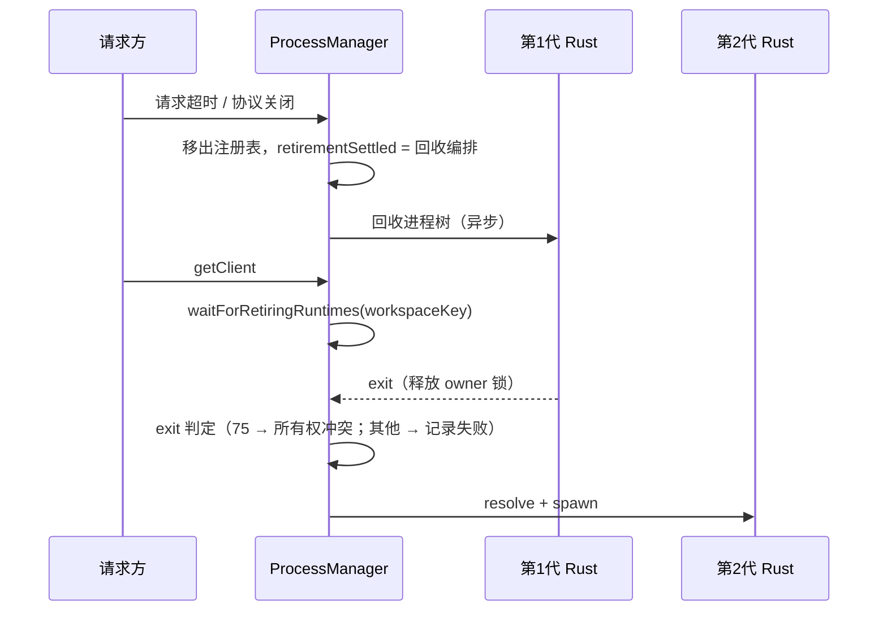
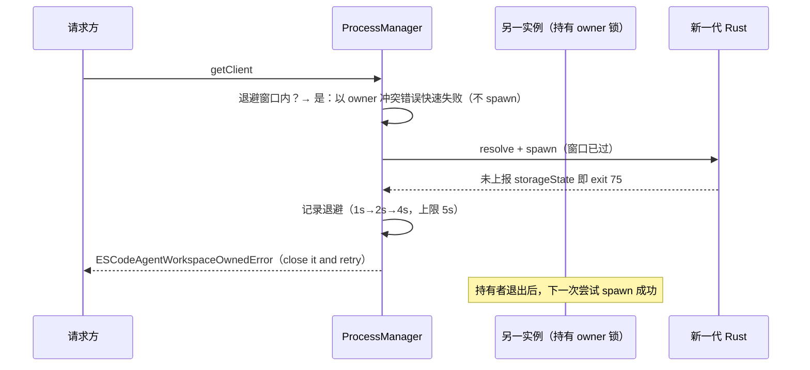

# Rust runtime 打包与选择（WP8）

2026-09-24。此前 Rust runtime 只能通过 `ESCODE_AGENT_SERVER_COMMAND` 指向本地二进制启用；桌面安装包不含 Rust 二进制，`ESCODE_AGENT_SERVER_RUNTIME=escode-cli-rust` 单独设置时被忽略（仍启动 Node）。（2026-10-03 起**默认 runtime 为 Rust**：安装态未设置 `ESCODE_AGENT_SERVER_RUNTIME` 且无自定义命令时用随包二进制，见下文「默认切换」。）

## 规则

- 描述符（`packages/shared/src/escode-agent-runtime.ts`，唯一事实源）：新增 `rustBinaryName = "escode-cli-rust"` 与 `resolveRustBinarySegments(platform)`（Windows 追加 `.exe`），与 Node bundle 同放 `glm/` 资源目录。
- 查找（`providerRuntimeResolver.findESCodeAgentRustBinary`）：候选链与 Node bundle 完全平行（packaged resources → `~/.escode/server/agents/glm` → `bundled-agents/<platform>/glm` → legacy）。
- 选择（`resolveDefaultESCodeAgentCommand`，唯一 owner）：
  1. `ESCODE_AGENT_SERVER_COMMAND` 显式命令（现状不变）；
  2. 未设命令但 `ESCODE_AGENT_SERVER_RUNTIME=escode-cli-rust`：使用随包 Rust 二进制，参数 `app-server --stdio --cwd <workspacePath>`，`storagePreparationMode: "process"`、`supportsStorageStartup: true`（与显式命令路径相同）；
  3. 找不到随包 Rust 二进制：**直接报错**（`error` 记录 `escode_agent.runtime.rust_binary_missing`），不改用 Node（2026-10-12，见「不回退 Node」）；
  4. 其余情况维持现有顺序（dev 源码 → Electron Node bundle → 已部署二进制）。
     `ESCODE_AGENT_SERVER_RUNTIME` 接受 `node`（显式回退，与未设置等价）与 `escode-cli-rust`；其他值抛错（此前只在设置了命令时校验）。
- 构建（`packages/desktop/scripts/prepare-rust-agent.mjs`，由 `prepare-runtime-assets` 在 `ESCODE_BUNDLE_RUST_AGENT=1` 时调用）：按目标平台映射 Rust target triple（`win32-x64 → x86_64-pc-windows-msvc`、`win32-arm64 → aarch64-pc-windows-msvc`、`darwin-* → *-apple-darwin`、`linux-* → *-unknown-linux-gnu`；`ESCODE_RUST_TARGET` 可覆盖，例如本机无 MSVC 时用 GNU），`cargo build --release --locked --target <triple> -p escode-cli-rust`，复制到 `bundled-agents/<platform>/glm/`。
- 官方插件宿主（2026-09-25，rust-official-plugin-seed.md）：Rust 命令额外带 `ESCODE_PLUGIN_HOST_EXEC_PATH` 与
  `ESCODE_PLUGIN_HOST_ENTRYPOINT`（与 Node 链同一 Electron-as-Node 与 `escode.cjs`），Rust seed 官方插件时据此改写
  插件 MCP 的启动命令；开发态 tsx 源码入口不传。
- macOS 签名（2026-09-25 修订，见 rust-ci.md）：`glm/` 在 electron-builder 中被 `signIgnore`。Rust 二进制跟随应用的签名开关：`ESCODE_ENABLE_MAC_SIGN=1` 时用同一身份（`ESCODE_RUST_CODESIGN_IDENTITY` / `APPLE_SIGNING_IDENTITY` / `CSC_NAME`，缺失即失败）以 hardened runtime 签名；未开启时整个应用都不签名，二进制保持未签名。

## 不回退 Node（2026-10-12，用户决定）

此前的两条自动回退（随包二进制缺失、Rust 就绪前失败 → 改用 Node）已删除。原因：Rust 会话写在
`<dataDir>/rust-sessions.sqlite`，Node 不读该库；一次偶发失败就让本 Host 生命周期内的 Rust 期会话全部
报 `fault.subscribe.sessionNotFound`（「重装后首次启动打不开历史会话，杀进程重启又好了」）。

- 选择：用户/运维仍可显式设置 `ESCODE_AGENT_SERVER_RUNTIME=node`；这是选择，不是回退。
- 随包二进制缺失：resolver 抛错（`ESCode Rust runtime (escode-cli-rust) is not installed…`），启动失败如实上报。
- Rust 就绪前失败：只记录 `error` 诊断 `escode_agent.runtime.rust_startup_failed`（含 `reason`、`exitCode`），
  下一次启动仍用 Rust。`ESCodeAgentCommandResolverContext` 不再携带 `rustRuntimeFailed`。
- 退出码 75（`WORKSPACE_OWNED_EXIT_CODE`）：workspace owner 锁被其他进程持有，是可重试的所有权冲突，记录
  `warn` `escode_agent.runtime.rust_workspace_owned`。
- 默认 Rust 属于桌面安装包（`ESCODE_DESKTOP_PACKAGED=1`）与已注入 `ESCODE_REMOTE_PACKAGED_RUNTIME=1` 的远程
  server；远程 release 的 glm 组件已包含 Rust 二进制，缺失即部署/启动失败（见下文「远程环境使用 Rust」）。
  开发态 App（未打包）连接远程时未注入该标记，远端维持 Node 链。

## 换代等待旧 owner（2026-10-12）

现场日志：第 1 代 Rust 的 `provider/testModelConnectivity` 请求 180s 超时 → Host 把它移出注册表并异步回收进程树
（Windows 上耗时数秒）→ 下一个请求立刻拉起第 2 代 → 第 1 代仍持有 workspace owner 锁 → 第 2 代以 75 退出。

- 所有者：`ESCodeAgentProcessManager` 持有每个 workspace 的 runtime 代际；`ownedProcesses` 包含已移出注册表但尚未退出的
  退休进程。
- 规则：`startClient` 在解析命令前等待同一 workspaceKey 的退休进程；每个退休进程等待「进程退出」与「回收编排结束」
  （`retirementSettled`，不论成败）二者先到者。边界来自旧进程自身的回收生命周期，不额外引入超时；回收失败时放行，
  新进程若仍撞锁则以 75 退出并如实报错。
- Rust 就绪前失败的判定统一在 `exit` 里做（需要退出码），且在放行等待者之前完成。

## owner 冲突如实上报与启动退避（2026-10-13）

现场（安装版 + dev 应用同时打开同一 workspace）：dev 流程的 debug CLI 先取得 owner 锁，安装版每次 spawn 都在上报任何
`startup/storageState` 之前以 75 退出；Host 侧存储启动门禁被 transport 关闭触发 dispose，把失败翻译成
`SQLite startup failed: transport_closed`——UI（例如「添加模型 → 测试连接」）因此看到与数据库无关的假象错误。同时调用方
重试没有节流：spawn 风暴达到 130–175 次/分钟，单日 `rust_workspace_owned` 1.4 万次、桌面日志 158 MB。

- 就绪边界（`ESCodeAgentProcessManager.getClient`，唯一 owner）：命令声明 `supportsStorageStartup` 时，返回 client 即代表
  存储启动已有首个终态——ready 才返回；就绪前进程退出在启动处归因，不再把注定失败的 client 交给调用方。
- 归因：就绪前退出码 75（`RUST_WORKSPACE_OWNED_EXIT_CODE`，Host 协议契约）→ `ESCodeAgentWorkspaceOwnedError`，文案可执行
  （`The workspace runtime is already owned by another instance; close it and retry.`）。stdout EOF 可能先于 exit 事件到达，
  归因在 250ms 宽限内等待 `exit` 取退出码；非 75 的就绪前失败维持原错误（含 `startup_status_timeout`），不改写。
- 退避：owner 冲突按 workspaceKey 记录退避窗口 `1s → 2s → 4s`（上限 5s）；窗口内不再 spawn，直接以同一错误快速失败。
  记录只在成功接管（storage ready）时清除；退出码 75 只可能出现在取得 owner 锁之前，ready 之后无需重复判定。
- 边界：崩溃、主动回收、spawn 失败（如 ENOENT）不建立退避——这些失败之后必须能立即重新拉起。归因与退避都归
  `ESCodeAgentProcessManager`（workspace runtime 代际的唯一 owner），CLI 侧退出码契约不变。

## 验收

- 单测：Rust 选择、缺失报错、显式命令优先、非法 runtime 抛错；平台 → triple 映射。
- 单测（`escodeAgentProcessManager.test.ts`）：声明存储启动的 fake CLI 报 ready 后 `getClient` 才返回；就绪前 exit 75 →
  `getClient` 抛 `ESCodeAgentWorkspaceOwnedError` 且窗口内不再 spawn（窗口过期后允许再次尝试）；就绪前非 75 → 维持原
  `SQLite startup failed: transport_closed` 错误且不建立退避（下一次立即重试）。
- `escode-cli-rust-startup-failure.test.ts`：就绪前失败后仍用 Rust；退休进程未退出时新一代不启动（去掉等待即失败）。
- 本机已验证（2026-09-25）：`ESCODE_RUST_TARGET=x86_64-pc-windows-gnu` 下 `prepare:rust-agent` 产出 release 二进制 `bundled-agents/win32-x64/glm/escode-cli-rust.exe`（24 MB）；Host 真实解析链（未注入）按规则 2 选中它，并在 App harness 下完成一轮（`escode-cli-rust-runtime-selection.test.ts`，未随包时该用例跳过）。
- 未验证：MSVC 目标构建、macOS 签名与公证、Linux 包（本机环境限制，如实标注）。

## 默认切换（2026-10-03，用户决定）

- 选择顺序：`ESCODE_AGENT_SERVER_RUNTIME=node` → Node；`=escode-cli-rust` → Rust；**未设置**时，若无自定义命令且不在 monorepo
  开发态（开发入口在场即保持 Node，改源码立刻生效），用随包 Rust 二进制。（2026-10-12 起找不到二进制直接报错，不回退 Node。）
- 打包态隔离（2026-10-12）：开发入口按 `process.cwd()` 向上探测，安装包在仓库目录下启动（CI installed job、开发者从终端启动）
  会误命中 monorepo 源码入口，回到 Node 且因 tsx 入口没有 `storagePreparationEntry` 报 `unsupported_runtime`。Main 在
  `app.isPackaged` 时向 Host 注入 `ESCODE_DESKTOP_PACKAGED=1`，解析器据此跳过开发入口探测（默认选择、Node 回退链与插件宿主 env
  三处同口径），打包态的 runtime 选择与 cwd 无关。
- 打包：`ESCODE_BUNDLE_RUST_AGENT` 默认开启（`=0` 关闭时安装包只含 Node，须同时设置 `ESCODE_AGENT_SERVER_RUNTIME=node`，否则启动报错）。
  `ESCODE_BUNDLE_NODE_AGENT=0` 可产出不含 `resources/glm/zcode.cjs` 的 Rust-only 安装包，并保留
  `plugin-host.cjs` 继续承载官方插件；两者同时关闭会在构建期报错（见 rust-release-rollback.md
  「Rust-only 打包产物开关」）。
- 用例：`escode-cli-rust-runtime-selection.test.ts` 覆盖默认选 Rust、二进制缺失报错、开发态 / 显式 node / 非桌面安装包保持 Node。

## 远程环境使用 Rust（2026-10-12，用户决定）

远程工作区（SSH / WSL / Docker）此前只部署 `glm/<platform>/zcode.cjs`，远端 agent 永远是 Node。与桌面一致，
打包产物的远程环境也默认使用 Rust，且不回退 Node。

### 制品

| 远程平台                      | Rust target                                    | 说明                                              |
| ----------------------------- | ---------------------------------------------- | ------------------------------------------------- |
| `linux-x64`                   | `x86_64-unknown-linux-musl`                    | 静态链接，不依赖远端 glibc 版本（用户选择方案 a） |
| `linux-arm64`                 | `aarch64-unknown-linux-musl`                   | 同上                                              |
| `darwin-x64` / `darwin-arm64` | `x86_64-apple-darwin` / `aarch64-apple-darwin` | macOS 远端                                        |

- 位置：远程 release 的 glm 组件内 `glm/<platform>/escode-cli-rust`，与 `zcode.cjs` 同一组件（同一 manifest SHA）。
- 来源（`scripts/prepare-prebuilds.mjs` → `scripts/remote-rust-agent.mjs`，唯一 owner）：
  1. `ESCODE_REMOTE_RUST_BINARIES_DIR=<dir>`：取 `<dir>/<platform>/escode-cli-rust`（CI 由 `rust-runtime` job 产物提供）；
  2. 未设置时用本机 cargo 构建对应 target（Linux musl 需要 `musl-tools`）；
  3. 都拿不到即构建失败——远程 Rust 是默认 runtime，不能产出缺二进制的远程包。
- 打包范围：`prepare-runtime-assets` 在未显式设置 `ESCODE_REMOTE_ASSET_PLATFORMS` 时只构建 `linux-<目标架构>`
  （安装包只内置这一份，与 release job 同口径），避免本地打包要求交叉编译全部 musl / darwin 目标。直接运行
  `prepare:remote-assets` 仍缺省构建全部远程平台（开发 / e2e mock-cdn），需要对应工具链或预构建目录。
- 校验：`prepare-bundled-remote-assets` 必需条目、`afterPack` 产物断言、运行时本地 release 完整性
  （`source_server_install.rs` 的 glm 组件条目）都包含 `glm/<platform>/escode-cli-rust`。

### 部署与选择

- 部署（`apps/escode-host/crates/host-services/src/source_server_install.rs`）：Rust Host 安装 glm 组件目录到
  `~/.escode/server/agents/glm`（含 `escode-cli-rust` 与现有 `zcode.cjs`），并生成 Node wrapper `escode-agent`。
  Rust-only 打包会从组件中移除 `zcode.cjs`；TS CLI 退场时 wrapper 应改为执行 Rust 或被删除。
- 远端选择：桌面安装包的 Host 连接远程时给远端 server 注入 `ESCODE_REMOTE_PACKAGED_RUNTIME=1`。resolver 视
  `ESCODE_DESKTOP_PACKAGED=1` 或 `ESCODE_REMOTE_PACKAGED_RUNTIME=1` 为「打包运行时」：跳过 monorepo 开发入口探测、
  默认 Rust、缺二进制直接报错。开发态 App（未打包）连接远程时不注入，远端维持 Node（开发部署只同步 JS bundle）。
- 远端插件宿主：Rust 命令的 `ESCODE_PLUGIN_HOST_EXEC_PATH` / `ESCODE_PLUGIN_HOST_ENTRYPOINT` 在远端取
  `$ESCODE_SERVER_RUNTIME_ROOT/node` 与 `~/.escode/server/agents/glm/zcode.cjs`（存在时）。
- 数据：远端 Rust 会话库 `~/.escode/rust/rust-sessions.sqlite`；首次打开 workspace 时只读导入远端既有 TS 历史
  （`~/.escode/cli/db/db.sqlite`），与桌面同一迁移语义。

### CI

`release.yml` 的 `rust-runtime` 矩阵增加 `x86_64-unknown-linux-musl`（ubuntu-latest）与 `aarch64-unknown-linux-musl`
（ubuntu-24.04-arm），安装 `musl-tools`；`desktop` job 依赖 `rust-runtime`，下载目标架构的 musl 产物，解压到
`ESCODE_REMOTE_RUST_BINARIES_DIR/linux-<arch>/escode-cli-rust`。

### 验收

- 单测：平台 → target 映射；二进制来源（目录优先、缺失报错）；resolver 在远程打包运行时默认 Rust、缺二进制报错、
  未注入时维持 Node；远程 server 启动命令仅在桌面打包态注入标记；部署上传可执行的 Rust 二进制、缺失时不跳过部署。
- 本机：`x86_64-unknown-linux-musl` release 构建成功并能以 `app-server --stdio` 完成启动握手（见提交说明）。
- 未验证：aarch64 musl 与 macOS 远端产物（本机无对应工具链），真实 SSH 远端连接（需要 CI / 真机）。

## Node runtime（TS CLI）退场清单（2026-11-04，未执行）

> 删除 `ESCODE_AGENT_SERVER_RUNTIME=node` 与 `resources/glm/zcode.cjs` 的完整范围。前置门槛与证据见
> [rust-parity-remaining.md](rust-parity-remaining.md)；产品确认前不执行，避免把“计划”当成现状。

| 面   | 位置                                                                                                                                      | 退场动作                                                                                                              |
| ---- | ----------------------------------------------------------------------------------------------------------------------------------------- | --------------------------------------------------------------------------------------------------------------------- |
| 选择 | `packages/services/src/escode-agent/escodeAgentProcessManager.ts` `resolveDefaultESCodeAgentCommand`                                      | 拒绝 `node`；删除 `resolveWorkspaceDevESCodeAgentCommand` / `resolveElectronRuntimeESCodeAgentCommand` 与对应错误文案 |
| 描述 | `packages/shared/src/escode-agent-runtime.ts`                                                                                             | 删除 `nodeBundleEntryFile` / `resolveNodeBundleSegments`；保留 `pluginHostEntryFile`                                  |
| 远端 | `apps/escode-host/crates/host-services/src/source_server_install.rs`（glm 组件与 `escode-agent` wrapper）、`remotePluginHostEnv`          | 只部署 Rust 二进制；wrapper 改指 Rust 或删除；插件宿主保留 `plugin-host.cjs`                                          |
| 构建 | `apps/escode-cli`、`scripts/build-desktop-agent-cli.mjs`、`packages/desktop/scripts/stage-agent-bundle.mjs`                               | 删除 TS CLI bundle 构建与 stage 入口（确认无其它消费者后移除 workspace）                                              |
| 打包 | `packages/desktop/scripts/prepare-agent-node-bundle.mjs`、`prepare-bundled-remote-assets.ts`、`scripts/prepare-prebuilds.mjs`             | 移除 `zcode.cjs` 资产与 `ESCODE_BUNDLE_NODE_AGENT` 开关；断言只校验 Rust                                              |
| 差分 | `packages/services/tests/escode-cli-rust-golden.ts`、`scripts/diff-escode-cli-rust-parity*.mjs`、`scripts/bench-escode-cli-node-rust.mjs` | 删除 `nodeOracle` / `--record` / `--live-node` / Node bench 侧；golden 只读                                           |
| 测试 | `escode-cli-rust-runtime-selection.test.ts`、`escode-cli-rust-installed-rust-only.test.ts`                                                | 删除 `node` 选择断言；保留 Rust-only 缺 bundle 断言                                                                   |
| 文档 | `rust-packaging.md`、`rust-release-rollback.md`、`rust-ci.md`、`rust-cli-architecture.md`                                                 | 删除回退说明；保留“只能降级到含 Node CLI 的旧安装包”                                                                  |

顺序：

1. 各平台用 `ESCODE_RECORD_CLI_GOLDEN=1` 最终重录；确认 `--golden --strict` 为 0 open / 0 新差异 / 0 欠账。
2. 删除选择与描述层（含 `node` 显式值），开发态改本地 Rust 二进制；跑 `pnpm test:escode-cli-rust`。
3. 删除构建/打包资产与 `ESCODE_BUNDLE_NODE_AGENT`，重跑 Rust-only release 三平台。
4. 删除 Node oracle 与 bench 侧，保留 `fixtures/cli-golden`。
5. 更新回滚文档：旧安装包仍含 Node CLI，降级路径不变。

验证：`pnpm typecheck`、`pnpm lint`、`pnpm check:escode-cli-rust`、`pnpm test:escode-cli-rust`、
`node scripts/diff-escode-cli-rust-parity.mjs --golden --strict`、`release.yml` 的 `rust_only` 三平台、
installed Rust-only（`zcode.cjs` 不存在且 Rust 正常启动）。
