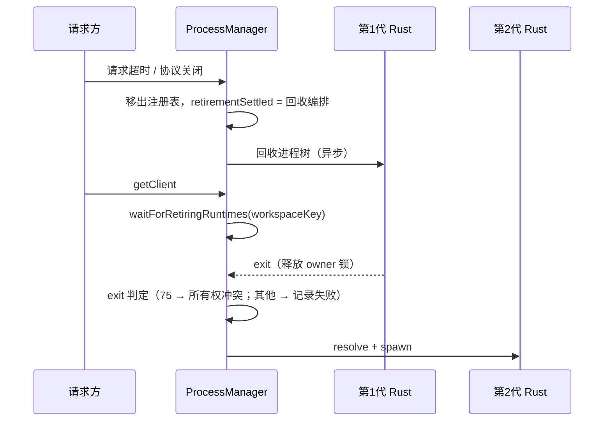

# Rust runtime 打包与选择（WP8）

2026-09-24。此前 Rust runtime 只能通过 `ESCODE_AGENT_SERVER_COMMAND` 指向本地二进制启用；桌面安装包不含 Rust 二进制，`ESCODE_AGENT_SERVER_RUNTIME=escode-cli-rust` 单独设置时被忽略（仍启动 Node）。（2026-10-03 起**默认 runtime 为 Rust**：安装态未设置 `ESCODE_AGENT_SERVER_RUNTIME` 且无自定义命令时用随包二进制，见下文「默认切换」。）

## 规则

- 描述符（`packages/shared/src/escode-agent-runtime.ts`，唯一事实源）：新增 `rustBinaryName = "escode-cli-rust"` 与 `resolveRustBinarySegments(platform)`（Windows 追加 `.exe`），与 Node bundle 同放 `glm/` 资源目录。
- 查找（`providerRuntimeResolver.findESCodeAgentRustBinary`）：候选链与 Node bundle 完全平行（packaged resources → `~/.escode/server/agents/glm` → `bundled-agents/<platform>/glm` → legacy）。
- 选择（`resolveDefaultESCodeAgentCommand`，唯一 owner）：
  1. `ESCODE_AGENT_SERVER_COMMAND` 显式命令（现状不变）；
  2. 未设命令但 `ESCODE_AGENT_SERVER_RUNTIME=escode-cli-rust`：使用随包 Rust 二进制，参数 `app-server --stdio --cwd <workspacePath>`，`storagePreparationMode: "process"`、`supportsStorageStartup: true`（与显式命令路径相同）；
  3. 找不到随包 Rust 二进制：**直接报错**（`error` 记录 `escode_agent.runtime.rust_binary_missing`），不改用 Node（2026-10-12，见「不回退 Node」）；
  4. 其余情况维持现有顺序（dev 源码 → Electron Node bundle → 已部署二进制）。
     `ESCODE_AGENT_SERVER_RUNTIME` 接受 `node`（显式回退，与未设置等价）与 `escode-cli-rust`；其他值抛错（此前只在设置了命令时校验）。
- 构建（`packages/desktop/scripts/prepare-rust-agent.mjs`，由 `prepare-runtime-assets` 在 `ESCODE_BUNDLE_RUST_AGENT=1` 时调用）：按目标平台映射 Rust target triple（`win32-x64 → x86_64-pc-windows-msvc`、`win32-arm64 → aarch64-pc-windows-msvc`、`darwin-* → *-apple-darwin`、`linux-* → *-unknown-linux-gnu`；`ESCODE_RUST_TARGET` 可覆盖，例如本机无 MSVC 时用 GNU），`cargo build --release --locked --target <triple> -p escode-cli-rust`，复制到 `bundled-agents/<platform>/glm/`。
- 官方插件宿主（2026-09-25，rust-official-plugin-seed.md）：Rust 命令额外带 `ESCODE_PLUGIN_HOST_EXEC_PATH` 与
  `ESCODE_PLUGIN_HOST_ENTRYPOINT`（与 Node 链同一 Electron-as-Node 与 `escode.cjs`），Rust seed 官方插件时据此改写
  插件 MCP 的启动命令；开发态 tsx 源码入口不传。
- macOS 签名（2026-09-25 修订，见 rust-ci.md）：`glm/` 在 electron-builder 中被 `signIgnore`。Rust 二进制跟随应用的签名开关：`ESCODE_ENABLE_MAC_SIGN=1` 时用同一身份（`ESCODE_RUST_CODESIGN_IDENTITY` / `APPLE_SIGNING_IDENTITY` / `CSC_NAME`，缺失即失败）以 hardened runtime 签名；未开启时整个应用都不签名，二进制保持未签名。

## 不回退 Node（2026-10-12，用户决定）

此前的两条自动回退（随包二进制缺失、Rust 就绪前失败 → 改用 Node）已删除。原因：Rust 会话写在
`<dataDir>/rust-sessions.sqlite`，Node 不读该库；一次偶发失败就让本 Host 生命周期内的 Rust 期会话全部
报 `fault.subscribe.sessionNotFound`（「重装后首次启动打不开历史会话，杀进程重启又好了」）。

- 选择：用户/运维仍可显式设置 `ESCODE_AGENT_SERVER_RUNTIME=node`；这是选择，不是回退。
- 随包二进制缺失：resolver 抛错（`ESCode Rust runtime (escode-cli-rust) is not installed…`），启动失败如实上报。
- Rust 就绪前失败：只记录 `error` 诊断 `escode_agent.runtime.rust_startup_failed`（含 `reason`、`exitCode`），
  下一次启动仍用 Rust。`ESCodeAgentCommandResolverContext` 不再携带 `rustRuntimeFailed`。
- 退出码 75（`WORKSPACE_OWNED_EXIT_CODE`）：workspace owner 锁被其他进程持有，是可重试的所有权冲突，记录
  `warn` `escode_agent.runtime.rust_workspace_owned`。
- 默认 Rust 只属于桌面安装包（`ESCODE_DESKTOP_PACKAGED=1`）。远程服务端（SSH 部署的 `entry-stdio`）尚未随
  远程资源分发 Rust 二进制，未设置时维持 Node 链；远程切换 Rust 见后续计划，切换前不得让远程默认选中 Rust。

## 换代等待旧 owner（2026-10-12）

现场日志：第 1 代 Rust 的 `provider/testModelConnectivity` 请求 180s 超时 → Host 把它移出注册表并异步回收进程树
（Windows 上耗时数秒）→ 下一个请求立刻拉起第 2 代 → 第 1 代仍持有 workspace owner 锁 → 第 2 代以 75 退出。

- 所有者：`ESCodeAgentProcessManager` 持有每个 workspace 的 runtime 代际；`ownedProcesses` 包含已移出注册表但尚未退出的
  退休进程。
- 规则：`startClient` 在解析命令前等待同一 workspaceKey 的退休进程；每个退休进程等待「进程退出」与「回收编排结束」
  （`retirementSettled`，不论成败）二者先到者。边界来自旧进程自身的回收生命周期，不额外引入超时；回收失败时放行，
  新进程若仍撞锁则以 75 退出并如实报错。
- Rust 就绪前失败的判定统一在 `exit` 里做（需要退出码），且在放行等待者之前完成。

## 验收

- 单测：Rust 选择、缺失报错、显式命令优先、非法 runtime 抛错；平台 → triple 映射。
- `escode-cli-rust-startup-failure.test.ts`：就绪前失败后仍用 Rust；退休进程未退出时新一代不启动（去掉等待即失败）。
- 本机已验证（2026-09-25）：`ESCODE_RUST_TARGET=x86_64-pc-windows-gnu` 下 `prepare:rust-agent` 产出 release 二进制 `bundled-agents/win32-x64/glm/escode-cli-rust.exe`（24 MB）；Host 真实解析链（未注入）按规则 2 选中它，并在 App harness 下完成一轮（`escode-cli-rust-runtime-selection.test.ts`，未随包时该用例跳过）。
- 未验证：MSVC 目标构建、macOS 签名与公证、Linux 包（本机环境限制，如实标注）。

## 默认切换（2026-10-03，用户决定）

- 选择顺序：`ESCODE_AGENT_SERVER_RUNTIME=node` → Node；`=escode-cli-rust` → Rust；**未设置**时，若无自定义命令且不在 monorepo
  开发态（开发入口在场即保持 Node，改源码立刻生效），用随包 Rust 二进制。（2026-10-12 起找不到二进制直接报错，不回退 Node。）
- 打包态隔离（2026-10-12）：开发入口按 `process.cwd()` 向上探测，安装包在仓库目录下启动（CI installed job、开发者从终端启动）
  会误命中 monorepo 源码入口，回到 Node 且因 tsx 入口没有 `storagePreparationEntry` 报 `unsupported_runtime`。Main 在
  `app.isPackaged` 时向 Host 注入 `ESCODE_DESKTOP_PACKAGED=1`，解析器据此跳过开发入口探测（默认选择、Node 回退链与插件宿主 env
  三处同口径），打包态的 runtime 选择与 cwd 无关。
- 打包：`ESCODE_BUNDLE_RUST_AGENT` 默认开启（`=0` 关闭时安装包只含 Node，须同时设置 `ESCODE_AGENT_SERVER_RUNTIME=node`，否则启动报错）。
- 用例：`escode-cli-rust-runtime-selection.test.ts` 覆盖默认选 Rust、二进制缺失报错、开发态 / 显式 node / 非桌面安装包保持 Node。
