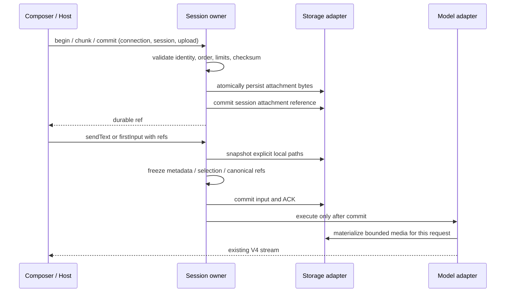

# Rust Composer 附件输入

## 当前协议和所有者

依据 `packages/ui/src/v4/composer/attachmentUpload.ts`、共享 `attachmentRefSchema`、TS `attachment-upload-registry.ts` 与 `commands/attachment-refs.ts`：本地文件直接作为 ref；粘贴图片、Web 内容经 `v4/attachment/begin/chunk/commit/abort` 得到 ref。命令和 topic 仅携带引用与元信息，不内联正文。

Session actor 仍是输入、上传关联、队列、附件授权与历史的唯一所有者。存储端口负责异步文件 IO、原子快照及持久化；模型 adapter 在每次模型调用编码前按需读取快照，重试复用已编码请求。模型能力来自同一次绑定的配置，禁止把图片/PDF/视频悄悄当作普通文本发送。

## 行为

- 上传按 connectionId/sessionId/uploadId 隔离。重复 begin 元信息一致时返回当前进度，重复 chunk 内容一致时幂等；乱序、冲突、总量越界、校验和不一致不得完成。commit 可重试；abort、连接关闭和 TTL 清理未完成上传，不删除已经提交的附件。
- 与共享限制一致：每附件 20 MiB，每片 512 KiB，最多 64 片、16 个并发上传、64 MiB staging，TTL 5 分钟。staging 使用有界块缓冲，不按 chunk 拼接全量字符串。只有 commit 校验后写持久快照，命令 ACK 不早于元数据提交。
- 新文件输入支持仅附件、首条输入、普通输入、busy FIFO 和 sendQueuedNow。排队时保存完整附件元信息及不可变快照；提升队列不重新读取可能已变更的源文件。引用不跨会话复用，过期 staging 不能冒充已提交 ref。
- 本地附件在 admission 时读取；新上传 ref 只允许引用当前 Session 拥有的 artifact。规范化显示 ref 指向不可变快照，原文件后续更改或删除不影响已接受输入与预览。文本以用户上下文进入消息；图片、PDF 和视频保留媒体语义。PDF 验证 `%PDF-`，媒体按模型能力明确校验；不支持的格式报错。
- 数据库不保存媒体 base64，canonical 只保存内部附件描述，adapter 编码请求时转换；内部存储路径/字段不得泄漏给供应商（与 TS 相同的派生媒体缓存副本路径除外，见 rust-media-read.md 第 4 期）。文本预览和请求编码有界；超限不得以完整内容伪装截断结果。大图缩放与来源路径已对齐（2026-09-26）；大于 20 MiB 的本地文件与完整文本 Read 预览差分仍须后续补齐后才能宣布完整 TS 附件对齐。
- 预览沿用当前 session/row/entity/index 授权；未发送附件不能通过普通历史读取入口读取。历史、重启、压缩继续保留快照引用。附件读取失败不允许执行模型或工具。

## 验收

现有 App client/schema + 真实 Rust 子进程验证 begin/chunk/commit 幂等和故障、双连接隔离、关闭清理、仅附件/首发/排队/重启/跨会话拒绝、源文件变更后内容稳定、图片/PDF/视频三协议投影与不支持模型拒绝、提交失败无请求。使用真实 Composer 选择本地文本并提交，证明用户入口可用。TS/Rust 分片状态机同输入差分；性能检查包括多片载荷和媒体 base64 不进入会话元数据。

## 本地路径附件的大小、媒体分类与文本预览（2026-10-31）

TS 真源：`core/src/runtime/helpers/attachments.ts` + `attachment-media-resolver.ts` +
`attachment-path-reference.ts`。旧 Rust 对所有本地路径附件一律快照并硬性拒绝 >20 MiB，
与 Node 的分支不一致：Node 对文本读有界预览、对未超限视频接受、对超限媒体或非文本文件只交付路径引用。

规则（App V4 的本地路径 ref；`escode-artifact://` 上传 ref 仍受 20 MiB 上传上限）：

- 分类只看 MIME 的媒体段：`image/*`、`video/*`、`application/pdf`，其余按普通文件处理
  （`audio/*` 不是媒体输入，按普通文件路径引用；不再报 `Audio attachment input is not implemented`）。
- 普通文件若扩展名属于 TS `isTextLikePath`：任意文件大小都接受，读取规则与 TS
  `resolveLocalFileAttachment` 一致：
  - `size ≤ READ_MAX_FILE_SIZE_BYTES`（256 KiB）→ `host::text_file::read(path, offset=None,
    limit=None, allowPartialFallback=true)`，整文件读取，不按 2000 行截断（仅受 25000 token 预算）。
  - `size > 256 KiB` → `read(path, offset=1, limit=2000, allowPartialFallback=true)`。

  快照的是预览正文；显示用 `bytes` 仍为原文件大小。预览保存 `previewTotalLines` 与
  `partialViewNotice`，请求时按它们生成与 TS 相同的 Read reminder。
- 普通文件若不是文本扩展名（含音频、未知扩展名、二进制）：不复制正文，记录路径引用
  （`referenceReason = "binary_file"`），模型请求给
  `Attached <按扩展名推断的 mime>: <原引用>` + `because the file is not a known text attachment.`。
- 媒体：`image/*` >20 MiB → `image_too_large`；`application/pdf` >20 MiB → `pdf_too_large`；
  `video/*` >30 MiB → `video_too_large`。超限项不复制正文，只记录路径引用；模型请求给对应的
  `because ... larger than ...` 文案。
- `video/*` ≤30 MiB 正常快照与内联（TS `VIDEO_INPUT_MAX_BYTES`）；图片/PDF ≤20 MiB 正常快照。
  快照上限按 MIME 决定，上传事务仍使用共享 20 MiB 上限。
- 引用资产字段：`referenceReason` + 原路径 + 原大小；`originalBytes` 用于展示原始大小（文本预览时
  `totalBytes` 是预览正文大小）。模型请求只为实际快照字节做 20/30 MiB 与 64 MiB 总量检查。
  回放（retry/edit）校验 attachment 元数据时，`bytes` 必须与
  `originalBytes ?? totalBytes` 比较；预览资产的 committed 字节是预览正文，不能用它校验展示大小。
- 文本预览不剥离 UTF-8 BOM（TS `readTextFileForModel` 保留）；编码探测（UTF-16LE/GBK/GB18030）
  与 CRLF 归一复用 `host::text_file`，与 Read 工具同一实现。

验收：新增差分 `packages/services/tests/escode-cli-rust-attachment-limits.test.ts`：
小音频路径引用、>20 MiB 文本预览、>20 MiB 图片/PDF 路径引用、>30 MiB 视频路径引用、
21 MiB 视频内联（只比较媒体 part 形态与摘要）、BOM/GBK 文本附件、源文件删除后历史重放稳定。

交付记录（2026-10-31）：上述差分 10/10 通过（golden `attachment-limits.*.json`）。实现中修正两处
与 TS 不一致的细节：文本附件此前一律按 2000 行截断（256 KiB 内的多行文件会被误截）；预览资产的
`bytes` 回放校验误用 preview 大小导致 retry 被 `Attachment metadata does not match committed content`
拒绝。既有附件/媒体/Read 差分（`escode-cli-rust-attachments.test.ts`、
`escode-cli-rust-attachment-media.test.ts`、`escode-cli-rust-media-read-differential.test.ts`、
`escode-cli-rust-history.test.ts`、`escode-cli-rust-read-text-parity.test.ts`）33/33 通过。

跨平台 golden（2026-11-01）：windows-latest 上这 9 个用例全红，差异只有附件引用里的路径分隔符——
附件引用嵌在 JSON 转义文本里（`{"file_path":"D:\\..."}`），而 `canonical()` 只归一 `*Path` 字段，
无法归一字符串内部的转义形态；Windows 的 Node 与 Rust 都输出反斜杠引用（JSON 里是
`<CWD>\\\\note.mp3`，解析后 `<CWD>\note.mp3`），通用 golden 是 Linux 录制的 `<CWD>/note.mp3`。
按 `rust-unified-host.md` 的规则补平台录制：
`record cli goldens` run `41279354207`（Windows runner 上 `ESCODE_GOLDEN_PLATFORM=1`）产出
`attachment-limits.*.win32-x64.json`，人工挑选这 9 个文件入库（未手抄 Linux 值）。
