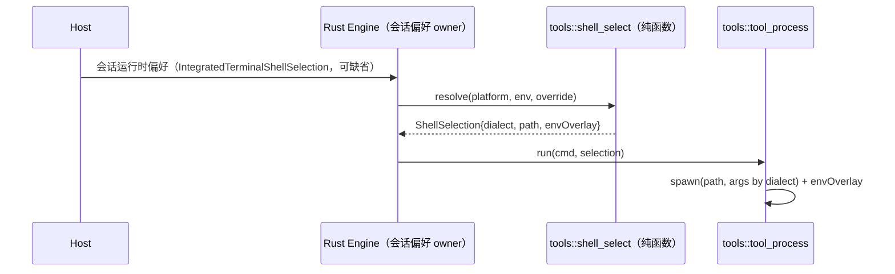

# Rust Shell 选择与 TS 对齐

2026-09-24，WP2（跨平台正确性）的第一项。Rust Bash 工具的 shell 解析必须与 TS `apps/escode-cli/packages/adapters/src/exec/bash-shell-provider.ts` 一致，否则同一条模型命令在两个 runtime 上会得到不同语义。

## 现状差异（已确认）

| 平台             | TS（基准）                                                                                                                                                                 | Rust（`crates/tools/src/tool_process.rs::run`） |
| ---------------- | -------------------------------------------------------------------------------------------------------------------------------------------------------------------------- | ----------------------------------------------- |
| Windows 默认     | 自动探测 Git Bash：固定路径 `C:\Program Files{, (x86)}\Git\bin\bash.exe` → PATH 中 `git.exe` 反推 `..\bin\bash.exe` / `..\..\bin\bash.exe`；都没有时走 legacy system shell | 固定 `cmd.exe /D /S /C`                         |
| Windows 用户选择 | Host 下发 `IntegratedTerminalShellSelection`（`mode!=auto`）：`git-bash`（路径需可执行）或 `cmd`（`cmd.exe` 裸名可免校验）                                                 | 不支持                                          |
| POSIX 默认       | `$SHELL` 为 bash/zsh 时优先；否则按 `$SHELL` 类型决定 bash/zsh 顺序（默认 zsh 优先），先 PATH、后 `/bin` `/usr/bin` `/usr/local/bin` `/opt/homebrew/bin`                   | 固定 `/bin/bash -c`                             |
| 环境覆盖         | git-bash/posix 注入 `GIT_EDITOR=true`、`SHELL=<选中路径>`                                                                                                                  | 无                                              |

证据：Windows 上 `tests/coding_tools.rs` 的后台 Shell 用例依赖 `$$`/`sleep`，在 `cmd.exe` 下无法表达，clippy `-D warnings` 也因 `pid` 仅在 unix 分支使用而失败。

## 规则

- 唯一所有者：`crates/tools` 内新增 `shell_select.rs`，纯函数 `resolve(platform, env, override, exists) -> ShellSelection`，与 TS `resolveEffectiveBashShellSelection` 一一对应；`tool_process::run` 只消费结果，不再内联平台分支。
- 用户选择来源与 TS 相同：会话运行时偏好（Host → runtime），`mode=auto` 视为无覆盖。首版 Rust 若尚未接入该偏好，仅实现自动探测，并在 `runtime/capabilities` 中不宣告 shell 覆盖能力，不静默忽略用户设置。
- legacy 回退：TS 的 `legacy-shell` 在 Windows 即系统 `ComSpec`（缺省 `cmd.exe`），POSIX 为 `/bin/sh`；Rust 保持一致。
- Git Bash 下 cwd、临时文件等路径需按 TS `windowsPathToGitBashPath` 规则转换（`C:\a` → `/c/a`）。

## 验收

1. 差分单测：同一组 `(platform, env, override, exists)` 输入，Rust `resolve` 与 TS `resolveEffectiveBashShellSelection` 输出相同的 dialect/path/source（fixture 由 Node 脚本导出 JSON，`--check` 防漂移）。
2. Windows 实测：装有 Git Bash 时 `echo $$` 返回 bash pid；后台任务可被进程树清理；无 Git Bash 时回退 `cmd`。
3. `tests/coding_tools.rs` 后台用例在 Windows 走 Git Bash 分支运行，不再依赖 `cfg(unix)` 才有意义；clippy 在 Windows 通过。
4. macOS/Linux：交叉编译通过；`$SHELL=zsh` 时选择 zsh 的单测。

## 实现状态（2026-09-24）

- 已实现：`crates/tools/src/shell_select.rs`（解析与 spawn 参数）、`crates/core/src/app/shell_preferences.rs`（Engine 按会话请求一次 `session/requestRuntimePreferences{scope:"user-execution"}` 并缓存，并发首批 Bash 共用一个请求）、Bash 工具在启动 shell 前经 `Event::ShellPreference` 取偏好（15s 超时，同 `ESCODE_SESSION_RUNTIME_PREFERENCES_REQUEST_TIMEOUT_MS`）。
- 已知差异，待对齐：
  - TS 对 -32601/-32020 以外的错误和超时会让会话 runtime 创建失败；Rust 传输层把错误回包归一为 `Null`，统一回退自动探测。
  - ~~TS 会把选择结果作为快照持久化，冷恢复沿用创建时的 shell；Rust 仅进程内缓存，冷恢复重新请求。~~
    2026-09-30 差分更正：**这条链路上 TS 也不写快照**。phase 1（Host 选 Git Bash）结束后 Node 的
    `session_entry` 只有 `runtime/model_selection` 与 `runtime/execution_state`，没有
    `bash_shell_selection`（`persistSessionShellEnvironmentSnapshot` 因 `config.bashShellSelection`
    为空而早退）。因此两侧行为一致，而且分两种情况：
    - **会话内**（同一进程）：设置变更不影响正在跑的会话（Node 的 `config.bashShellSelection` 在会话
      开始时固定一次，Rust 的 `(session, "user-execution")` 缓存同效）；
    - **跨进程续跑**：两侧都按当前设置重新解析（Node 没有快照可恢复，Rust 缓存已随进程消失），
      把设置从 Git Bash 改成 CMD 后，续跑的下一条 Bash 两侧都改用 cmd。
      结论：Rust 复请求的行为与 Node 一致，不要为此加会话级快照。
      验收：`packages/services/tests/escode-cli-rust-shell-switch.test.ts`（同一进程内改设置，会话内
      仍用旧 shell）与 `packages/services/tests/escode-cli-rust-shell-resume.test.ts`（跨进程续跑改用
      新 shell，并断言 Node 侧没有 `bash_shell_selection` entry）；两例都逐字比较两侧工具结果。

### 请求时机（2026-10-31 对齐 Node）

- Node 在会话物化期解析 `user-execution`，`session-baseline` 对拍里该 Host 反向请求排在 `inputAccepted`
  ack 之前（`server-2` → `id:4`）。Rust 原先只在首个 Bash（技能初始化取提示词 shell 名）时才懒请求，
  请求落到 ack 与首个 online 帧之后。
- 现在 `send_input` 在受理首个输入时预取（`ShellPreferences::prefetch_shell_preference`，仍挂在根会话），
  请求进入该命令的 outbox，由 `outbound_batch` 先于命令响应写出；后台回合的 `Event::ShellPreference`
  复用同一 in-flight 请求。缓存与子会话继承语义不变，每会话仍只请求一次。
- 验收：`session-baseline` golden 对拍中 `server-2` 位于初始快照之后、`inputAccepted` ack 之前；
  `escode-cli-rust-shell-preferences.test.ts` / `escode-cli-rust-subagent-shell.test.ts` 的请求次数断言不变。

### 失败命令的预取回滚（2026-11-01）

- 预取请求（以及其它在命令分派期间暂存的 Host 反向请求）只存在于该命令的 outbox。命令失败时
  `Engine::request` 不再写出该 outbox；此时必须同步撤销 `ShellPreferences` 的 in-flight 记账
  （`requests`/`waiters`）：以 `Null` 完成本批 waiter（本轮退回自动探测，**不写缓存**），让下一次输入
  重新发起 `user-execution` 请求。
- 根因：修复前只清空 outbox、不撤销记账，后续输入看到 `waiters` 非空便以为请求在途，永远等不到回包；
  首个提示词 shell 名/首个 Bash 要等满 15s 超时（`escode-cli-rust-attachments.test.ts` 先发一条
  “invalid metadata” 被拒的输入即可复现）。
- 验收：同一用例的“被拒输入 → 合法附件输入”序列在默认预算内收到 `completedSuccess`；`user-execution`
  请求恰好发送一次（下一次输入补发），不缓存 `Null`。

### 子代理继承父会话的 shell 选择（2026-09-30）

TS `subagent.ts` 把父会话已解析的 `bashShellSelection` 直接传给子 runtime，子会话**不**以自己的
sessionId 发 `session/requestRuntimePreferences{scope:"user-execution"}`。Rust 对齐：子会话沿
`parent_id` 上溯到根会话，请求与缓存都记在根会话上（Rust 在首个输入受理时预取；若子会话在预取前先跑
Bash，仍会替根会话取一次，否则会退化成自动探测，拿到与 App 里显式选择不同的 shell）。上溯深度与子代理
嵌套上限一致，父链异常时不会死循环。

验收：App 差分 `packages/services/tests/escode-cli-rust-subagent-shell.test.ts`——Host 指定 CMD 时，
父会话发 `runtime-materialization` + `user-execution` 各一次，**子会话不再发请求**，且子会话的
Bash 实际走 cmd（`ver` 输出 Windows 版本；不能用 `echo %OS%`，该变量在清洗后的子进程环境里为空，
两种 shell 都会原样输出）。
