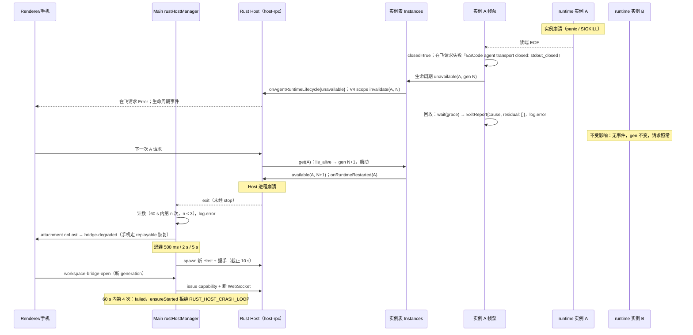

# Rust Host 韧性：实例崩溃隔离、Host 崩溃重启、启动失败与保序（rust-u2-host-skeleton.md 子 spec）

> 状态：M2 实施 · 2026-10-18
> 父 spec：`rust-u2-host-skeleton.md`（§3.2 有界通道、§3.4 Gateway、§6 dev 开关）、`rust-unified-host.md` §2（实例生命周期）
> 对标（参考，不作 oracle）：ZCode-rs `docs/specs/rust-host-resilience.md`（D2，clone `909c6554`，2026-10-11）
> 验收项：验收报告 `rust-migration-acceptance-2026-10-18.md` 的 H2.7、H2.2（前半）、H1.3、H1.4

## 0. 目标形态与范围

目标形态里 Rust Host 是唯一 Host，没有 Node Host 兜底。因此 Host 自身必须做到：

1. 一个 workspace 的 runtime 实例崩溃，不影响其它 workspace；崩溃实例的在飞请求显式失败，下一次请求懒重启下一代。
2. Host 进程崩溃时，Main 能检测到并有限次自动重启；超过上限后显式报错，不静默回退。
3. 启动失败按类别显式报错，每类都有时间上限，不挂起。
4. 真实 `host-rpc` 路径的保序粒度、各队列的容量与溢出策略，与代码一致。

本轮不做：Pending 业务域、删除 `ESCODE_RUST_HOST` 开关或 Node Host 回退分支（M5）、窗口自身 host 接线（H2.3）、删除 TS 代码。

## 1. 对 ZCode-rs D2 的取舍

| D2 条款                                                                       | 结论       | 理由                                                                                                                                                                                                                                   |
| ----------------------------------------------------------------------------- | ---------- | -------------------------------------------------------------------------------------------------------------------------------------------------------------------------------------------------------------------------------------- |
| 2.1.1 意外退出 = Main 没有发起 dispose 时 Host 退出，退出码不参与判断         | 采纳       | 退出码与信号无法区分“崩溃”和“自行 exit 0”；以 Main 是否发起 `stop()` 为唯一判据，与 TS `terminationKind === "unexpected"` 同义                                                                                                         |
| 2.1.3 有界重试：60 s 内最多 3 次，退避 500 ms / 2 s / 5 s，超出后不再自动重启 | 采纳       | 数值有对方 E2E 验证；App 级一个计数（我方同为一个 App 一个 Host）                                                                                                                                                                      |
| 2.1.2 重启方式 = reload 窗口                                                  | 不采纳     | 我方窗口自身 host 仍是 Electron utility process（H2.3 未接线），Rust Host 当前服务本地/远程 workspace attachment（手机远控已于 2026-10-20 删除）。attachment 的重建走既有 `web-remote-replayable` 恢复链路（§3.4），不 reload 桌面窗口 |
| 2.1.4 Renderer 的“正在重启 / 已放弃”页面                                      | 暂不采纳   | 依赖窗口自身 host 接线（H2.3）。本轮 Renderer 可见面只有手机端：沿用已有 `bridge-degraded` / `workspace-bridge-error` 的 reason 枚举（已本地化），不新增文案                                                                           |
| 2.2 启动失败页的 Retry / Exit 与 `StartupCoordinator`                         | 不采纳     | 我方 Host 启动不做存储迁移（embedded 不导入 TS 会话库，存储就绪由各实例自报 `startup/storageState`），没有可重试的 Host 级迁移步骤。启动失败以分类错误码交给调用方（§4）；放弃后的恢复入口是 `resetRestartBudget()`                    |
| 2.2.4 endpoint 在 ready 时签发                                                | 已等价满足 | capability 由 `issueRustHostCapability` 在每次 attach 时按需签发，不在拉起时预签                                                                                                                                                       |
| 2.3 流控水位 1 MiB / 256 KiB                                                  | 不采纳     | 我方 `host-rpc` 已按 8 MiB / 2 MiB / 64 MiB 实现并有测试（M1 H1.5）。本轮只核对口径（§6），不改数值                                                                                                                                    |
| 2.5 Host 主动关闭连接的 4001 重新接入                                         | 不采纳     | 我方 64 MiB 硬上限关闭是 fail-closed，当前消费者是远程 workspace attachment，已有恢复语义；桌面窗口不经 WebSocket                                                                                                                      |
| 2.1.5 CLI 与会话：旧 Host 的 CLI 在 stdin EOF 后自行退出，正在进行的 run 中断 | 采纳       | Host 进程死亡时 embedded 实例随进程消失；child 实例 stdin EOF 后自行退出（`kill_on_drop` 兜底）。会话事实在 runtime 的持久化存储里，新 Host 懒启动实例后按已有恢复逻辑展示                                                             |
| （ZCode-rs 无对应）runtime 实例崩溃隔离与懒重启                               | 我方补充   | D2 只覆盖 Host 进程级；我方把实例级故障隔离作为唯一 Host 下的主要手段（§2）                                                                                                                                                            |

## 2. runtime 实例崩溃（H2.7）

### 2.1 崩溃的定义

实例的出站读端在 Host 没有请求收口（`Instance::shutdown` / `Instances::close` / `Instances::shutdown`）时关闭，即为崩溃。两条链路的触发方式：

| 链路     | 触发                                                                                                                          | 读端关闭的原因                                         |
| -------- | ----------------------------------------------------------------------------------------------------------------------------- | ------------------------------------------------------ |
| embedded | runtime 内 panic：engine 循环的 `catch_panic` 把 panic 转为 `serve` 的错误，实例按正常收尾路径退出；实例根任务 panic 同样计入 | 实例任务结束，`Output` 全部 drop，内存链路的出站端关闭 |
| child    | CLI 子进程被杀（SIGKILL / Windows `TerminateProcess`）或自行退出                                                              | 子进程 stdout EOF                                      |

child 链路用 `env_clear` 隔离实例环境；Windows 上另行补回 `SystemRoot`、`SystemDrive`、`windir`、`ComSpec`、`PATHEXT`、`TEMP`、`TMP`、`PATH` 这组系统底座（`RuntimeOptions.env` 的同名值优先）。`env_clear` 在 Windows 会清掉 `SystemRoot`，缺少它时 Win32 socket 与系统证书库不可用（rust-lang/rust#114737），表现为 runtime ready 之后第一次模型请求失败或挂起；这些变量是平台事实，不是业务状态，不应由 Main 重复下发。

### 2.2 检测者：实例帧泵

唯一检测者是实例的帧泵（`host-runtime/src/instance.rs::pump`，读端的唯一消费者）。两条链路都归结为“读端返回 `None`”，因此检测逻辑不区分链路。实例表（`Instances`）不轮询存活，它在下一次 `get` 时看到 `is_alive() == false` 才换代（懒重启）。

帧泵读到 `None` 后按固定顺序执行：

1. `closed = true`；清空在飞请求表（等待方立即收到 §2.4 的错误）；清空订阅者（订阅流结束）。
2. 若该代已公告 `available`，发布一次 `unavailable` 生命周期事件。
3. 若不是 Host 请求的收口，则**立即回收**崩溃实例：`Lifecycle::wait(grace)`（embedded 等实例任务结束并 `drain`，child 等进程被回收），得到退出原因与残余清单，记 `error` 级日志（scope `runtime-link`，含 identity、generation、原因、残余），写入实例的 `ExitReport`（`Instance::exited()` 可等待）。
4. 若是 Host 请求的收口，第 3 步由 `shutdown` 自己完成，帧泵不重复回收。

就绪判定不轮询：帧泵收到 `startup/storageState ready` 时通过 `watch` 状态通知 `Instance::wait_ready`；读端关闭时同一通道置 `Closed`，等待中的 `initializeWorkspace` 立即拿到 `false`（`instance_ready.rs`）。

回收不等下一次 `get`：owner 锁（`WorkspaceOwnerGuard`）随实例任务结束释放，崩溃后立即回收能让下一代马上拿到锁，残余任务也不会拖到下一次请求才被中止。`Lifecycle::wait` 必须幂等（embedded 的 `JoinHandle` 只 await 一次，之后返回已记录的结果），因为下一次 `get` 的兜底收口与 `close` 仍可能对已回收的实例再调一次。

### 2.3 其它 workspace 不受影响

- 每个 workspace 一个实例槽、一个帧泵、一个写锁、一个在飞请求表；崩溃只关闭本实例的读端与表项。
- embedded 实例的任务都属于本实例的 `Spawner` 作用域，panic 只结束本实例任务；Host 进程与其它实例的 tokio 任务不受影响（`catch_panic` 与 `JoinHandle` 都把 panic 限制在任务边界内）。
- 生命周期事件只发布崩溃实例的 `unavailable`；其它 workspace 不收到任何事件，代次不变。
- 实例表的槽位锁（single-flight）按 workspace 区分，A 的懒重启不阻塞 B 的 `get`。

### 2.4 在飞请求的错误（Node 形状）

TS Host 的 agent 子进程崩溃时，协议客户端在 transport 关闭时拒绝全部在飞请求，文案为 `ESCode agent transport closed${suffix}`（`packages/services/src/escode-agent/escodeProtocolClient.ts:126`）；stdio transport 读到 stdout 结束时给出 `reason: "stdout_closed"`（`escodeStdioTransport.ts:234`）。Rust Host 的读端关闭就是 stdout 结束的等价物，因此：

- 崩溃实例的在飞请求、以及读端关闭后才发出的请求，一律以 `RuntimeClosed` 失败，文案逐字为 `ESCode agent transport closed: stdout_closed`。
- `host-rpc` 把它转成 Renderer 可见的 `RpcError`，`name` 为 `Error`（TS `new Error(...)` 的 name），`message` 同上；与超时（`RequestTimeout`）区分，调用方不据此回收 stale 实例。
- 不等请求自己的超时：读端关闭即失败。
- 客户端形状由 `packages/desktop/test/rustHostRuntimeCrash.test.ts` 用真实 `@escode/client` 端到端断言（SIGSTOP 子进程使转发请求停在在飞表，SIGKILL 后断言 `name`/`message`/`String(error)` 逐字一致）；host-runtime 层另由 `crash_isolation.rs` 断言类型化 `RuntimeClosed`。

### 2.5 订阅方收到什么

| 层                        | 订阅方                                 | 信号                                                                                                                                                                                    |
| ------------------------- | -------------------------------------- | --------------------------------------------------------------------------------------------------------------------------------------------------------------------------------------- |
| host-runtime              | `FrameSubscription`                    | `recv()` 返回 `None`，`lagged() == false`（与“消费过慢被摘除”区分），`is_closed() == true`；同时实例表的生命周期流收到 `Unavailable{identity, generation}`                              |
| host-rpc（Renderer 可见） | `escode-agent.onAgentRuntimeLifecycle` | `{state: "unavailable", workspaceKey, runtimeIdentity: {generation, identity, processId?}}`（TS `ESCodeAgentRuntimeLifecycleEvent` 同形）                                               |
| host-rpc（Renderer 可见） | V4 连接 scope                          | 收到 `unavailable` 后 `invalidate_runtime` 失效该 workspace 该代的订阅归属；下一代就位时发布 `onRuntimeRestarted{workspaceKey}`（generation > 1），Renderer 按既有逻辑重新订阅（TS 同） |

### 2.6 懒重启的 generation 语义

- generation 只在 `get` **成功**启动新实例时 +1；崩溃本身不改 generation。
- 崩溃后的第一次 `get(A)` 看到 `is_alive() == false`，在槽位锁内把 generation 从 N 改为 N+1 并启动新实例；新实例登记进槽位后才公告 `available`。
- 启动失败（`RuntimeLink::open` 报错）不占代次：回退为 N，下一次 `get` 仍尝试 N+1。
- 生命周期事件每代恰好一对：`available(N)` → `unavailable(N)` → `available(N+1)`。

### 2.7 残余任务如何收口

- embedded：实例任务结束时（含 engine panic 转错误后的正常收尾）`Spawner::abort_all()` 中止残余；实例根任务自身 panic 时同样必须执行 `abort_all`（根任务用 `catch_panic` 包住，panic 转为错误返回）。帧泵回收时 `drain(grace)` 返回的残余清单即 `running()` 在宽限后的快照。
- child：进程已死，操作系统回收进程；`wait(grace)` 内拿到退出状态即残余为空，超过宽限才记 `runtime-child`。
- 验收口径：崩溃回收完成后 `ExitReport.residual == []`（embedded 与 child 同）。非空即 `error` 日志点名，测试失败。

## 3. Host 进程崩溃（Main 侧）

### 3.1 检测

唯一检测者是 Main 的 `rustHostManager`：Host 子进程的 `exit` 事件到达时，若 Main 没有对该进程调用过 `stop()`，即为意外退出（不看退出码与信号）。`stop()` 先置“正在收口”标记，再关 stdin，因此 App 退出路径不会被误判。

### 3.2 重启策略

| 参数     | 值                                                                                                      |
| -------- | ------------------------------------------------------------------------------------------------------- |
| 窗口     | 任意 60 s 内                                                                                            |
| 次数上限 | 3 次自动重启                                                                                            |
| 退避     | 第 1/2/3 次之前分别等待 500 ms / 2 s / 5 s                                                              |
| 放弃条件 | 60 s 内第 4 次意外退出；或重启本身启动失败（§4 任一类）且已用完次数                                     |
| 放弃后   | 状态 `failed`，`ensureStarted()` 立即以 `RustHostStartError{code: "crash-loop"}` 拒绝；不回退 Node Host |
| 恢复入口 | `resetRestartBudget()`（显式操作）清空计数并回到 `idle`，下一次 `ensureStarted()` 重新拉起              |

- 重启是主动的：退避结束即拉起新 Host（不等下一次 attach），新 Host 就绪后状态回到 `running`。
- 退避期间的 `ensureStarted()` 等待同一个重启 Promise（single-flight），不另起进程。
- 重启拉起失败也计一次；用完次数即 `failed`。
- 计数器的时钟与定时器可注入（测试用），默认 `Date.now` 与 `setTimeout`。

状态机：

```text
idle ──ensureStarted──► starting ──ok──► running ──意外退出──► restarting(n, delay) ──拉起ok──► running
  ▲                        │                 │                        │
  │                        └─fail(§4)──► idle│stop()                  └─n>3 或拉起失败且次数用完──► failed
  └──────────────── resetRestartBudget() ◄───┴────────────────────────────────────────────────────┘
```

每次状态变化经 `onStateChange` 通知监听方：`{state: "restarting", attempt, delayMs, exit: {code, signal}}`、`{state: "running", pid}`、`{state: "failed", error}`。

### 3.3 Renderer 看到什么

本轮 Rust Host 服务本地/远程 workspace attachment（H2.3 未接线，桌面窗口 Renderer 仍连 Electron utility Host，不受影响）：

- Host 意外退出时，Main 立即把该 Host 上的全部 attachment 标记为丢失（§3.4），手机端收到 `bridge-degraded{reason: "rpc-transport-fault"}`，走既有 `web-remote-replayable` 恢复。
- 恢复期间重新打开 bridge 时，若 Host 仍在退避，`attachWorkspaceHost` 等待重启完成；若已放弃，`workspace-bridge-error{reason: "desktop-disconnected", error}`（已有本地化 reason，不新增文案）。
- Main 日志：意外退出记 `error`（含 pid、code、signal、第 n 次）；放弃记 `error`；重启成功记 `info`。

### 3.4 已打开的 attachment 如何重建

不做“原地重连”：attachment 的 MessagePort 上跑的是有状态的 `@escode/rpc` 会话（初始化帧、请求 id、事件订阅），换一条 WebSocket 接到新 Host 会留下过期状态（与 D2 2.1.2 不选原地重连的理由相同）。

1. Host 意外退出 → `rustHostManager` 对它桥接过的每个 attachment：拆桥（关 WebSocket）、关闭 Main 侧端口、触发 `onLost({reason: "host-exited"})`，并从登记表移除。
2. `webRemoteControlSharedHostAttachments` 收到 `onLost` → 释放该 attachment → 通知 `webRemoteControlManager.handleHostAttachmentLost(attachmentId)`。
3. `webRemoteControlManager` 找到使用该 attachment 的当前 bridge，按既有 raw fault 路径降级：`bridge-degraded{reason: "rpc-transport-fault"}`。
4. 手机端按 `web-remote-replayable` 语义发新的 `workspace-bridge-open`（新 `bridgeGeneration` / `recoveryId`）→ Main `attachWorkspaceHost` → `ensureStarted()`（等重启或立即拒绝）→ 新 attachment 桥到新 Host。会话事实在 runtime 存储中，按快照恢复。

`desktop-continuous` 链路本轮没有 Rust Host 消费者（H2.3），不受本节影响；切到唯一 Host 时按 D2 2.1.2 的 reload 方案另立 spec。

## 4. 启动失败

`startRustHost` 的所有失败抛 `RustHostStartError`（`name = "RustHostStartError"`，`code` 为下表之一）。整个握手（`hostReady` → `rpcListen` → `rpcListening`）共用一个截止时间 `timeoutMs`（默认 10 s），任何一类都不会超过它。失败后 Main 对子进程 `SIGKILL`。

| 分类       | `code`                        | 判定                                                                                     | 不挂起的上限                       | 日志级别 |
| ---------- | ----------------------------- | ---------------------------------------------------------------------------------------- | ---------------------------------- | -------- |
| 二进制缺失 | `RUST_HOST_BINARY_MISSING`    | 子进程 `error` 事件，`errno` 为 `ENOENT` / `EACCES`（不可执行同类）                      | `spawn` 报错即失败（不等截止时间） | `error`  |
| 启动即退出 | `RUST_HOST_EXITED_EARLY`      | 握手完成前子进程 `exit`；错误带 `exitCode` / `signal`                                    | 退出即失败（不等截止时间）         | `error`  |
| 握手超时   | `RUST_HOST_HANDSHAKE_TIMEOUT` | 截止时间到仍未完成握手；错误带未完成的阶段（`hostReady` / `rpcListening`）与 `timeoutMs` | `timeoutMs`                        | `error`  |
| 监听失败   | `RUST_HOST_LISTEN_FAILED`     | Host 回 `failed`（如端口被占），或 `rpcListening` 缺少 secret                            | 收到回执即失败                     | `error`  |

另有 `RUST_HOST_CRASH_LOOP`（§3.2 放弃后的 `ensureStarted`）。

呈现路径（Main → Renderer）：

```text
startRustHost ─throw RustHostStartError{code}─► rustHostManager.ensureStarted（log.error，code + message）
  ─reject─► attachRustHostLocal ─reject─► attachWorkspaceHost ─reject─► webRemoteControlManager.createWorkspaceBridge
  ─catch─► workspace-bridge-error{reason: mapWorkspaceBridgeFailureReason(code) = "desktop-disconnected", error: message} ─► 手机端
```

`mapWorkspaceBridgeFailureReason` 把 `RUST_HOST_*` 映射到既有的 `desktop-disconnected`（已有本地化文案）。不再写 “falling back to Node Host”：当前代码里 `attachWorkspaceHost` 在 Rust attachment 失败时并不回退，错误直接上抛；开关关闭时的 Node 路径是 M5 的删除对象（见 M2 报告的删除清单）。

## 5. 保序粒度（H1.3）

### 5.1 真实 `host-rpc` 路径（Renderer 的 `@escode/rpc` over WebSocket）

保证的是**每连接**的顺序，与 TS `ChannelServer` 同构（`packages/rpc/src/channelServer.ts:100-117`：收到 Promise 请求即同步调用 `channel.call`，响应在 Promise 完成时发出）：

1. **读序**：每连接一个读循环，帧按到达序切分、解析。
2. **登记序 = 到达序**：每条 Promise 请求在读循环内**同步**完成三件事——查 channel/method、调用处理函数取得 future（处理函数的同步前缀在此执行）、登记进在飞表——然后才交给独立任务执行。因此同一连接上先到的请求，其处理函数一定先被调用；`PromiseCancel` 总能找到先于它到达的请求。
3. **执行并发**：处理函数的异步部分并发执行（与 TS 每个请求一个独立 Promise 相同）；响应顺序 = 完成顺序，不是到达序；响应按请求 id 关联。
4. **写序**：每连接一个写任务，出站帧按入队顺序写出；同一事件订阅的 `EventFire` 按产生顺序。
5. **跨连接**：不保证全局顺序（TS 中各窗口是独立的 MessagePort，同样没有跨连接顺序）。需要跨连接一致的写入由服务域自己的唯一写者保证（如 settings 的单写者）。
6. **处理函数 panic**：同步前缀与异步体都在 `session::start` 内用 `catch_unwind` 捕获，回 `name="Fatal"` 的错误帧；不再让独立任务展开后请求悬空（`session_tests.rs` 两例）。

修复依据：M2 之前的实现在独立任务里才调用处理函数，tokio 多线程调度下同一连接先后两条请求的处理函数调用顺序不确定，与 TS 不一致。

### 5.2 Gateway 的“到达序 = 登记序”

`host-gateway` 的同步取号（`register`）只用于 `host-surface`（V4 NDJSON 传输面）：连接号按 accept 顺序分配，lane 顺序即连接到达序。它**不在**真实 `host-rpc` 路径上；`host-rpc` 的顺序语义见 5.1。

## 6. 队列口径（H1.4）

| 队列                          | 常量与构造点                                                                                                                                                           | 容量                                | 溢出策略                                                                                                                                                               |
| ----------------------------- | ---------------------------------------------------------------------------------------------------------------------------------------------------------------------- | ----------------------------------- | ---------------------------------------------------------------------------------------------------------------------------------------------------------------------- |
| runtime→Host 扇出（每订阅者） | `host-runtime/src/instance.rs` `SUBSCRIBER_CAPACITY`、`EARLY_FRAMES_CAPACITY`；构造于 `Instance::subscribe`                                                            | 4096 行；首个订阅者前缓冲 1024 行   | 不静默丢帧：满即摘除该订阅者并置 `lagged`；早期缓冲溢出时首个订阅者一开始即 lagged                                                                                     |
| host-surface 连接出站         | `host-surface/src/lib.rs` `OUTBOUND_CAPACITY`；经 `Gateway::register` 构造（`bounded::channel("gateway-outbound", …, DropReconstructible)`）；实例帧泵 `try_send` 投递 | 256 帧                              | 满即丢该连接的这一帧（可重建流，由快照恢复补齐），不阻塞帧泵                                                                                                           |
| host-rpc 连接出站（字节水位） | `host-rpc/src/connection.rs` `HIGH_WATER`/`LOW_WATER`/`HARD_LIMIT`；构造于 `connection::run`（无界通道 + 字节计数）                                                    | 高 8 MiB / 低 2 MiB / 硬上限 64 MiB | 不丢帧：高水位 → `saturated`，低水位 → `drained`（边沿），超硬上限关闭连接                                                                                             |
| Host 控制队列（控制 + 日志）  | `src/control.rs` `CONTROL_QUEUE_CAPACITY`；构造于 `ControlWriter::channel`                                                                                             | 1024 条                             | 控制消息必达（队满等待）；**日志批次队满时任何级别都可能丢**，按写者计数（`ControlWriter::dropped_logs()`）与进程计数（`logging::dropped_batches()`），并镜像到 stderr |

Host 日志取 (b)“队满时任何级别都可能丢，并计数”，不取 (a)“warn 起不丢”。理由：

- 日志 sink 在同步上下文里被调用（含持锁路径），必须非阻塞；要让 warn 起不丢，只能阻塞调用方或另开无界旁路，前者拖住业务路径，后者破坏有界性。
- 控制消息已有必达路径；日志丢弃只发生在 1024 条积压时，此时 stderr 镜像仍保留内容（Main 以 `stdio: inherit` 接收 Host 的 stderr），丢失的只是结构化出口。
- 丢弃可观测：两级计数都有测试。

真实 RPC 路径上不存在“Gateway 入站 256 背压”：`host-rpc` 读循环不设入站队列，请求登记后立即交给独立任务；入站压力由 WebSocket/TCP 的接收窗口承担。

## 7. 所有者与事件顺序



## 8. 验收

| 场景                                                                                                                                                     | 测试                                                                                                     |
| -------------------------------------------------------------------------------------------------------------------------------------------------------- | -------------------------------------------------------------------------------------------------------- |
| embedded：A 注入 panic，B 的在飞与后续请求正常；A 在飞请求显式错误；A 订阅结束；懒重启 gen+1；残余为空                                                   | `apps/escode-host/crates/host-runtime/tests/crash_isolation.rs`（`fault-injection` feature，仅测试构建） |
| child：SIGKILL / TerminateProcess A 的 CLI 子进程，断言同上；CLI 二进制缺失时测试失败并提示先构建（不再 skip 记 ok）                                     | 同上                                                                                                     |
| 真实 `@escode/client` 经 host-rpc 收到的在飞请求错误为 `name=Error`、文案逐字 `ESCode agent transport closed: stdout_closed`；同一崩溃发布 `unavailable` | `packages/desktop/test/rustHostRuntimeCrash.test.ts`（POSIX：SIGSTOP 停住 runtime 后 SIGKILL）           |
| 四类启动失败各自分类、`error` 日志、在截止时间内失败                                                                                                     | `packages/desktop/test/rustHostResilience.test.ts`                                                       |
| Host 被杀后在上限内自动恢复，attachment `onLost` 后重建并可用；连续崩溃超过上限停止并显式报错                                                            | 同上                                                                                                     |
| 同一连接 N 个请求的登记序 = 到达序、响应关联正确；多连接各自保序                                                                                         | `apps/escode-host/crates/host-rpc/tests/rpc_order.rs`                                                    |
| 日志队满时 warn/error 也被丢弃并计数                                                                                                                     | `host-control/src/lib.rs` 单测                                                                           |

故障注入（`test/panic` 方法）只在 `escode-cli-core` 的 `fault-injection` feature 下编译，仅由 `escode-host-runtime` 的 dev-dependency 打开：只有构建测试目标的调用（`cargo test` / `clippy --all-targets`）启用它，`cargo build`（含 `--release` 与安装包构建）不启用。
