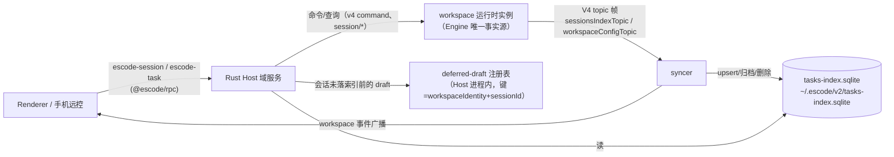

# u2-5 会话与任务域（`escode-session` 写面 + `escode-task` + tasks-index）子 spec

> 父计划：`rust-unified-host.md` 阶段 2「服务移植优先序 5：sessions + tasks + tasks_index」。
> 上游：`rust-u2-host-skeleton.md`（u2a 骨架/RPC 面/dev 开关、`file` 与 `system` 域已落地）。
> 定位：本文件先定**边界与所有者**，再按切片实施；每片自带验收，可独立回退。

## 1. 范围

**做**（Renderer/手机远控经 `escode-session`、`escode-task` 两个 channel 可见的全部行为）：

- `escode-session` 写面补全：`createSession`、`resumeSession`、`closeDeferredDraftSession`、`promoteDeferredDraftSession`；
- `escode-task` 全量方法（上表 50 个，按切片分批）；
- Host 侧 **tasks-index** 存储（与 TS 同文件、同 DDL、同迁移），以及驱动它写入的 **syncer**。

**暂不做**（登记原因，各自独立立项）：

- `automations` / `off_peak_tasks` 两张表的**调度**（属优先序 8 automation 域；本域只保证同库同 schema 不互斥）；
- 任务标题的模型生成（`rust-session-title.md` 已在 CLI 侧实现，Host 复用运行时结果，不再实现一遍）；
- Claude 历史导入（`scanImportableClaudeSessions` / `importClaudeSessions`）：依赖 `~/.claude` 扫描与导入事务，属独立工作包；
- `provider runtime headers`（`respondProviderRuntimeHeaders`）：属 providers/account 域（优先序 6）。

## 2. 所有者与数据流

**唯一事实源**：会话状态（phase/消息/权限/队列）归运行时实例（CLI 侧 Engine）。tasks-index 只是它的**投影**，Host 是投影的唯一写者。Renderer 不写索引。

不变式：

1. **单写者**：tasks-index 只由 Host 的 syncer 与 `escode-task` 写；运行时与 TS Main 都不直接写（TS Main 只经 TS Host 的服务）。
2. **投影可重放**：索引行可由「运行时 topic 帧 + 会话快照」重建；出现分歧时以运行时为准（`repairSubagentTaskIndex` 同类修复路径在 Rust 侧同样保留）。
3. **draft 不入索引**：`persistence: "deferred"` 的会话只在 Host 内存注册表与运行时存在，首次 `sendPrompt` 后才落索引（与 TS 同语义：空会话不进侧边栏）。
4. **广播与写同源**：写索引与向 Renderer 广播 workspace 事件在同一处发生（避免"索引写了但 UI 不刷新"或反之）。

## 3. 存储契约（与 TS 互操作）

| 项 | 约定 |
| --- | --- |
| 路径 | `join(getAppConfigDir(), "tasks-index.sqlite")` = `<dataBaseDir>/.escode/v2/tasks-index.sqlite`（dataBaseDir 由 Main 经 `rpcListen` 提交，见 u2 骨架 §6） |
| 表 | `tasks`、`task_groups`、`task_group_members`、`task_group_view_node_orders`、`task_group_workspace_bootstraps`、`automations`、`automation_runs`、`off_peak_tasks`、`tasks_schema_migration` |
| 打开参数 | `PRAGMA busy_timeout = 25`、`PRAGMA foreign_keys = ON`（与 TS `prepareTasksIndexStorage` 同）；迁移/维护期间的取锁等待上限 1h，且**分阶段上报**（`checking`/`waiting_for_lock`/`migrating`/`maintaining`/`committing`/`ready`，映射到 `startup/tasksState` 事件） |
| DDL | 复用 TS 的 `TASK_INDEX_SCHEMA` 文本（`schema-v1.ts`）+ 迁移 `0001_adopt_task_schema`/`0002_provider_selection`/`0003_official_glm_selection`；Rust 侧以 `include_str!` 引入同一份 DDL 文本并加 **checksum 哨兵**（对照质量报告 §4：`rust_*`/`dwf_*` DDL 无机器校验的欠账，本域不允许重演） |
| 迁移对照 | 启动时读 `tasks_schema_migration` 已应用 id 集合；Rust 只允许**前向补齐**，遇到未知（更新版 TS 写的）id 就拒绝写入并回报结构化错误，不猜 |
| 并发 | 与 TS Host 交替运行时靠 SQLite 锁 + busy_timeout；本域不引入第二套锁（`host/file_lock.rs` 是文件锁，语义不同，不混用） |

## 4. 接口映射

| 方法族 | 实现来源 |
| --- | --- |
| `createTask` / `closeTask` / `resumeTask` / `listTasks` / `getTaskMeta` / `getTaskSnapshot*` / `setMode` / `setModel` / `setConfigOption` / `sendPrompt` / `stopGeneration` / `compactSession` / `goalSession` / `respondPermission` / `respondElicitation` / 队列类（`enqueueTaskCommand`/`promoteTaskCommand`/`cancelTaskCommand`） | 运行时转发（`session/*`、`v4/command`、`session/messages`）+ 索引 upsert |
| `listTaskList` / `listPinnedTasks` / `listArchivedTasks` / `listDeletedTaskIds` / `listGroupedTaskViewStructure` / `applyGroupedTaskViewOrder` / 分组四法 | 索引读/写（纯 SQL，不需要运行时） |
| `archiveStaleTasks` / `archiveWorkspaceTasks` | 索引写（批更新 + 广播） |
| `getTaskSnapshotBody` / `getTaskSnapshotToolCallsSlice` / `getTaskSnapshotRef` | 运行时读（快照已在运行时侧分页；Host 只转发 + ETag 透传） |
| `switchAgent` / `syncTaskSessionBinding` | 运行时写 + 索引列更新（`provider`/`model`/`migration_source`） |
| `getWorkspaceProviderConfigFile` / `getTaskNativeSessionLogFile` | 文件域读（路径由 providers/account 域配置提供，未迁移前回显式缺口） |

## 5. `createSession` / `resumeSession` 的 Host 侧职责

TS 里这两个方法在服务层做了四件事，Rust Host 必须逐条对齐（参数整形与顺序是可见行为）：

1. **参数整形**（`buildSessionCreateParams` 同序）：可选字段缺省即**省略**（运行时 strict 拒绝 null）；`offPeakToolEnabled`/`dynamicWorkflowEnabled`/`dynamicWorkflowMode` 只在灰度命中时下发 `true`，关闭时不写字段；`mcpServers`/`toolAllowlist`/`toolDenylist`/`importedHistory` 的省略规则不同（`importedHistory` 是完整性边界，**不参与兼容重试省略**）；`persistence: "deferred"` 原样透传。
2. **调用运行时**：`session/create`（resume 为 `session/resume`），带 `traceId`；旧运行时对未知字段的兼容重试（compat 字段逐个省略后重试）在 Rust 侧以同一字段名集合实现。
3. **落索引与广播**（非 deferred）：syncer 先 `ensure` 该 workspace/session 的订阅 → 索引 upsert（`moveGroupedTaskToTop` 语义）→ 广播 `task_meta_changed`（保持 TS 的既有广播 reason，不擅自语义化）。
4. **deferred**：写入 Host 进程内 draft 注册表（`workspaceIdentity + sessionId` → 快照引用）；此后该会话的 `setModel`/`setConfigOption` 等状态变更必须**被挡在索引之外**，直到首次 `sendPrompt`（`promoteDeferredDraftSession` 显式提升，`closeDeferredDraftSession` 丢弃）。

`resumeSession` 追加：恢复历史后按 task 记录重放思考强度/模型（TS 在同一处做，含"运行时不支持则跳过"的分支）。

## 6. 切片（每片独立可验收）

| 片 | 内容 | 验收 |
| --- | --- | --- |
| S1 索引只读 | tasks-index 打开/对账 + `getTaskMeta` + 列表类读（`listTaskList`、`listPinnedTasks`、`listArchivedTasks`、`listGroupedTaskViewStructure`） | 与 TS 服务在**同一 DB 文件**上逐字段比对（TS 写入 → Rust 读）；DDL checksum 与迁移 id 集合断言；未知迁移 id 拒绝写入 |
| S2 createSession + syncer | `createTask`/`createSession` 参数整形 → 运行时 → 索引 upsert → 广播；V4 topic 帧摄入（`sessionsIndexTopic`/`workspaceConfigTopic`） | 真机：创建会话后侧边栏出现且 `tasks` 行字段逐列正确；运行时帧驱动的后续状态变更（running/completed/标题）同步到索引；索引与运行时不一致时可修复 |
| S3 写面补全 | `closeTask`/`resumeTask`/`archive*`/`delete`/`pin`/分组读写/`switchAgent`/`syncTaskSessionBinding`、`escode-session` 的 deferred 两法 + `createSession`/`resumeSession` | 与 TS 行为逐方法比对（同 DB、同输入）；deferred 会话不进索引（负向断言） |
| S4 快照与命令面 | `getTaskSnapshot*`、`sendPrompt`、队列三法、`stopGeneration`、`compactSession`、`goalSession`、权限/追问应答 | 端到端：从 Renderer 发起一轮对话（含队列、停止、权限应答）走通 Rust Host |

## 6.1 进度

**S1 存储层已落地（2026-10-15）**：

- 生成器 `scripts/generate-escode-host-tasks-schema.mjs`：以真实 TS `prepareTasksIndexStorage` 在临时库跑完迁移为**行为提取**，产出期望账本（id+checksum）与迁移后物理 DDL + 两个 sha256；`--check` 已接入 `pnpm check:escode-host`。
- `host-services/src/tasks_index`：打开既有库（`busy_timeout=25`、`foreign_keys=ON`）、**账本三分类对账**（缺失/多出/checksum 不符一律结构化拒绝，不建库不半迁移）、生成资产自校验（`#[rustfmt::skip]` 保证生成文本与格式化无关）、`getTaskMeta` 同序投影（meta 优先 + 标量列覆盖 + cron/off-peak 兜底 + identity 三规则 + 非法 meta 回退）。
- 测试：host-services 16 例（含负向：缺一条迁移/多出未知迁移/checksum 不符/文件缺失不建库）。
- **登记差异**：`meta_json` 校验只覆盖「必填 + 已声明字段的类型/枚举」（不复制 zod 的深层对象校验），差异只在损坏行上可见（TS 走列回退、Rust 走 meta 投影）；`S2` 落地时以差分语料补齐深层校验。

**S1 通道接线已落地（2026-10-15）**：

- `host-rpc/src/domains_task.rs`：`escode-task` channel 接 `getTaskMeta`（懒打开索引、失败不缓存；
  `dataBaseDir` 缺省时空缺省缺口；错误按 JS Error 形状下发，结构化 code 落 `name`）。
  其余方法由 `respond` 回显式缺口并列出已实现集合；清单登记 1 条 `Implemented` + 12 条 `Pending`
  （`createTask`/`sendPrompt`/… 首批待迁移），契约对账 `RPC_CHANNELS` 同步加 `escode-task`。
- 验证：`tests/rpc_task.rs` 2 例（真实 WS 端到端：读数、缺失回无值、未迁移方法缺口、
  索引不存在时 `TasksIndexUnavailable` 结构错误）+ **真实 TS Repo 差分**（`rustHostRpc.test.ts`：
  TS `prepareTasksIndexStorage` 建库、`TaskIndexRepo.seedTaskMetaIfMissing` 写最小/完整两条，
  Rust Host 经真实客户端读回与 TS `getTaskMeta` `toEqual` 全等；负向验证：改错期望即失败）。

**S1 列表分区已落地（2026-10-15）**：`listTasks` / `listPinnedTaskIds` / `listPinnedTasks` /
`listDeletedTaskIds` / `listArchivedTasks` 接真实索引读，过滤组合与排序逐条对齐 TS 适配器
（provider=glm；`listArchivedTasks` 不过滤 pinned——TS 同；`listPinnedTaskIds` 返回 id 数组
而非 meta；`ORDER BY updated_at DESC, created_at DESC, task_id DESC`）。存储层新增
`list_task_metas(TaskFilters)` / `list_deleted_task_ids`，行投影抽成复用函数。
验证：Rust 单测（7 种 provider/pinned/archived/deleted 组合的过滤与顺序、缺 dataBaseDir
时六个读方法全部显式缺口）+ **真实 Repo 差分**（同一份 SQL 组合 `toEqual` 全等；负向验证：
把 archived 那组改成带 pinned 过滤立即失败）。CLI 侧新增泛型阻塞桥
`spawn_blocking_io`（原 `blocking` 硬编码 channel 结果类型）。

**S1 查询面已落地（2026-10-15）**：`listTaskList`（`queryTaskList` 同构——多 workspace 聚合、
kind 四分区、provider=glm、`LOWER(title) LIKE` 或 `LOWER(searchable_text) LIKE` 命中、
`sortBy` 二序、`normalizeLimit` 语义、`{items,total,hasMore}`、`workspacePurpose` 叠加）
与 `listGroupedTaskViewStructure`（group 的 bootstrap 可见性过滤 + **全量成员** + 顶层排序
`node_key` JSON 解析，脏键跳过）。搜索摘要 `buildSearchSnippets` 逐条对齐：窗口半径 20/72、
上限 4 条、近重叠合并、`\s+`→空格截 140、标题命中回退整段；索引口径为 **UTF-16 码元**
（JS `slice`/`indexOf` 语义，代理对不再分叉）。

代码组织：`tasks_index/query.rs`（列表查询）、`query_grouped.rs`、`query_snippets.rs`、
`query_shared.rs`；channel 侧 `domains_task_query.rs` 独立成文件（400 行边界）。

验证：Rust 单测（timeline/pinned/archived 分区、搜索命中附摘要、limit 的 total/hasMore、
空 scopes 快返回、分组结构含成员与两类顶层排序）+ **真实 Repo 差分**（8 组 `listTaskList`
查询 + 分组结构 `toEqual` 全等，含星平面字符与多命中摘要；负向验证：把 kind 换掉立即失败）。

**登记差异（新增）**：搜索词大小写折叠用 Rust `to_lowercase`（Unicode 默认映射），TS 用
`toLocaleLowerCase()`（默认 locale）；只有在土耳其语/立陶宛语等特殊 case mapping 且
locale 命中时才可见（SQL 侧 `LOWER()` 两端口径一致，为 ASCII-only）。

下一步（S1 剩余）：`getTaskSnapshot*` 系列（运行时快照分页转发）与 ES 侧的
`task_groups` 写面（属 S3）。

## 7. 验收与环境

- **双 Host 交替写读演练**（父计划验收项）：TS Host 与 Rust Host 交替对同一 `tasks-index.sqlite` 建/改/归档任务，逐字段比对（复用 `scripts/test-escode-host-interop.mjs` 的形态，新增 tasks-index 用例）；
- **进程表断言**：Rust Host 下无 Node utility / CLI 残留（沿用 u2a 的进程表检查）；
- **重启与崩溃**：Host 被杀后重启，索引仍与运行时一致（syncer 重放）；
- 所有测试固定 Clock/UUID/realpath/SHELL（沿用 u1 的确定性约定），时间列用注入时钟。

## 8. 风险

1. **投影延迟**：索引依赖 topic 帧与快照，断流窗口内索引落后于运行时。缓解：以运行时为准的读路径优先（快照类方法直接转发），索引只承担列表/搜索；重连后补帧重放。
2. **DDL 漂移**：TS 侧新增迁移时 Rust 必须补齐。缓解：checksum 哨兵 + 迁移 id 集合断言（CI 失败而非静默）。
3. **并发写**：两侧同时写同一 DB 靠 SQLite 锁；`busy_timeout` 很小（25ms），需要写重试与结构化错误（不静默丢写）。
4. **TS 服务层未来改动**：本 spec 以当前检出的 TS 源码为基线（文件行号见各片实现注释）；TS 侧再改动需同步更新本文件与差分语料。
