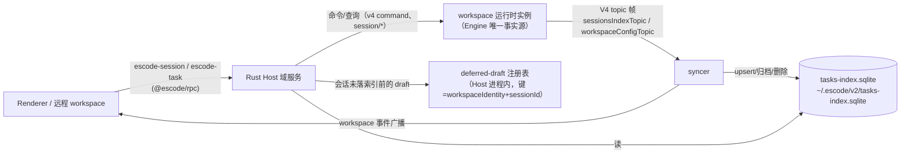
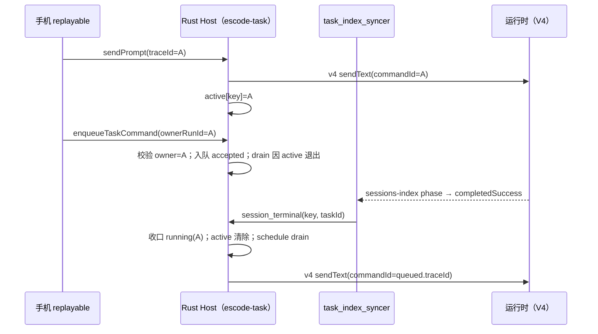

# u2-5 会话与任务域（`escode-session` 写面 + `escode-task` + tasks-index）子 spec

> 父计划：`rust-unified-host.md` 阶段 2「服务移植优先序 5：sessions + tasks + tasks_index」。
> 上游：`rust-u2-host-skeleton.md`（u2a 骨架/RPC 面/dev 开关、`file` 与 `system` 域已落地）。
> 定位：本文件先定**边界与所有者**，再按切片实施；每片自带验收，可独立回退。
>
> 2026-10-20：off-peak / 闲时任务功能已整体删除。本文中 `off_peak_tasks`、`offPeakTaskId`、
> `offPeakToolEnabled`、`offPeakRunType` 等描述均为历史实现记录；当前 schema 已由迁移
> `0004_drop_off_peak` 清理，服务面不再包含 off-peak 通道。

## 1. 范围

**做**（Renderer/远程 workspace 经 `escode-session`、`escode-task` 两个 channel 可见的全部行为）：

- `escode-session` 写面补全：`createSession`、`resumeSession`、`closeDeferredDraftSession`、`promoteDeferredDraftSession`；
- `escode-task` 全量方法（S1–S12 已 76/76 收口）；
- Host 侧 **tasks-index** 存储（与 TS 同文件、同 DDL、同迁移），以及驱动它写入的 **syncer**。

**暂不做**（登记原因，各自独立立项）：

- `automations` / `off_peak_tasks` 两张表的**调度**（属优先序 8 automation 域；本域只保证同库同 schema 不互斥）；
- 任务标题的模型生成（`rust-session-title.md` 已在 CLI 侧实现，Host 复用运行时结果，不再实现一遍）；
- `provider runtime headers`（`respondProviderRuntimeHeaders`）：属 providers/account 域（优先序 6）。

## 2. 所有者与数据流

**唯一事实源**：会话状态（phase/消息/权限/队列）归运行时实例（CLI 侧 Engine）。tasks-index 只是它的**投影**，Host 是投影的唯一写者。Renderer 不写索引。

不变式：

1. **单写者**：tasks-index 只由 Host 的 syncer 与 `escode-task` 写；运行时与 TS Main 都不直接写（TS Main 只经 TS Host 的服务）。
2. **投影可重放**：索引行可由「运行时 topic 帧 + 会话快照」重建；出现分歧时以运行时为准（`repairSubagentTaskIndex` 同类修复路径在 Rust 侧同样保留）。
3. **draft 不入索引**：`persistence: "deferred"` 的会话只在 Host 内存注册表与运行时存在，首次 `sendPrompt` 后才落索引（与 TS 同语义：空会话不进侧边栏）。
4. **广播与写同源**：写索引与向 Renderer 广播 workspace 事件在同一处发生（避免"索引写了但 UI 不刷新"或反之）。

## 3. 存储契约（与 TS 互操作）

| 项       | 约定                                                                                                                                                                                                                                                                                                                                       |
| -------- | ------------------------------------------------------------------------------------------------------------------------------------------------------------------------------------------------------------------------------------------------------------------------------------------------------------------------------------------ |
| 路径     | `join(getAppConfigDir(), "tasks-index.sqlite")` = `<dataBaseDir>/.escode/v2/tasks-index.sqlite`（dataBaseDir 由 Main 经 `rpcListen` 提交，见 u2 骨架 §6）                                                                                                                                                                                  |
| 表       | `tasks`、`task_groups`、`task_group_members`、`task_group_view_node_orders`、`task_group_workspace_bootstraps`、`automations`、`automation_runs`、`off_peak_tasks`、`tasks_schema_migration`                                                                                                                                               |
| 打开参数 | `PRAGMA busy_timeout = 5000`、`PRAGMA foreign_keys = ON`（Host 是长连接，与 TS `TaskIndexRepo` 的 5000ms 同；`prepareTasksIndexStorage` 的 25ms 只用于一次性启动准备）；迁移/维护期间的取锁等待上限 1h，且**分阶段上报**（`checking`/`waiting_for_lock`/`migrating`/`maintaining`/`committing`/`ready`，映射到 `startup/tasksState` 事件） |
| DDL      | 复用 TS 的 `TASK_INDEX_SCHEMA` 文本（`schema-v1.ts`）+ 迁移 `0001_adopt_task_schema`/`0002_provider_selection`/`0003_official_glm_selection`；Rust 侧以 `include_str!` 引入同一份 DDL 文本并加 **checksum 哨兵**（对照质量报告 §4：`rust_*`/`dwf_*` DDL 无机器校验的欠账，本域不允许重演）                                                 |
| 迁移对照 | 启动时读 `tasks_schema_migration` 已应用 id 集合；Rust 只允许**前向补齐**，遇到未知（更新版 TS 写的）id 就拒绝写入并回报结构化错误，不猜                                                                                                                                                                                                   |
| 并发     | 与 TS Host 交替运行时靠 SQLite 锁 + busy_timeout；本域不引入第二套锁（`host/file_lock.rs` 是文件锁，语义不同，不混用）                                                                                                                                                                                                                     |

## 4. 接口映射

| 方法族                                                                                                                                                                                                                                                                                                                                | 实现来源                                                                 |
| ------------------------------------------------------------------------------------------------------------------------------------------------------------------------------------------------------------------------------------------------------------------------------------------------------------------------------------- | ------------------------------------------------------------------------ |
| `createTask` / `closeTask` / `resumeTask` / `listTasks` / `getTaskMeta` / `getTaskSnapshot*` / `setMode` / `setModel` / `setConfigOption` / `sendPrompt` / `stopGeneration` / `compactSession` / `goalSession` / `respondPermission` / `respondElicitation` / 队列类（`enqueueTaskCommand`/`promoteTaskCommand`/`cancelTaskCommand`） | 运行时转发（`session/*`、`v4/command`、`session/messages`）+ 索引 upsert |
| `listTaskList` / `listPinnedTasks` / `listArchivedTasks` / `listDeletedTaskIds` / `listGroupedTaskViewStructure` / `applyGroupedTaskViewOrder` / 分组四法                                                                                                                                                                             | 索引读/写（纯 SQL，不需要运行时）                                        |
| `archiveStaleTasks` / `archiveWorkspaceTasks`                                                                                                                                                                                                                                                                                         | 索引写（批更新 + 广播）                                                  |
| `getTaskSnapshotBody` / `getTaskSnapshotToolCallsSlice` / `getTaskSnapshotRef`                                                                                                                                                                                                                                                        | 运行时读（快照已在运行时侧分页；Host 只转发 + ETag 透传）                |
| `switchAgent` / `syncTaskSessionBinding`                                                                                                                                                                                                                                                                                              | 运行时写 + 索引列更新（`provider`/`model`/`migration_source`）           |
| `getWorkspaceProviderConfigFile` / `getTaskNativeSessionLogFile`                                                                                                                                                                                                                                                                      | 文件域读（路径由 providers/account 域配置提供，未迁移前回显式缺口）      |

## 5. `createSession` / `resumeSession` 的 Host 侧职责

TS 里这两个方法在服务层做了四件事，Rust Host 必须逐条对齐（参数整形与顺序是可见行为）：

1. **参数整形**（`buildSessionCreateParams` 同序）：可选字段缺省即**省略**（运行时 strict 拒绝 null）；`offPeakToolEnabled`/`dynamicWorkflowEnabled`/`dynamicWorkflowMode` 只在灰度命中时下发 `true`，关闭时不写字段；`mcpServers`/`toolAllowlist`/`toolDenylist`/`importedHistory` 的省略规则不同（`importedHistory` 是完整性边界，**不参与兼容重试省略**）；`persistence: "deferred"` 原样透传。
2. **调用运行时**：`session/create`（resume 为 `session/resume`），带 `traceId`；旧运行时对未知字段的兼容重试（compat 字段逐个省略后重试）在 Rust 侧以同一字段名集合实现。
3. **落索引与广播**（非 deferred）：syncer 先 `ensure` 该 workspace/session 的订阅 → 索引 upsert（`moveGroupedTaskToTop` 语义）→ 广播 `task_meta_changed`（保持 TS 的既有广播 reason，不擅自语义化）。
4. **deferred**：写入 Host 进程内 draft 注册表（`workspaceIdentity + sessionId` → 快照引用）；此后该会话的 `setModel`/`setConfigOption` 等状态变更必须**被挡在索引之外**，直到首次 `sendPrompt`（`promoteDeferredDraftSession` 显式提升，`closeDeferredDraftSession` 丢弃）。

`resumeSession` 追加：恢复历史后按 task 记录重放思考强度/模型（TS 在同一处做，含"运行时不支持则跳过"的分支）。

## 6. 切片（每片独立可验收）

| 片                        | 内容                                                                                                                                                                    | 验收                                                                                                                                            |
| ------------------------- | ----------------------------------------------------------------------------------------------------------------------------------------------------------------------- | ----------------------------------------------------------------------------------------------------------------------------------------------- |
| S1 索引只读               | tasks-index 打开/对账 + `getTaskMeta` + 列表类读（`listTaskList`、`listPinnedTasks`、`listArchivedTasks`、`listGroupedTaskViewStructure`）                              | 与 TS 服务在**同一 DB 文件**上逐字段比对（TS 写入 → Rust 读）；DDL checksum 与迁移 id 集合断言；未知迁移 id 拒绝写入                            |
| S2 createSession + syncer | `createTask`/`createSession` 参数整形 → 运行时 → 索引 upsert → 广播；V4 topic 帧摄入（`sessionsIndexTopic`/`workspaceConfigTopic`）                                     | 真机：创建会话后侧边栏出现且 `tasks` 行字段逐列正确；运行时帧驱动的后续状态变更（running/completed/标题）同步到索引；索引与运行时不一致时可修复 |
| S3 写面补全               | `closeTask`/`resumeTask`/`archive*`/`delete`/`pin`/分组读写/`switchAgent`/`syncTaskSessionBinding`、`escode-session` 的 deferred 两法 + `createSession`/`resumeSession` | 与 TS 行为逐方法比对（同 DB、同输入）；deferred 会话不进索引（负向断言）                                                                        |
| S4 快照与命令面           | `getTaskSnapshot*`、`sendPrompt`、队列三法、`stopGeneration`、`compactSession`、`goalSession`、权限/追问应答                                                            | 端到端：从 Renderer 发起一轮对话（含队列、停止、权限应答）走通 Rust Host                                                                        |

## 6.1 进度

**S1 存储层已落地（2026-10-15）**：

- 生成器 `scripts/generate-escode-host-tasks-schema.mjs`：以真实 TS `prepareTasksIndexStorage` 在临时库跑完迁移为**行为提取**，产出期望账本（id+checksum）与迁移后物理 DDL + 两个 sha256；`--check` 已接入 `pnpm check:escode-host`。
- `host-services/src/tasks_index`：打开既有库（`busy_timeout=5000`、`foreign_keys=ON`）、**账本三分类对账**（缺失/多出/checksum 不符一律结构化拒绝，不建库不半迁移）、生成资产自校验（`#[rustfmt::skip]` 保证生成文本与格式化无关）、`getTaskMeta` 同序投影（meta 优先 + 标量列覆盖 + cron/off-peak 兜底 + identity 三规则 + 非法 meta 回退）。
- 测试：host-services 16 例（含负向：缺一条迁移/多出未知迁移/checksum 不符/文件缺失不建库）。
- **登记差异**：`meta_json` 校验只覆盖「必填 + 已声明字段的类型/枚举」（不复制 zod 的深层对象校验），差异只在损坏行上可见（TS 走列回退、Rust 走 meta 投影）；`S2` 落地时以差分语料补齐深层校验。

**S1 通道接线已落地（2026-10-15）**：

- `host-rpc/src/domains_task.rs`：`escode-task` channel 接 `getTaskMeta`（懒打开索引、失败不缓存；
  `dataBaseDir` 缺省时空缺省缺口；错误按 JS Error 形状下发，结构化 code 落 `name`）。
  其余方法由 `respond` 回显式缺口并列出已实现集合；清单登记 1 条 `Implemented` + 12 条 `Pending`
  （`createTask`/`sendPrompt`/… 首批待迁移），契约对账 `RPC_CHANNELS` 同步加 `escode-task`。
- 验证：`tests/rpc_task.rs` 2 例（真实 WS 端到端：读数、缺失回无值、未迁移方法缺口、
  索引不存在时 `TasksIndexUnavailable` 结构错误）+ **真实 TS Repo 差分**（`rustHostRpc.test.ts`：
  TS `prepareTasksIndexStorage` 建库、`TaskIndexRepo.seedTaskMetaIfMissing` 写最小/完整两条，
  Rust Host 经真实客户端读回与 TS `getTaskMeta` `toEqual` 全等；负向验证：改错期望即失败）。

**S1 列表分区已落地（2026-10-15）**：`listTasks` / `listPinnedTaskIds` / `listPinnedTasks` /
`listDeletedTaskIds` / `listArchivedTasks` 接真实索引读，过滤组合与排序逐条对齐 TS 适配器
（provider=glm；`listArchivedTasks` 不过滤 pinned——TS 同；`listPinnedTaskIds` 返回 id 数组
而非 meta；`ORDER BY updated_at DESC, created_at DESC, task_id DESC`）。存储层新增
`list_task_metas(TaskFilters)` / `list_deleted_task_ids`，行投影抽成复用函数。
验证：Rust 单测（7 种 provider/pinned/archived/deleted 组合的过滤与顺序、缺 dataBaseDir
时六个读方法全部显式缺口）+ **真实 Repo 差分**（同一份 SQL 组合 `toEqual` 全等；负向验证：
把 archived 那组改成带 pinned 过滤立即失败）。CLI 侧新增泛型阻塞桥
`spawn_blocking_io`（原 `blocking` 硬编码 channel 结果类型）。

**S1 查询面已落地（2026-10-15）**：`listTaskList`（`queryTaskList` 同构——多 workspace 聚合、
kind 四分区、provider=glm、`LOWER(title) LIKE` 或 `LOWER(searchable_text) LIKE` 命中、
`sortBy` 二序、`normalizeLimit` 语义、`{items,total,hasMore}`、`workspacePurpose` 叠加）
与 `listGroupedTaskViewStructure`（group 的 bootstrap 可见性过滤 + **全量成员** + 顶层排序
`node_key` JSON 解析，脏键跳过）。搜索摘要 `buildSearchSnippets` 逐条对齐：窗口半径 20/72、
上限 4 条、近重叠合并、`\s+`→空格截 140、标题命中回退整段；索引口径为 **UTF-16 码元**
（JS `slice`/`indexOf` 语义，代理对不再分叉）。

代码组织：`tasks_index/query.rs`（列表查询）、`query_grouped.rs`、`query_snippets.rs`、
`query_shared.rs`；channel 侧 `domains_task_query.rs` 独立成文件（400 行边界）。

验证：Rust 单测（timeline/pinned/archived 分区、搜索命中附摘要、limit 的 total/hasMore、
空 scopes 快返回、分组结构含成员与两类顶层排序）+ **真实 Repo 差分**（8 组 `listTaskList`
查询 + 分组结构 `toEqual` 全等，含星平面字符与多命中摘要；负向验证：把 kind 换掉立即失败）。

**登记差异（新增）**：搜索词大小写折叠用 Rust `to_lowercase`（Unicode 默认映射），TS 用
`toLocaleLowerCase()`（默认 locale）；只有在土耳其语/立陶宛语等特殊 case mapping 且
locale 命中时才可见（SQL 侧 `LOWER()` 两端口径一致，为 ASCII-only）。

下一步（S1 剩余）：`getTaskSnapshot*` 系列（运行时快照分页转发）与 ES 侧的
`task_groups` 写面（属 S3）。

## 6.2 S2 写层（存储）已落地（2026-10-15）

`tasks_index` 增加写路径（TS `writeRecord` / `seedTaskMetaIfMissing` / `syncTaskMeta` 同构），
合并规则逐条对齐（这些规则决定列表顺序与状态显示，不能简化）：

- `updated_at` 取 `max(入库, 已有)`（快照可能落后于 agent patch 写入的时间戳）；
- 终态（completed/error）不被更旧的 running 快照降级（`shouldPreserveNewerTerminalStatus`）；
- 用户手动标题（`title_overridden`）不被 agent 标题覆盖；
- `migrationSource`/`cronAutomationId`/`offPeakTaskId`/`unreadAt` 缺省保留既有值；
- `pinned`/`archived`/`deleted` 缺省沿用既有行；`searchable_text` 只在显式传入时更新
  （否则保留已索引正文，避免被后续无正文写入清空）；
- `unread_at` 只在 unread 专属写路径覆盖（CAS marker），`last_unread_at` 取历史最大值。

验证：Rust 单测 21 例（seed 幂等与不覆盖、合并规则四组断言、unread CAS 的列级断言）。
**说明**：本片只落存储层，**没有任何 RPC 方法暴露写**（单写者不变式未变）；TS↔Rust 的
双向写读对账（`双 Host 交替写读`）随 S2b 的 `createTask` 一起做——那时才存在可对账的
服务级写入口。

## 6.3 任务目标注册表 + `getTaskModelSelection`（2026-10-15）

`{taskId}` 单参方法需要把 taskId 解析回 workspace，TS 靠进程内 `taskTargets` 注册表。
本轮落地：

- `task_targets.rs`：两条写入路径**语义不同、不能合并**——`remember`（`rememberTaskTarget`，
  缺省**保留**既有 cronAutomationId）与 `remember_indexed_meta`（索引 meta 为权威，可清空 cron）；
  未命中报 `ESCODE_SESSION_TARGET_NOT_FOUND`（同 code 同文案）。
- 已把注册表接进**既有的读路径**（TS 同样在这里登记）：`getTaskMeta`、四个列表分区、
  `listTaskList`，逐条 `rememberIndexedTaskMeta`。此前这些路径没有登记，属已交付代码的语义缺口，
  本轮补齐。
- `getTaskModelSelection`：注册表解析目标 → 运行时 `session/read` → 回 `settings.model.current`
  （TS 同序；缺值时回 `undefined`，TS 回 `null`）。task channel 因此拿到与 session 域同一套
  `Instances`/`OptionsFactory`（同一 workspace 只会有一个实例）。

验证：host 101 passed / 0 failed（新增目标注册表 4 例：cron 保留 vs 权威覆盖、typed error、
meta 行登记；端到端 2 例：未注册任务的 typed error、列表读登记后调用被路由到运行时会话读并
透传运行时的语义错误）。`pnpm check:escode-host` 全绿。

**下一步**：`getTaskSnapshot`（resume + snapshot→meta 投影 + 索引写）与 `getTaskConfigOptions`
（`settingsToConfigOptions` 投影）——两者的前置件（注册表/写入层/运行时转发）本片已就位。

## 6.4 S2b 快照读面（`getTaskSnapshot*` / `getTaskConfigOptions`，2026-10-15）

### 6.4.1 范围与所有者

- **做**：`escode-task.getTaskSnapshot` / `getTaskSnapshotWithEtag` / `getTaskSnapshotBody` /
  `getTaskSnapshotRef` / `getTaskSnapshotToolCallsSlice` / `getTaskConfigOptions` 六个方法，
  以及它们依赖的服务层投影（agent 协议快照 → `ESCodeTaskSnapshot`）。
- **投影所有者**：Host。运行时只给**agent 协议快照**（`session/resume` 与 `session/read` 同形，
  键 `messages/projection/protocol/runtime/session/settings/slashCommands/todos`）；任务索引的
  投影与写入都由 Host 做（TS 同构：`escodeTaskServiceAdapter.ts` 的 `snapshotToESCode`/`snapshotToMeta`）。
- **draft 语义**：本片不引入 draft 注册表（属 S3 `createSession`）；快照读面只读已存在的会话。

### 6.4.2 接口（逐条对齐 TS 适配器）

| 方法                                             | 行为                                                                                                                                                                   |
| ------------------------------------------------ | ---------------------------------------------------------------------------------------------------------------------------------------------------------------------- |
| `getTaskSnapshot(params)`                        | 注册表登记目标 → `session/resume` → `snapshotToESCode` → `limitTaskSnapshotMessages` → `syncTaskMeta`（索引投影 + 用户手动标题保留）→ 回 `{...snapshot, meta: 索引行}` |
| `getTaskSnapshotWithEtag(params)`                | 同上，另算 `sha256(JSON.stringify(snapshot))`；`ifNoneMatch` 命中回 `{snapshot:null, etag, notModified:true}`                                                          |
| `getTaskSnapshotBody` / `Ref` / `ToolCallsSlice` | TS 适配器本身返回 `null`（不在该 Host 实现），Rust 照抄该语义                                                                                                          |
| `getTaskConfigOptions(params)`                   | 注册表解析 → 运行时 `session/read` → `settingsToConfigOptions(settings)`                                                                                               |

`session/resume` 参数整形（与 `buildSessionResumeParams` 同序）：`{sessionId, workspace}` +
可选 `thoughtLevel` / `mcpServers` / `toolAllowlist` / `toolDenylist`；缺省一律**省略**（运行时严格拒绝 null）。
`model` 不随 resume 下发（TS 的 `buildSessionResumeParams` 同样不带它）。

### 6.4.3 验收

1. **TS oracle 差分（生成器 + 逐字段全等）**：`scripts/generate-escode-host-task-projection-fixtures.mjs`
   用**真实 TS 适配器**（`createESCodeTaskServiceAdapter` + 假 `escodeAgentService.resumeSession` 回放
   固定快照 + 真实 `TaskIndexRepo`）跑出 `getTaskSnapshot` / `getTaskSnapshotWithEtag` /
   `getTaskConfigOptions` 的期望 JSON，Rust 单测逐字段 `assert_eq`；生成器 `--check` 进 `pnpm check:escode-host`。
   夹具覆盖：多轮 user/assistant 文本、reasoning、工具调用（completed/error/running）、compact
   summary、model-only synthetic user、goal 续跑提醒与迭代号、附件（image）、syntheticTimeline
   （fork/compaction）、todos/todoGroups/goalStats、pendingPermissions（含 user-input-backed →
   elicitation）、后台任务控制项、`messageLimit` 截窗与 `history.truncatedBefore`、`lastError` 分支。
   四个变体：`desktop`（无截窗）/ `limited`（`messageLimit=2`）/ `replayable`（索引 hint 回填 +
   空 elicitation 语义）/ `errorSnapshot`（`lastError` → `status=error` + attribution 对象透传）。
2. **通道接线（真 embedded 实例 + 真 WebSocket）**：`crates/host-rpc/tests/rpc_task_snapshot.rs`——
   会话不存在时 `getTaskSnapshot` / `WithEtag` / `getTaskConfigOptions` 都把运行时的
   `Session unavailable` 原样透出（证明请求真的走 `session/resume`，不是缺口回显或索引短路）；
   `getTaskSnapshotBody` / `Ref` / `ToolCallsSlice` 本地直回 `null`；缺参回 `InvalidRequest`；
   缺 `dataBaseDir` 时六个方法全部回显式缺口。
3. **端到端（真会话链路，2026-10-15 由 §6.5 补上）**：`rpc_session_create.rs` 用 Host 的
   `escode-session.createSession` 建真会话（真 embedded 实例 + 真模型配置夹具），再读回
   `getTaskMeta` / `getTaskSnapshot` / `getTaskSnapshotWithEtag`，并负向断言 deferred 草稿不进索引。
   仍待补：`packages/desktop/test/rustHostRpc.test.ts` 的真实客户端用例与
   `ifNoneMatch` **命中**分支（快照含随机 traceId，命中需要稳定 traceId，见 §6.4.4-4）。

### 6.4.4 登记差异（本片）

1. **grayscale 工具面 flag**：TS `resumeSession` 会在门禁命中时下发 `offPeakToolEnabled` /
   `dynamicWorkflowEnabled`（服务端灰度，Host 侧解析）；Rust Host 不实现该门禁解析，
   **只在与门禁为假时等价**（缺省即 fail-closed）。可见条件：用户打开了闲时任务/动态工作流灰度，
   冷恢复的会话会丢对应工具簇。移除条件：automation 域（优先序 8）迁移时接入门禁解析。
2. **legacy 分支**（`resumeSnapshotOrLegacy` 读到磁盘旧会话文档 → 只读 legacy 快照）：
   依赖会话文件读取链与 Claude 导入，本片不实现；运行时回 `Session unavailable` 时 Rust Host
   按运行时错误上抛，TS 则可能回 legacy 快照。可见条件：只有存在 legacy 会话文档的 workspace。
3. **live tool projection 合并**（`mergeLiveToolProjectionIntoSnapshotMessages`）：TS 把进程内
   流式期间的临时工具调用合并进快照；Rust Host 无流式投影状态（事件面未迁移），该合并为空操作。
   可见条件：流式进行中读快照，工具调用尚未落持久化快照时。
4. **`getTaskSnapshotWithEtag` 的 etag 值**：`sha256(JSON.stringify(snapshot))` 对**键序敏感**，
   Rust 的 JSON 序列化键序与 TS 不同，etag 与 TS 逐字节不同（同一 Host 内自洽，客户端只用它做
   条件请求）。另外快照里的权限/追问事件带 `generateTraceId` 随机值，**同参数两次请求的 etag 也
   不同**（TS 同此行为，差分资产已钉住 `conditionalRequestHits: false`）。若要逐字节一致需做键序
   对齐 + 稳定 traceId，本片不做。
5. **`meta_json` 深校验**与 **`getTaskModelSelection` 缺值**沿用 §6.1/§6.3 的既有登记。
   本片补充一条实测：`attribution` 在 meta 里是**对象**（`errorAttributionSchema`），
   写成字符串会让 meta_json 落成非法行、TS 读回退化成列投影（`traceId` 变 `escode-<taskId>`、
   丢 `thoughtLevel`/`target`）；Rust 的浅层校验不复制这一退化，差异只在**非法 meta 行**上可见。
6. **`model` hint 不下发运行时**：TS 的 `resumeSnapshot` 把索引里的 `model` 提示交给 agent 层
   （连接/陈旧模型守卫），`buildSessionResumeParams` 不把它写进 `session/resume`；Rust Host 同样
   只把 `thoughtLevel` 随 resume 下发（差分资产 `calls` 已钉住该形状）。

### 6.4.5 落地进度（2026-10-15）

**投影层**：新增 `crates/host-services/src/task_projection/`（14 个文件，逐文件 ≤400 行）——
`policy`/`visible`/`status`（可见性策略与任务状态）、`messages` + `message_parts`/`message_merge`/
`message_timeline`（`mapMessage` 与相邻 assistant 合并）、`timeline`（fork/verifier divider 补插与重排）、
`background` + `background_controls`（通知与控制项）、`permissions`（权限 → `permission_request` /
`elicitation_request`）、`config_options`、`meta`（`snapshotToMeta` + 截窗 `history`）、`service`
（请求整形 / 投影 + 索引回写 / ETag）。`host-services` 因此新增依赖 `uuid`（traceId 随机 UUID，
TS `createUuid()` 同口径）。

**通道**：`domains_task_snapshot.rs` 接六个方法；契约清单 `getTaskSnapshot` 由 `Pending` 转
`Implemented` 并新增另外五个条目（`crates/host-proto/src/inventory_services.rs`，原 `inventory.rs`
拆成 control + 服务域两文件以守住行数上限；`host_proto::methods()` 是新的全量视图）。

**证据**：host-services 75 例（含 oracle 差分 7 例）全绿；`rpc_task_snapshot.rs` 3 例（真 WebSocket）；
契约对账 3 例；`pnpm check:escode-host` 全绿（边界 + 两个生成器 `--check` + fmt + clippy -D warnings）；
`pnpm lint` 0 error、`pnpm typecheck` 通过。负向验证：把 `fromESCodeMode` 改成一律 `build`、
把截窗改成不切窗口，两次都让 oracle 差分立即失败，改回后恢复全绿。

**下一步（S2 收尾）**：`createTask`/`escode-session.createSession` 的参数整形 + draft 注册表
（§5），它是 §6.4.3-3 那条端到端与 `ifNoneMatch` 命中的前置。

## 6.5 S2 写入口：`escode-session` 写面（2026-10-15）

TS 真相源：`packages/services/src/escode-session/escodeSessionService.ts`（`createSession` :221、`resumeSession` :275、
`setModel`/`closeSession`/草稿三法 :410-470）与 `escode-agent/escodeAgentService.ts` 各方法的 `client.request(...)` 字面量。

| 方法                                          | Rust 行为（与 TS 同序）                                                                                                                                                                                                                                      |
| --------------------------------------------- | ------------------------------------------------------------------------------------------------------------------------------------------------------------------------------------------------------------------------------------------------------------ |
| `createSession`                               | filesystem MCP 注入 → `session_create_params`（白名单）→ `session/create`，信封带 `trace.traceId`（`sessionTraceId ?? uuid v4`）→ `persistence: "deferred"` 只记草稿并返回原始快照；否则 `withApiRetryRuntime` + 索引写                                      |
| `resumeSession`                               | MCP 注入 → `session_resume_params` → `session/resume` → `withApiRetryRuntime` → thoughtLevel 重放（`canReplayThoughtLevelFromResumeSnapshot` + `session/setThoughtLevel`）→ `broadcastSnapshot !== false` 时带 `modelOverride`/`thoughtLevelOverride` 写索引 |
| `setModel`                                    | 草稿判定 → `session/setModel`（白名单）→ `withApiRetryRuntime` → 非草稿写索引（`modelOverride = formatModelPickerValue(model)`）                                                                                                                             |
| `readSession` / `setThoughtLevel` / `setMode` | 白名单转发 + `withApiRetryRuntime`                                                                                                                                                                                                                           |
| `closeSession`                                | 清草稿 → `session/close` → 回 `undefined`                                                                                                                                                                                                                    |
| `closeDeferredDraftSession`                   | `expectedPersistence: "deferred"` 条件关闭；成功清草稿；失败回 `false`                                                                                                                                                                                       |
| `promoteDeferredDraftSession`                 | 清草稿标记，回 `undefined`                                                                                                                                                                                                                                   |

实现：`host-services/src/session_params.rs`（白名单、`ToolGates`、`with_api_retry_runtime`、thoughtLevel 重放判定）、
`host-services/src/task_projection/index_sync.rs`（写路径 meta：syncer `buildMetaFromSnapshot` + `searchableText`）、
`host-rpc/src/domains_session_write.rs`、`host-rpc/src/deferred_drafts.rs`。草稿注册表与任务域共用同一份句柄（单写者）。

评审修正（`docs/reports/rust-unified-host-audit-2026-10-15.md` A11/A12，均为本片上一版未登记的偏移）：

- 灰度 flag（`offPeakToolEnabled`/`dynamicWorkflow*`）改为 Host 判定（`ToolGates`，当前关闭），**不再读 Renderer 入参**；
- 写路径 meta 不再借用读路径 `snapshotToMeta`：补 overrides、`target: null` 清空、`searchableText`；
- 索引写失败只记日志（TS `broadcastSnapshot` 吞错），不再让 `createSession` 失败；
- `resumeSession` 去掉 TS 没有的草稿判定；
- 转发方法按 TS 字面量整形，不再整包透传 Renderer 入参并附 `workspace`（只有 list/create/resume 带）；
- `closeSession` 回 `undefined`（原回 `closed` 布尔，TS 端测试曾把该偏移写成期望）。

验证：`host-rpc/tests/rpc_session_create.rs`（真 embedded 实例：建会话 → 索引行 → 快照读面 → deferred 草稿不进索引/列表）、
`tests/rpc_session_write.rs`（close/条件关闭/提升/setModel/create/resume 的返回语义）、`session_params` 9 例、`index_sync` 4 例、
`packages/desktop/test/rustHostRpc.test.ts`（真实客户端）。

**登记差异**：

1. ~~**不广播** `workspace_task_list_changed`（事件面中 workspace 事件源未迁移）~~ **已撤销（2026-10-15）**：
   S3a 的 `WorkspaceEvents` 总线（`host-rpc/src/workspace_events.rs`）已在索引写后广播，
   `escode-task.onDynamicWorkspaceEvent` 与 `window-controller` 投影同源消费
   （证据：`tests/rpc_task_state.rs`、`tests/rpc_window_controller.rs`）。剩余差异只在
   `reason: "task_created"`（依赖分组写面 S3，见 §6.7.4-5）。
2. **不做系统分组置顶**（`moveGroupedTaskToTop`，分组写面 S3）。
3. **不接产品 CUA MCP resolver / 账号 provider 同步 / Claude 空导入修复**（扩展域、providers/account 域、导入工作包）。
4. **`withApiRetryRuntime` 只有无状态部分**：进行中重试的跟踪依赖会话事件（`session.updated`/`streamRecovery.updated`），随事件源接入。
5. **`resumeSession(broadcastSnapshot: false)` + model 时不改索引 model 列**（TS `syncTaskModel` → `updateTaskState`，S3）。
6. **不做旧 app-server 兼容重试**（`getSessionCreateCompatFields`）：Rust Host 只驱动同版本内置 runtime，strict schema 一致。
7. **工具面灰度关闭**：见 `rust-u2-agent-v4.md` §6-6。

## 6.6 S3a 侧栏状态写与 workspace 事件总线（2026-10-15，补记）

> 该片在提交 `65c073f6` 落地，此前只在进度叙述里被引用、未单列小节；2026-10-15 交付
> `window-controller` 时回填，因为它现在是两条消费链路（Renderer 事件面 + controller 投影）的共同上游。

- **写面**：`setTaskPinned`/`archiveTask`/`unarchiveTask`/`setTaskUnread`/`renameTask`/`deleteTask` + 归档删除两法
  （`host-rpc/src/domains_task_state.rs`、`domains_task_delete.rs`）；事件 `reason` 与 TS 逐字一致
  （`task_pinned`/`task_unpinned`/`task_meta_changed`/`task_archived`/`task_unarchived`/`task_title_changed`/`task_deleted`）；
  `setTaskUnread` 的 CAS 分支（`expectedUnreadAt` 未命中 → 不清、不广播）、`deleteArchivedTasks` 的逐项事务 /
  去重保序 / 批次单事件均照搬。
- **总线**：`WorkspaceEvents`（进程内唯一、按身份键扇出、监听者无界——低频列表变更通知）；`renameTask` 另尽力
  同步 V4 `renameSession`（失败只记日志、保留索引标题，TS 同）。
- 证据：`tests/rpc_task_state.rs`（pin/unread 含 CAS 清除/rename/archive/delete 的返回值、事件 `reason` 与索引读回）。
  评审修正（R1/R2）：实例登记进槽位前公告 `available` 会让 syncer 扑空（负向 3/3 失败）；
  逐条 `tokio::spawn` 写索引会乱序落库（负向 2/3 失败）——两处均已修并回归。

## 6.7 S3b 任务索引 syncer：V4 topic 帧摄入（2026-10-15）

### 6.7.1 范围与所有者

**做**：TS `escodeTaskIndexSyncer.ts` 摄入主体的 Rust 等价物——Host 内常驻组件，对每个出现过
运行时的 workspace，向 sessions-index / workspace-config 两个 topic 建**被动订阅**
（`runtimePolicy: "existing-only"`，绝不拉起运行时；`visibility: "background"`；
connectionId = `host-<uuid>#task-index`、clientMode `desktop-continuous`，TS
`v4ConnectionIdFor("task-index")` 同形），把 V4 topic 帧落成 tasks-index 行与 workspace 事件：

- **首帧 snapshot = 静默基线**：`seedTaskMetaIfMissing` 逐批 64 条补缺失行（summary 投影：
  status=phase 映射、`titleSource==="custom"` 才置 `titleOverridden`、`forkedFromTaskId`、
  provider=glm、mode=default）；不广播、不回放历史终态；
- **基线 diff（后续 snapshot 与 online deltas 共用 `processSummary`）**：draft 跳过；
  基线里非终态 → 终态（completedSuccess/completedInterrupted/error）迁移 =
  `applyAgentPatch(status, updatedAt=now)` + 广播 `task_status_changed`（error 或无未验证 goal
  时附 `unreadSignal: "background_terminal"`），随后回源完整快照收敛
  （`readSession(existing-only, contentProfile:"index")` → syncTaskMeta + searchableText +
  `hasUserVisibleContent` 门控广播）；
  - 新可见任务（基线无此 id 或前值 draft）→ 回源建行 + 广播；
  - 标题变化（trim 非空且与前值不同）→ `applyAgentPatch(title)` + 广播 `task_title_changed`
    （行缺失走回源）；
- **水位与恢复**：每 topic 独立 `logEpoch/seq`；快照原子 apply 后才算 base；delta
  `fromSeq ≠ seq` 即 gap → 同订阅 resync（带 base）→ recovery 帧收口；ACK 不匹配 / resync
  失败 / 恢复帧 30s 未齐 → 该 topic 新代 fresh 订阅；订阅建立前的帧按 (topic,sub) 暂存
  （1024 帧 / 32MB，溢出标记恢复）；订阅退避重试（瞬态 25ms×2^n ≤1s；provider 未就绪 5s）；
- **workspace-config 帧**：目录非空时经 `workspace_config_options_update` 事件下发
  （`configOptions` 零映射直通；空目录不下发）。

**不做**（登记见 §6.7.4）：子代理索引修复、终端/就绪内部事件、远端 legacy 归属 allowlist。

**所有者**：syncer 是 V4 摄入状态（订阅代际/水位/基线摘要/恢复态）的唯一所有者；索引写与
`escode-task` / `escode-session` 写面共用同一 `LazyIndex` 句柄（单写者不变式不变）；广播经
同一 `WorkspaceEvents` 总线；帧装配器（`TopicWireFrameAssembler` 同构）在
`agent_v4::assembler`，当前唯一消费者是 syncer（Renderer 侧仍自行装配，Host 不改投递面）。

**触发**：`Instances` 生命周期驱动——`available` → ensure（幂等）+ 两 topic 订阅；`unavailable`
→ 仅清本地订阅/恢复态（不发 unsubscribe RPC：CLI 内订阅已随进程销毁）；同 workspace 新一代
available → 重订阅，新 snapshot 对已 seeded 基线走 diff 路径收敛。

### 6.7.2 接口

| 项         | 约定                                                                                                                                                                                                                             |
| ---------- | -------------------------------------------------------------------------------------------------------------------------------------------------------------------------------------------------------------------------------- |
| 订阅请求体 | `{topic, connectionId, clientMode, visibility}`（缺省省略；`base` 只在 resync 恢复时经 body 下发）                                                                                                                               |
| 帧入口     | `FrameHub.listen(workspaceKey, kind)`（监听先于订阅安装，跨代复用；按 subscriptionId 过滤，ACK 前暂存）                                                                                                                          |
| 逻辑帧     | `TopicWireFrameAssembler` 同构：complete 直通 / fragment 重组（crc32+base64+UTF-8+JSON+信封一致），预算与 tombstone 逐条对齐 TS                                                                                                  |
| 索引写     | `tasks_index::apply_agent_patch`（TS `TaskIndexRepo.applyAgentPatch`：行缺失/已删回 `None`；`title_overridden` 时拒收 agent 标题；flags 全保留；`lastError` 键在场才覆盖）；回源写复用 `task_projection::sync_snapshot_to_index` |
| 广播       | `task_status_changed` / `task_title_changed` / `workspace_config_options_update`（reason 与 TS 逐字同；`task_created` 依赖分组写面，本片不产生）                                                                                 |

### 6.7.3 验收

1. **装配器单测**：complete 直通、分片重组（乱序齐片）、重复片幂等、checksum/base64/超预算/
   ordinal 冲突与 tombstone、超时 fault。
2. **帧应用单测**：快照基线（首帧静默播种、后续快照降级 diff）、水位（重复丢、gap 恢复、
   recovery 收口、recovery 期间 online 延后）、draft/终态/标题/可见分支（内存索引）。
3. **端到端（真 embedded 实例 + mock 模型）**：纯 V4 `createSession` 命令（不经
   `escode-session.createSession`，即 TS 注释里的"最早且不依赖标题时序的新任务边界"）→
   回合真实跑完 → 索引行出现、标题=首条输入、状态=completed；`onDynamicWorkspaceEvent` 收到
   `task_status_changed` 且 `unreadSignal=background_terminal`；`renameSession` 命令后索引标题
   跟随（`task_title_changed`）；已 `titleOverridden` 的行不被 agent 标题覆盖。

### 6.7.4 登记差异（本片）

1. **`repairSubagentTaskIndex` 未迁移**：首帧基线不做子代理行修复。可见条件：索引里残留
   `forkedFromTaskId` 行且运行时已删父会话（TS 会顺手清；Rust 留到导入/修复工作包）。
2. **`onSessionTerminalEvent` / `onSessionReadyEvent` 不发**：TS 消费者是手机 host command
   queue（remote 域未迁移）；Rust 侧无消费者，接入 remote 队列时补。
3. **`legacyTaskIds` 不下发**：远端 3.3.6 升级归属证明依赖 remote identity 链（remote 域未迁移）；
   本机 workspace 不受影响。
4. **逻辑帧 payload 校验为最小形状**（kind/fromSeq/toSeq/payload.kind/数组在场 + 信封一致），
   不复制 zod 深校验；差异只在损坏帧上可见（同 rust-u2-agent-v4 §6 既有登记口径）。
5. **`moveGroupedTaskToTop` 不落分组顺序**：回源写不初始化 grouped sort_order（分组写面 S3，
   沿用 §6.5-2 登记）；因此 TS 的 `initializedGroupedOrder → task_created` 分支不产生，
   首个广播 reason 仍为 `task_status_changed`。
6. **计时器语义**：TS `setTimeout(...).unref()` 不让进程存活；Rust tokio 任务随进程退出，无
   等价差异面。
7. **重试计数/告警限频常量与 TS 一致**（25ms×2^n≤1s、5s、60s），但生产日志走 `eprintln!`
   （Host 尚无 service logger；与其他 Host 模块同现状）。

### 6.7.5 评审修正（2026-10-15，评审会话）

1. **R1 生命周期公告早于实例登记**（`host-runtime`）：`available` 原在 `Instance::start` 里、实例写入
   槽位**之前**发布；syncer 收到后立即按 existing-only 订阅，在多线程调度下可能取不到实例 →
   RUNTIME_UNAVAILABLE → 该 workspace 进入 dormant，直到下一代运行时都不再同步。修正：实例表登记后
   才公告；实例在公告前已退出则两条都不发（与 TS「unavailable 只针对已公告运行时」同）。回归用例
   `host-runtime/tests/host_io.rs::available_is_announced_only_after_the_instance_is_registered`
   （负向：恢复「先公告后登记」3/3 失败）。
2. **R2 索引写乱序**（syncer）：帧应用对每条摘要各 `tokio::spawn` 一次写，连续改名 / 标题与终态补丁
   可能乱序落库，索引停在旧标题。TS 的写在帧序同步发起并经 `TaskIndexRepo.enqueueWrite` 串行。修正：
   每个 workspace 一个串行写队列（`Ingest::enqueue`）。回归用例
   `task_index_syncer_order_tests.rs`（50 次连续改名；负向：恢复逐条 spawn 3 次里 2 次失败）。
3. 复核通过（与 TS 逐项比对，无需改动）：`resolveTerminalUnreadSignal`（`goalStatus` 在 schema 中
   只 optional、不可 null）、`syncTaskModel`（仅 `broadcastSnapshot === false` 且有 model，吞错 warn）、
   订阅请求体与 existing-only 语义。
4. 已知差异补登：connectionId 为**每个 workspace** 一个 `host-<uuid>#task-index`（TS 进程内一个）；
   runtime 侧订阅按实例隔离，不影响路由。

## 6.8 分组视图写面（2026-10-15）

**范围**：`escode-task` 的 `createTaskGroup` / `renameTaskGroup` / `updateTaskGroupColor` / `deleteTaskGroup` / `applyGroupedTaskViewOrder`。
选它的理由（按 `packages/ui/src` 实查）：侧栏分组视图（`useGroupedTaskView.ts`）每次建组/改名/改色/删组/拖拽排序都会调用，此前在 dev 开关下一律 NotImplemented。

**所有者**：tasks-index 仍是唯一写者（`host-services/src/tasks_index/write_groups.rs`，与 `write_state` 共用事务助手）；RPC 面 `host-rpc/src/domains_task_groups.rs`
只做参数解包、provider 边界（`glm`）与事件广播。

**规则**（逐条对照 `taskIndexRepo.ts:2260-2920`）：

- 新建 group 立即进入顶层排序并插到最顶（`MIN(sort_order) - 1000`，空表为 `1000`）；title `trim` 后为空 → `New Group`，颜色缺省 `gray` 且**创建时不校验**（改色才校验）。
- `delete`：group 行与其顶层排序行同一事务；不存在 → `Task group 不存在，无法删除`。
- `apply`：先校验（scope 内 → 可见 → 同一 task 不进多个 group → group 必须存在；glm provider 边界下旧 provider 的引用静默跳过），再**一个事务**提交
  全局 bootstrap marker + 顶层 task 退出 group + 成员 upsert（`sort_order = (i+1)*1000`）+ 全量顶层排序（只清当前 scope 内的 task 排序）。
- 事件：rename / recolor / delete / apply 成功后，对入参 `workspaceScopes` 的每个 scope 广播 `workspace_task_list_changed(task_meta_changed)`（无 taskMeta / taskId）；create 不广播；失败不广播。

**登记差异**：

1. `applyGroupedTaskViewOrder` 回包 `nodes` 恒为空，且**不复制回包路径的隐式写回**：TS 回包走旧的 `queryGroupedTaskView`，会把「可见但没有顶层排序」的任务补成用户排序、补 NULL 的组内排序、并可能做 workspace 自动分组初始化
   （apply 已写 bootstrap marker，故初始化不会发生）。Renderer 明确不采信回包（`useGroupedTaskView.ts`），缺省序由 `createdAt` 派生（`buildGroupedTaskViewFromSessions.ts`）；TS 自己也把该回包标注为待收敛的过渡面。
2. `createTaskGroup` 的两条写（插 group、插顶层排序）在 Rust 合并成一个事务（TS 是两条独立语句，崩溃会留下没有顶层排序的 group，靠后续补齐自愈）；对调用方不可见。

**验收**：`rust-u2-tasks-index` 单测 `write_groups_tests.rs`（6 例，含校验失败不留部分写入、旧 provider 跳过）+ `packages/desktop/test/rustHostTaskGroups.test.ts`：同一脚本分别驱动真实 TS `TaskIndexRepo`
与 Rust Host（真实客户端），每步后比较 `listGroupedTaskViewStructure`（group id 归一化、时间戳剔除；TS 一侧只允许多出上述隐式补齐的 task 排序行）与全部错误文案，并断言广播次数。
负向验证：新组插到最底、删组不删排序、排序步长改错、事件 reason 改错，均失败。

## 6.9 `restartWorkspaceProcess`（2026-10-15）

`escode-task.restartWorkspaceProcess`（Renderer「重新加载工作区会话」调用，`useWorkspaceSessionReload.ts`）= TS `escodeAgentService.disposeWorkspace`：使该身份的 runtime 实例失效，
之后的 `prepareWorkspace` 等调用懒重启（新世代）。Rust：`Instances::close(identity)`（槽位与世代保留，重启时世代 +1）。**不是**任务 teardown：任务目标注册表、V4 订阅、workspace 事件监听均不动（TS 同注释）。
未知身份 / 重复调用幂等；残余任务只记日志。验收：`tests/rpc_task_restart.rs`（关闭 → `live` 为空 → 下次使用世代 +1 → 空 workspace 幂等；去掉 `close` 即失败）。
登记差异：TS 另清理 `waiting provider-ready` 续跑、V4 订阅路由与 CUA turn 追踪——Rust 无对应进程内状态（V4 订阅随实例生命周期事件重连，见 agent-v4 spec）。

## 7. 验收与环境

- **双 Host 交替写读演练**（父计划验收项）：TS Host 与 Rust Host 交替对同一 `tasks-index.sqlite` 建/改/归档任务，逐字段比对（复用 `scripts/test-escode-host-interop.mjs` 的形态，新增 tasks-index 用例）；
- **进程表断言**：Rust Host 下无 Node utility / CLI 残留（沿用 u2a 的进程表检查）；
- **重启与崩溃**：Host 被杀后重启，索引仍与运行时一致（syncer 重放）；
- 所有测试固定 Clock/UUID/realpath/SHELL（沿用 u1 的确定性约定），时间列用注入时钟。

## 8. 风险

1. **投影延迟**：索引依赖 topic 帧与快照，断流窗口内索引落后于运行时。缓解：以运行时为准的读路径优先（快照类方法直接转发），索引只承担列表/搜索；重连后补帧重放。
2. **DDL 漂移**：TS 侧新增迁移时 Rust 必须补齐。缓解：checksum 哨兵 + 迁移 id 集合断言（CI 失败而非静默）。
3. **并发写**：两侧同时写同一 DB 靠 SQLite 锁；`busy_timeout` 很小（25ms），需要写重试与结构化错误（不静默丢写）。
4. **TS 服务层未来改动**：本 spec 以当前检出的 TS 源码为基线（文件行号见各片实现注释）；TS 侧再改动需同步更新本文件与差分语料。

## 7. `escode-task.getModelTrajectory`

TS 真相源：`escode-agent/modelTrajectory.ts`、`modelTrajectoryFileTail.ts`（`escodeTaskServiceAdapter.getModelTrajectory` 直接返回其结果）。

- **事实源**：运行时落盘的 `model-io-<sanitizedTaskId>.jsonl`，在 `<homedir>/.escode/cli` 与 `<dataBaseDir>/.escode/cli`（去重）下的 `debug`、`rollout` 目录里找。`taskId` 即 `sessionId`；文件名片段只留 `[A-Za-z0-9_-]`（连续其它字符压成 `-`，去首尾 `-`，截 80 字符，空则 `no-session`）。
- **读取**：每个文件只读尾部 32 MiB（起点 >0 时丢弃截断的首行并标 `truncated`）；只收 `type==="model_io"` 且 `sessionId===taskId` 的行，坏 JSON 行忽略。
- **排序**：`startedAt` 的 `Date.parse`（非法 → 0），平手按 `requestId` 的 `localeCompare`（稳定）。
- **展开**：`messagesKind==="delta"` 的记录用上一条（已展开）的同名集合前 `offset` 条 + 本条 delta 还原；`sdkMessages`、`body.messages` 同理；`tail` 基线不展开。
- **映射**：`callSource`（main_turn → main；subagent；compact 或 `role==="compact"`；其它 `querySource` → sidecar；role 为 subagent → subagent；缺省 main；没有 querySource 时首条 system 消息以固定前缀开头推断 `session_title`）；消息内容按角色映射为
  `text / reasoning / tool-call / tool-result / image / unknown` 部件（`tool` 角色的字符串内容是工具输出，`isError` 时包成 `{type:"error-text",value}`，否则尝试按 JSON 解析）。
- **截断**：`limit` 非有限或 ≤0 取 200（小数取整）；`truncated = 输入被截断 || 条数>limit`，保留最后 `limit` 条。**TS 的 `slice(length-limit)` 在输入被截断且条数不足 limit 时下标为负，按“从末尾数”会丢掉前 `2·len-limit` 条**——逐字复刻（差分用例覆盖）。
- 登记差异：`Date.parse` 只支持 ISO 8601 子集（其它格式 → 0，JS 能解析的 `Mar 3 2020` 之类不识别）；TS 的 debug 日志不复刻。
- 验收：`rustHostUserConfig.test.ts` 的 trajectory 用例（debug+rollout 两目录、乱序/同时刻、delta 展开、各类部件与错误、非 model_io/他人 session/坏行、sanitize、limit 变体、>32 MiB 尾部截断、负下标怪癖）对真实 TS `readModelTrajectory` 逐字比较；
  负向验证：把负下标分支改成 0 即失败。

## 8. `escode-task` 的常量/回收类方法

TS 适配器里这几个方法没有状态：`getWorkspaceProviderConfigFile` → `{provider:"glm", path: workspacePath, exists:false}`；`getTaskSessionFilePath` →
`{path: "<workspacePath>/<taskId>.escode-session", exists:false}`；`checkCodexConnectivity` → `{target:"escode-agent", reachable:true}`；
`releaseWorkspacePreparation` 与 `restartWorkspaceProcess` 同走 `disposeWorkspace`（Rust：`Instances::close`，其后的使用懒重启新世代）。
验收：`rpc_task_restart.rs` 的集成用例（回收后 `live` 为空、三个常量应答逐字）。**未做**：`getTaskNativeSessionLogFile`（需要本地时区的日期文件名，Rust 侧无时区库，且只服务诊断入口）。

## 9. escode-task 归档/日志/用量（S4，2026-10-17）

本片交付 4 个成员：`archiveStaleTasks`、`archiveWorkspaceTasks`、`getTaskNativeSessionLogFile`、
`getTaskTokenUsage`（escode-task 剩余 41 的 S4 切片）。

### 9.1 `archiveStaleTasks`

- 过滤（与 TS `TaskIndexRepo.archiveStaleTasks` 逐条同）：
  `workspace_key = 键`、`deleted = 0`、`archived = 0`、`pinned = 0`、`unread_at IS NULL`、
  `updated_at < cutoff`、`task_status = 'completed'`；`olderThanDays` 先 `max(1, floor())`，
  `cutoff = now - days*24h`。
- `provider` 可选：给定则追加 `provider = ?`；缺省清理**全部**历史 provider（适配器注释同）。
- 选中行按 `updated_at DESC, created_at DESC, task_id DESC`，在**同一事务**里置 `archived = 1`，
  返回选中行的 task meta；随后每个任务广播一次 `workspace_task_list_changed`（reason
  `task_meta_changed`，带 `taskId`）。

### 9.2 `archiveWorkspaceTasks`

- 作用域固定 provider = `glm`（TS `ESCODE_AGENT_PROVIDER`）；列出未归档、未删除的行，
  同事务逐个置归档；**事件只广播一次**（reason `task_meta_changed`，不带 `taskId`），
  即使没有可归档任务也广播（TS 同）。
- 返回该 workspace 下 provider=glm、已归档的全部任务（含此前已归档的），排序同列表分区。
- Rust 直接更新 `archived` 列（与 `archiveTask` 的单条写路径同一语义；meta 不变）。

### 9.3 `getTaskTokenUsage`

- 转发 workspace 实例的 `v4/conversation/usage`，请求 `{sessionId: taskId}`；
  实例策略 `start-if-needed`（TS `getReadOnlyClient` 默认）。
- 错误按运行时协议错误透传（`ESCodeProtocolClientError`）；无运行时访问时显式 `InvalidRequest`。

### 9.4 `getTaskNativeSessionLogFile`

- 返回 Rust runtime 当前写入的 JSONL 日志：目录 `ESCODE_LOG_DIR ?? ~/.escode/cli/log`，
  文件名 `escode-rust-YYYY-MM-DD.jsonl`（runtime `file_log` 的写者路径；新增
  `escode_cli_host::file_log::current_log_path()`）。
- 应答 `{provider: "glm", path, exists}`；`exists` 为当前文件是否已创建。

### 9.5 登记差异

1. **日志文件名前缀**：Rust runtime 写 `escode-rust-<date>.jsonl`，TS adapter 返回 Node runtime 的
   `escode-<date>.jsonl`。指针指向**当前实际运行时的文件**，避免导出到不存在的日志。
2. 归档返回的是事务后重读的 meta（Rust 索引即事实），TS 另维护进程内 overlay；对返回值不可见。
3. 事件顺序：批量归档的每条事件在写库成功后发出（TS 先写 overlay 再写库、再发事件）；
   订阅方只依赖 reason 与最终 state。

### 9.6 验收

- 单测：stale 过滤（完成/置顶/未读/已归档/非完成/其他 provider 全部排除）、provider 过滤、
  `olderThanDays <= 0` 按 1 天；workspace 批量归档只动 glm、幂等、返回归档列表。
- 端到端：预建 tasks-index 夹具 → `archiveStaleTasks`（全部 provider）→
  `archiveWorkspaceTasks`（返回 stale+recent+running）→ workspace 事件 reason/无 taskId →
  `getTaskNativeSessionLogFile` 的 `glm` 与 `escode-rust-*.jsonl`。
- 负向验证：①去掉 `task_status = 'completed'` → stale 用例失败；②workspace 归档去掉
  `provider = 'glm'` → 跨 provider 用例失败。

## 10. escode-task 生命周期（S5，2026-10-17）

本片交付 3 个成员：`createTask`、`resumeTask`、`closeTask`（escode-task 剩余 37 → 34）。

### 10.1 `createTask`（UI 主路径）

- 入参：`workspacePath`/`workspaceIdentity`、`mode`、`modelSelection`（或 deprecated `model` picker +
  `thoughtLevel`）、`draftSessionId`、`mcpServers`、`automationId`、`offPeakTaskId`、
  `deferPersistenceUntilFirstPrompt`。
- `mcpServers` 先按 TS `appendWorkspaceToFilesystemMcpServers` 注入 workspace 根。
- **draft 复用**：有 `draftSessionId` 且没有 `mcpServers` 时先 `session/read`；成功则按
  `settings.model.current` / `settings.thoughtLevel.current` 与请求比较，不同才 `session/setModel` /
  `session/setThoughtLevel`；会话已失效（`Session not found|is not active`）降级为新建，其它错误上抛。
- **新建**：`session/create`（`sessionTraceId` 由 Host 生成 UUID）：
  `mode` 按 `toESCodeMode`（plan 由 runtime 转成 `planEnabled`，meta 的 mode 仍是 build，与 TS 同）、
  `model` 用 `modelSelection`、`thoughtLevel`、`mcpServers`；
  自动化/`deferPersistenceUntilFirstPrompt` 时 `persistence: "deferred"`；自动化时
  `titleGenerationEnabled: false`。
- **索引**：`sync_snapshot_to_index` 写行；自动化/闲时再 `syncTaskMeta` 补
  `cronAutomationId`/`offPeakTaskId`；登记任务目标；广播 `task_created`（即使快照还没有可见内容）。
- 返回 meta + `initialSlashCommands`（快照 `slashCommands`，缺省 `[]`）。
- **登记差异**：
  1. `v4Create`（Bot/host 路径）显式拒绝：`code = ESCODE_TASK_V4_CREATE_UNSUPPORTED`（bot 域尚未迁移）；
  2. 新建任务的 grouped-view 置顶（TS `initializeGroupedTaskAtTop`）未实现——任务按普通新行出现；
  3. 未显式通知 syncer / 广播 `workspace_config_options_update`：新建会话的 V4
     sessions-index 帧到达后自然收敛；UI 的配置事件由 escode-agent 订阅面提供；
  4. 旧 picker `provider/model[$level]` 只支持主路径（自定义模型 payload 未解析）。
- `forkedFromTaskId`/`permissionScope` 在非 v4Create 路径与 TS 一样不参与 create 请求。

### 10.2 `resumeTask`

- 索引 hint：`thoughtLevel` 缺失时读 task meta 回填（读失败不阻断）；`model` 由调用方显式给出
  （与 TS 一致，仅参与索引覆盖，不随 `session/resume` 下发）。
- `mcpServers` 注入 workspace 根后走与 `escode-session.resumeSession` **同一个**
  `resume_snapshot`（thoughtLevel 重放 → `withApiRetryRuntime`）。
- 写索引 reason `task_status_changed`；自动化/闲时补归属字段并返回索引 meta。

### 10.3 `closeTask`

- 从任务目标注册表取 workspace（未加载 → `ESCODE_SESSION_TARGET_NOT_FOUND`）；
  `session/close` → `updateIndexedTaskState(deleted: true)` → workspace 级
  `task_meta_changed` 事件（带 taskId，meta 为空）。
- 索引行缺失时沿用单条状态写的「从运行时播种后重试」路径。

### 10.4 验收

- 端到端（真 embedded 实例）：
  - `createTask`（plan + modelSelection）→ 返回 `sess_*`、`initialSlashCommands`、索引可读；
  - `resumeTask`（thoughtLevel）→ 返回同一 taskId 的 meta；
  - `closeTask` → `getTaskMeta` 为空、`listSessions` 不再包含该会话。
- 负向验证：①`closeTask` 不删索引 → 关闭用例失败；②`createTask` 不写索引 → 创建用例失败。
- 门禁：workspace 全部测试目标、clippy `-D warnings`、边界/清单/架构检查通过；库存
  **299 已实现 / 239 待办**。

## 11. escode-task 输入/停止/交互（S6，2026-10-17）

本片交付 5 个成员：`sendPrompt`、`stopGeneration`、`compactSession`、`respondPermission`、
`respondElicitation`；`goalSession` 依赖运行时未提供的 legacy goal actions，留待后续（34 → 29）。

### 11.1 `sendPrompt`

- 目标：`workspacePath` 显式给出时直接使用；否则从任务目标注册表取（未加载 →
  `ESCODE_SESSION_TARGET_NOT_FOUND`）。
- **无附件（主路径）**：V4 `sendText` 命令，`commandId = traceId`（幂等键与 CLI inputId 对齐），
  payload：`text`、`heldQueueDisposition: keepQueueAndSend`、可选 `modelSelection`/`modelExecution`/
  `toolDisallowlist`、`turnAttribution`。ACK 用 `assertV4CommandAckOk`。
- **带附件**：legacy `session/send`（V4 sendText 的附件命令面未建模，TS 同），body 带 `sessionId`/
  `inputId`/`content`/`attachments`/可选 `queryId`/`messageId`/`modelSelection`/`modelExecution`/
  `toolDenylist`/归属字段。
- **工具面隔离**（TS `resolvePromptToolDenylist`）：基础 `toolDenylist` + 本轮 `automationId` 时追加
  `CronCreate/CronUpdate/CronDelete`；`offPeakTaskId` 时追加 `OffPeakCreate`；两者同时存在时**都加**。
  `cronAutomationId`（持久归属）不参与本轮隔离。
- **归属**（TS `turnAttributionOf`）：`automationId` 优先；否则 `offPeakTaskId` + 可选 `offPeakRunType`。

### 11.2 `stopGeneration`

- V4 `stop` 命令，payload 只在有值时带 `expectedForegroundExecutionId`；`runId` 仅日志。
- 未知执行身份导致的停止由 CLI 幂等/拒绝，Host 只透传 ACK。

### 11.3 `compactSession`

- V4 `compact` 命令（`{text: instructions}`），ACK accepted/queued 后 `session/read` 取当前快照；
  返回 `{response: "", snapshot, compact: {state: "accepted", inputId?}}`。
- **登记差异**：legacy `session/compact` 的 `operationId` 不存在；`response` 为空；
  `expectedRevision` 不参与（V4 compact 非 CAS 命令）。压缩终态由事件/快照收敛。

### 11.4 `respondPermission` / `respondElicitation`

- 均走 V4 `resolveInteraction`：permission 的 `answer = {optionId}`；
  elicitation 的 `answer = {action, content?}`。ACK 成功（含 noop）返回 `true`。
- **登记差异**：`clientMode = web-remote-replayable` 时 TS 在 adapter 本地补投 observer 清理事件；
  Rust Host 暂无任务事件发射器，由 V4 事件流/下一次快照收敛。

### 11.5 `goalSession`（待做）

- 运行时只提供 V4 `sendGoalCommand` / `pauseGoal` / `resumeGoal`（CAS），没有 legacy
  `session/goal` 的 `show`/`clear`/`set`/`replace` 结构化动作面；直接拼接会改变语义。
- 前置条件：运行时补齐 goal actions（或在 V4 增加对应命令），之后再按 TS 的 `action` 分支实现
  `{response, snapshot, startedTurn?}`。

### 11.6 验收

- 单元：`toolDenylist` 合并（automation/offpeak/两者并存、cron 轮不 deny OffPeakCreate）与
  `turnAttribution` 优先级。
- 端到端（真 embedded 实例）：`createTask` → `sendPrompt`（V4 ACK）→ `stopGeneration` →
  `respondPermission`/`respondElicitation`（noop → true）→ `compactSession`（accepted + snapshot）→
  `closeTask`。
- 负向验证：①去掉 denylist 合并 → 单元用例失败；②compact 不读快照 → 端到端失败。
- 门禁：workspace 全绿、clippy、边界/清单/架构、typecheck/lint；库存 **304 已实现 / 234 待办**。

## 12. escode-task 任务控制与 legacy 桩（S7，2026-10-17）

本片交付 9 个成员：5 个真实控制面 + 4 个 TS 本身就是 `unsupported` 的桩（29 → 20）。

### 12.1 `setMode`

- `mode` 按 `toESCodeMode` 归一（缺失/未知 → build）。
- `plan`：V4 CAS `switchCollaborationMode`，payload **`{mode:"build", planEnabled:true}`**——
  Rust runtime 的 V4 命令不接受 `mode:"plan"`（Node runtime 接受），Host 做同样的语义适配。
  其它模式：`{mode, planEnabled:false}`。
- `auto`：legacy `session/setMode`（TS 同路径）；Rust runtime 的 legacy 模式枚举不含 auto，
  调用会透传 `Unsupported core execution mode`（登记差异；UI 的模式列表当前不含 auto）。
- 成功后 `session/resume` 收敛索引（不发列表事件；事件由 V4 config delta 驱动）。

### 12.2 `setModel`

- legacy `session/setModel`（`{sessionId, model: modelSelection}`）→ `session/resume` →
  索引收敛；返回 `settingsToConfigOptions(snapshot.settings)`。
- 模型切换的执行事实由运行时 Registry 决定，Host 只传 ModelSelection（TS 注释同）。

### 12.3 `setConfigOption`

- `model` → `parseModelPickerValue(value)` 后走 setModel 路径；
- `thought_level` → 先 `session/read` 取 `settings.model.current`（缺失时报
  `请先选择模型，再设置思考档位`），再 CAS `switchModelConfig`
  `{provider, model, thought}`；
- `mode` → 与 `setMode` 同路径；
- 未知 configId 不做命令，只 resume + 返回 options。
- 返回最新的配置项数组。

### 12.4 `setAutomationSessionConfig`

- CAS `switchModelConfig` `{provider, model: modelSelection.modelId, thought}`；
  `thoughtLevel` 非空时再发一次同模型命令收敛档位（同默认值时运行时返回 noop）。
- 返回最新配置项数组。

### 12.5 `setAssistantMessageFeedback`

- 与 TS 一致：取 `getTaskSnapshot` 投影，按 `turnIndex` 数第 N 条 assistant 消息，
  就地写入/删除 `feedback` 后返回快照；**不持久化**（TS 同）。
- 消息不存在时原样返回。

### 12.6 legacy 桩（4）

`branchTaskFromPrompt` / `deliverSessionMessage` / `sendSessionMessageDeliveryResult` / `switchAgent`
照抄 TS 适配器的 `unsupported`：`name = "Error"`，
`code = ESCODE_AGENT_UNSUPPORTED_LEGACY_TASK_METHOD`，
`message = "ESCode task service adapter does not support IESCodeTaskService.<name> yet."`。

### 12.7 验收

- 端到端（真 embedded 实例）：`createSession`(titleGeneration off) → 停掉可能的标题生成 →
  `setMode`(plan) → `getTaskConfigOptions` → `setModel` → `setConfigOption`(thought/mode) →
  `setAutomationSessionConfig` → `setAssistantMessageFeedback`（返回快照）→ 4 个桩的错误形状 →
  `closeTask`。
- 负向验证：①去掉 plan 的 `planEnabled` 适配 → setMode 用例失败；
  ②去掉桩的稳定 code → 桩用例失败。
- 门禁：workspace 全绿、clippy、边界/清单/架构、typecheck/lint；库存 **313 已实现 / 225 待办**。

## 13. escode-task 命令队列（S8，2026-10-17）

本片交付 4 个成员：`enqueueTaskCommand` / `promoteTaskCommand` / `cancelTaskCommand`，
以及 TS 适配器本身就是 `unsupported` 的 `syncTaskSessionBinding`（20 → 16）。

### 13.1 所有者和数据结构

- 队列是 **Host 进程内**状态（TS `runtimeCommands` 同构），不落库、不跨 Host 重启；
  键 = `workspaceKey + "\0" + taskId`，`workspaceKey = workspaceIdentity?.trim() || workspacePath`
  （`tasks_index::workspace_key`）。
- 每条命令 `status: "accepted" | "running" | "failed"`，字段与 TS
  `ESCodeTaskRuntimeCommand` 逐字段一致：`commandId`、`taskId`、`traceId`、`queryId?`、
  `workspacePath`、`workspaceIdentity?`、`workspaceKey`、`createdAt`、`updatedAt`、
  `clientId?`、`clientLabel?`、`type:"send_prompt"`、`content`、`attachments?`、`automationId?`。
- 活跃轮次表 `active[任务键] = traceId`：由 `sendPrompt` / `compactSession`（带 `inputId`）写入，
  由 V4 sessions-index 的 **phase 终态迁移**（`completedSuccess`/`completedInterrupted`/`error`）
  清除；`ownerRunId` 校验与 drain 闸门都只读这张表。
- 同一任务键的 drain 用一把异步互斥锁串行；同一时刻至多一个 `running` 命令。

### 13.2 `enqueueTaskCommand`

- `ownerRunId` 非空时校验：无 active → `NO_ACTIVE_TASK_OWNER`（`No active task owner.`）；
  与 active 不等 → `STALE_TASK_OWNER_COMMAND`（`Stale task owner command.`）。
- 组装命令（`createdAt = updatedAt = Date.now()`），push 到队尾，随后调度 drain
  （`reason = enqueue`）。返回 `{accepted:true, command}`。
- 保留 `automationId`：drain 时按自动化轮施加同一套工具隔离（`CronCreate/CronUpdate/CronDelete`）。

### 13.3 `promoteTaskCommand`

- 先做 owner 校验；命令不存在 → `Error` + `code=OWNER_COMMAND_FAILED`，
  文案 `Task command not found.`。
- `running` 原样返回 `{accepted:true, command}`；其余置 `accepted`、刷新 `updatedAt` 并移到队首，
  再调度 drain（`reason = promote`）。

### 13.4 `cancelTaskCommand`

- 先做 owner 校验；不存在 → 日志 info，返回
  `{canceled:true, commandId, reason:"not_found"}`（幂等）。
- `running` → 日志 info，返回
  `{canceled:false, commandId, reason:"already_running", status:"running"}`。
- 其余从队列删除，日志 info，返回 `{canceled:true, commandId, status}`。
- **登记差异**：TS 还会 `emitTaskEvent(task_snapshot_updated)`；Rust Host 的任务事件发射器
  随事件面（`onDynamicTaskEvent` 等 5 个）一起迁移，本片不新增部分实现。

### 13.5 drain 与快照

- drain 顺序：active 存在 → 退出；存在 `running` → 退出；取第一条 `accepted` 的
  `send_prompt` → 置 `running` → 走与 `sendPrompt` 相同的发送路径
  （无附件 V4 `sendText`，`commandId=traceId`；有附件回退 legacy `session/send`）。
  失败时置 `failed`（保留在队列中）并清 active；成功时 active 保持到终态。
- `getTaskSnapshot` / `getTaskSnapshotWithEtag` / `setAssistantMessageFeedback` 的
  `runtime.pendingCommands` 返回该任务的实时队列（此前固定空数组）。
- **登记差异**：不维护 TS 的 turn.started 校正（无任务流事件）；终态只依赖 sessions-index。
  桌面 continuous 的 renderer 本地队列不经过本队列（与本片无关，保持原语义）。

### 13.6 `syncTaskSessionBinding`（legacy 桩）

与 §12.6 同形：`name="Error"`、`code=ESCODE_AGENT_UNSUPPORTED_LEGACY_TASK_METHOD`、
`message="ESCode task service adapter does not support IESCodeTaskService.syncTaskSessionBinding yet."`。

### 13.7 验收

- 单元：命令字段/键、owner 三态、promote 移首、cancel 三态、终态收口与 pending 投影。
- 端到端（真 embedded 实例 + 悬挂模型端点）：`createTask`(titleGeneration off) →
  `sendPrompt`(A) 保持 active → `enqueue`(owner=A) → `promote`/`cancel` 语义 →
  快照 `pendingCommands` 顺序与清空 → `syncTaskSessionBinding` 错误形状。
- 负向验证：①去掉 owner 校验 → 单元用例失败；②去掉终态收口 → drain 用例失败。
- 门禁：workspace 全绿、clippy、边界/清单/架构、typecheck/lint；库存 **333 已实现 / 205 待办**
  （escode-task 50/50 收口）。

## 14. escode-task `initialize` 与 `goalSession`（S9，2026-10-17）

本片交付 2 个成员（16 → 14）。

### 14.1 `initialize`

- TS `escodeAgentService.initialize` 的 Host 侧同构：建/复用 workspace 实例并等待运行时报到
  （`Instance::wait_ready`，30s），返回 `{available, version}`；`version = "ESCode Protocol/1"`
  （TS 由 `protocolName/protocolVersion` 拼接）。起不来时仍返回 `available:false`，不抛错。
- `workspaceKey` 用 `workspaceIdentity?.trim() || workspacePath`（`runtime_target`）。

### 14.2 `goalSession`

- 按 action 映射到 V4 goal 命令（`clearGoal` 于 2026-10-17 新增，见 `rust-goal.md`）：
  - `set` / `replace`：V4 `sendGoalCommand`（`{text: objective}`，自动成为新一轮 goal）；空目标
    不发命令，回 TS `Usage: /goal <objective>` / `Usage: /goal replace <objective>`；
  - `pause` / `resume` / `clear`：CAS `pauseGoal` / `resumeGoal` / `clearGoal`；
  - `show`：只读 `session/resume` 快照。
- `response` 按 TS `formatGoalSummary` / `formatGoalChanged` 从 legacy 快照 `session.target`
  （objective/status/tokensUsed/tokenBudget/timeUsedSeconds）生成：`set`/`replace` →
  `Goal active…`，`resume` → `Goal resumed…`，`pause` 成功为空串；运行时 ACK `noop`
  对应 `No goal to pause.` / `No goal to resume.` / `No goal to clear.`；`clear` 成功
  `Goal cleared.`；无目标 `show` → `No goal is set. Use /goal <objective> to set one.`。
  运行中 `clear`/`resume` 由运行时以 `activeTurn` 拒绝，Host 透传为错误（TS `ensureNoActiveTurn`）。
- `set`/`replace`/`resume` 前登记 active inputId；终态由 sessions-index 清除。成功后
  `session/resume` 收敛索引（不发列表事件），返回 `{response, snapshot, startedTurn}`，
  `startedTurn` 仅在 `set`/`replace`/`resume` 且快照 `session.status == "running"` 时为 `true`。
- 差异：TS plan 模式下 set 会追加 plan 续跑提示；Rust runtime 拒绝 plan 与 goal 同时存在，不会进入该分支。
  UI 的 `/goal clear` 仍走 slash 命令的 unsupported 提示（UI 直接发 V4 命令，不经 `goalSession`）。

### 14.3 验收

- 端到端：`initialize` 返回协议常量；无目标 `show`/`clear` 返回 TS 文案；`set` 创建目标并进入
  goal continuation（`Goal active…`）；`pause` 打断续跑后 `clear` 删除目标（快照 `session.target` 消失）。
- 负向验证：去掉 active 登记 → goal 队列 owner 用例失败。

## 15. Claude 历史导入（S10，2026-10-17）

本片交付 2 个成员（14 → 12）：`scanImportableClaudeSessions` / `importClaudeSessions`。

### 15.1 扫描

- 扫描根：`homedir`、`HOME`、`dataBaseDir` 下的 `.claude/projects`（去重），递归收集 `*.jsonl`，
  跳过 `subagents`/`worktree`/`worktrees` 目录。
- 每个文件读前 16 行：sidechain 标记跳过；提取 cwd/可见首条用户文本/创建时间；worktree 路径跳过；
  可选 `workspacePath` 规范化比较过滤；`modifiedSince` 按 mtime；结果按 `updatedAt` 倒序，
  `limit > 0` 截断。返回 `{provider:"claude", sessionId, workspacePath, sourcePath, updatedAt,
createdAt?, previewTitle?}`。
- 路径比较在 Windows 用小写；Host 侧用 `std::fs`/`std::path`。

### 15.2 导入

- 按 sessionIds 去重、逐条：
  1. 重新查找 candidate（同一扫描边界），workspace 不存在 → `skipped(workspace_path_missing)`；
  2. 复制 jsonl 到 `<dataBaseDir>/.escode/v2/agent-config/claude/<workspaceHash>/projects/...`
     （原子 rename；记录新建文件用于失败清理）；
  3. 解析可见 user/assistant 消息（连续 assistant 片段聚合，过滤 tool_result/IDE 标签/synthetic 占位）；
  4. `session/create` 携带 `importedHistory`（`source:"claudeCode"`、标题/时间/消息）、
     `sessionId = claude-import-<sha256(workspacePath:sessionId)[0..24]>`、`persistence:"immediate"`；
  5. 快照写入 tasks-index（`migrationSource:"claudeCode"`，取消 archived/deleted），并写 legacy
     snapshot `<dataBaseDir>/.escode/v2/sessions/<workspaceHash>/<taskId>.json`；
  6. 广播 `task_meta_changed`；失败清理已复制文件并进 `failed`。
- 返回 `{imported:[{provider,sessionId,taskId,workspacePath}], skipped:[...], failed:[...]}`。
- 运行时承接 `importedHistory.source="claudeCode"`（2026-10-18，见 `rust-legacy-session-methods.md`）：
  `session/create` 一次提交建出可续聊的 runtime 会话（行 + canonical 消息）。原先 runtime 只接受
  分享上下文导入、Host 退回 legacy 快照 + 索引的兜底分支已删除：那条路径只让任务出现在列表里，
  Rust Host 没有 legacy 快照读路径，打开/续聊都会失败。runtime 拒绝导入时进 `failed`，不再静默降级。
- 同 `taskId` 重复导入：runtime 返回现有快照（不重写历史，与 TS 的“替换旧导入消息”不同，见该 spec 差异），
  Host 仍刷新索引行并取消 archived/deleted。
- TS 的 legacy 导入修复（未知命令 warning / 可见 assistant turn 选择）用于后续 repair 流程；
  本片只移植导入必需的用户/assistant 正文与工具结果过滤。

### 15.3 验收

- 单元：head 解析（sidechain/worktree/首条可见用户文本/时间戳）、消息聚合、任务 id 哈希。
- 端到端：构造 `HOME/.claude/projects/...jsonl` → scan → import → 索引行 provider=glm、
  migrationSource=claudeCode；`resumeTask` 成功且 `getTaskSnapshot` 含导入的问答正文；重复导入取消 hidden 状态。
- 负向验证：去掉 runtime 的 claudeCode 路由 → 导入进 `failed`（`Null shared import field`），e2e 失败。

## 16. 任务事件面（S11，2026-10-17）

本片交付 5 个成员（12 → 7）：`onDynamicStreamEvent`、`onDynamicTaskEvent`、
`onDynamicTaskReady`、`onDynamicTaskTerminalOutcome`、`onError`。

- Host 内新增 `TaskEventHub`（按 taskId 订阅）：事件来源是 syncer 的 phase 终态迁移与
  `escode-task` 写面（取消队列命令、终态收口）。终态时按顺序投递：
  1. `task_complete` / `task_error`（含 `inputId`、`stopReason`/`error`）；
  2. `task_snapshot_updated`（`reason:"task_status_changed"`）；
  3. ready outcome `{taskId, reason:"prompt_completed"|"prompt_failed"}`。
- `onDynamicTaskTerminalOutcome` 只投递 `{taskId, inputId?, outcome:"succeeded"|"failed"}`；
  `onDynamicTaskReady` 只投递 `{taskId, reason}`。两者都复用同一个 syncer 终态观察。
- `onDynamicStreamEvent` 与 `onDynamicTaskEvent` 共用 `TaskEventHub`；`onDynamicTaskEvent`
  额外登记任务目标（TS 同）。
- `onError`：与 TS 对等——TS adapter 的 `errorEmitter` 从不 `fire`，全仓无消费方；Host 同样只登记监听。
  （早先把它列为缺口是误判。）
- V4 帧 → 流事件：不在 Host 做通用映射（与既有架构决策一致）；`onDynamicStreamEvent`/
  `onDynamicTaskEvent` 只承载生命周期与快照通知。聊天平台 Bot 集成已于 2026-10-21 删除，
  `onDynamicConversationFrames` 与 Bot group/topic 成员退出服务面。
