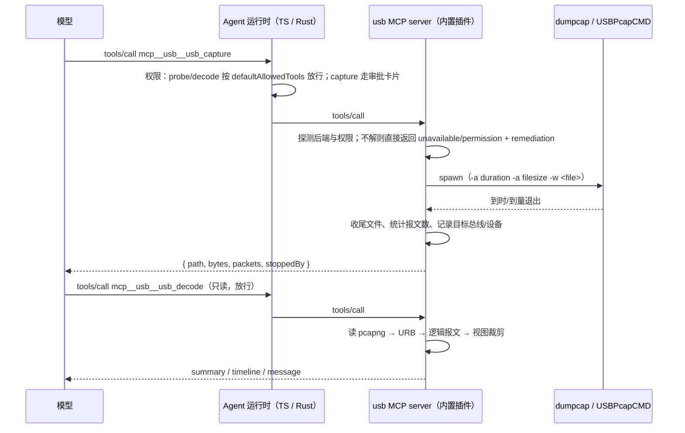

# USB 抓包与协议分析：Agent 工具

2026-10-14。目标：让 Agent 能「抓一段 USB 报文 → 按协议解码 → 给出结论」，覆盖智能卡读卡器（CCID）、
人机接口（HID）、大容量存储（MSC/SCSI）三类最常见的 USB 设备调试场景。

与串口工具（`docs/specs/serial-agent-tools.md`）的差别：串口是与用户面板共享的**常驻会话**，
USB 抓包是**一次性的、产物为文件**的操作，且没有需要 Host 持有的共享状态。因此本插件采用
`android-emulator` / `ios-simulator` 的形态（manifest 自声明 MCP server，见 `§9`），
不引入 Host 服务、broker 与反向协议。

## 1. 术语对齐

用户口语中的几个词在实现里对应不同层次，工具的描述与技能正文必须按这张表用词，避免 Agent 选错工具：

| 说法                    | 实际所在层                | 本插件的处理                                                        |
| ----------------------- | ------------------------- | ------------------------------------------------------------------- |
| CCID                    | USB 总线（读卡器接口类）  | `usb_decode(protocol=ccid)`：10 字节消息头 + APDU 载荷              |
| PC/SC                   | 操作系统 API（winscard / pcsc-lite） | **不在总线上**。等价信息是 CCID 消息里的 APDU 时序，由 `ccid` 解码还原成读卡会话视图；OS API 调用抓取不在范围内 |
| SCSI（含"SC II"等写错） | 存储命令集                | USB 上经 MSC/BOT 承载：`usb_decode(protocol=msc)` 解 CBW/CDB/CSW + sense |
| HID                     | USB 总线（人机接口类）    | `usb_decode(protocol=hid)`：报告描述符 + 报告字段解码               |
| U 盘 / 移动硬盘 / USB-SATA | 设备形态               | 走 `msc`；UAS（USB Attached SCSI）为 phase 2                        |

> 若"SCII"另有所指（不是 SCSI/SCSI-2），实现时按此表之外的协议处理，需要先补本节。

## 2. 范围与非目标

范围：

- 离线分析：对任意 `pcapng` / `pcap` 文件做 USB 与上述三类协议解码。**这条路径不依赖特权、不依赖外部命令行**，是插件的主线能力，也是 CI 与 macOS 上唯一可用的路径。
- 实时抓包：在具备抓包后端与权限的机器上抓一段并落盘（Linux usbmon / Windows USBPcap），时长与体积有上限。
- Agent 侧：三个工具 + 一份技能正文；免审批边界、审批预览与错误码沿用现有机制。

非目标：

- 不注入、不重放、不修改 USB 流量；不抓非 USB 总线（I2C/SPI/UART 走 serial 插件，网络走 REA 的 tshark 能力）。
- 不做 OS API 层抓取（PC/SC API、HID API、Windows API 监控、pcscd 调试日志）。
- 不覆盖 UAS、USB Video/Audio/CDC 的深层语义（仍给出原始 URB 与长度）、蓝牙 HCI、USB4/PD 链路层。
- 无 UI：phase 1 不加面板与自定义审批预览组件。

## 3. 工具

MCP server 名 `usb`，工具全名 `mcp__usb__<tool>`。三个工具构成单向漏斗：**探 → 抓 → 解**，
每个工具的存在理由不重叠，Agent 只需按「我现在缺什么信息」选择。

| 工具         | 审批     | 只读 | 回答的问题                                             |
| ------------ | -------- | ---- | ------------------------------------------------------ |
| `usb_probe`  | 默认放行 | 是   | 本机能不能抓、用什么后端、有哪些 USB 设备、有哪些现成抓包文件 |
| `usb_capture`| 需审批   | 否   | 现场抓一段（有权限时）并落盘                            |
| `usb_decode` | 默认放行 | 是   | 这份抓包里发生了什么：设备、协议、逐条报文、错误        |

### 3.1 何时用哪个工具

这张表同时是技能正文（`skills/usb-capture/SKILL.md`）的核心内容，也是三个工具 description 的取材来源。

| 用户症状 / 场景                                        | 第一步                                        | 第二步                                              | 结论看什么                                                        |
| ------------------------------------------------------ | --------------------------------------------- | --------------------------------------------------- | ----------------------------------------------------------------- |
| 读卡器 / 身份证阅读器 / 银行卡读卡器 不识别、APDU 失败 | `usb_probe`（确认 CCID 设备与抓包能力）       | `usb_capture` → `usb_decode(protocol=ccid)`         | `bError`、`bStatus`、ATR、APDU 命令名、`SW1SW2`（`6A82` 文件未找到、`6D00` 指令不支持、`6300` 校验失败、`6982` 安全状态不满足） |
| 键盘 / 鼠标 / 摇杆 / 自定义 HID 行为异常、按键错位     | `usb_probe` 或直接用已有抓包文件               | `usb_decode(protocol=hid)`                          | 报告描述符得出的字段布局与 usage、`ReportID`、按键码、报告长度是否与描述符一致 |
| U 盘 / 移动硬盘 读写失败、挂载失败、传输卡住           | `usb_probe`                                   | `usb_capture` → `usb_decode(protocol=msc)`          | CDB 操作码名、LB​A/长度、CSW `status`、`residue`、REQUEST SENSE 的 sense key / ASC / ASCQ |
| 用户已经有一份 `.pcapng`（Wireshark / USBPcap / 硬件分析仪导出） | 直接 `usb_decode(view=summary)`        | 按 summary 里的协议分布转 `timeline`                | 同上；先看 summary 确定该用哪个协议视图                            |
| 设备根本枚举不出来 / 反复重连 / 掉线                   | `usb_capture`（先让用户在抓包期间重新插拔）    | `usb_decode(view=summary)`                          | 描述符是否出现、设备地址是否变化、控制传输 STALL、错误状态         |
| 本机不能抓包（macOS / 无权限 / 无驱动）                | `usb_probe`（返回 `remediation`）             | 让用户在别的机器或硬件分析仪抓好后把文件交给 Agent | —                                                                 |
| 未知 / 厂商自定义类协议                                | `usb_decode(protocol=auto, view=summary)`     | `usb_decode(protocol=raw, view=timeline)`           | 端点、传输类型、长度、16 进制摘要                                  |

选型规则（写进技能正文，避免 Agent 靠猜）：

1. **先探后抓**：任何现场抓包之前先 `usb_probe`；没有抓包能力就不要尝试 `usb_capture`，直接把 `remediation` 转述给用户。
2. **有文件先解**：用户已提供抓包文件时跳过 `usb_capture`。
3. **协议来自设备类别，不来自猜测**：类别来自 `usb_probe` 的设备列表（interface class）或抓包内的描述符；两者都没有时用 `protocol=auto, view=summary` 先定性。
4. **先 summary 后 timeline**：`summary` 便宜且能定性；只有需要逐条报文时才 `timeline`，并且分页读。
5. **不要让用户看原始 hex**：结论必须是协议层术语（APDU 名、SW、CDB 名、sense key、HID 字段名）。

### 3.2 `usb_probe`

`{}`。返回本机能力与清单，是唯一的环境探针：

- `platform`：`linux` / `darwin` / `win32`。
- `capture`：`{ available, backend: "dumpcap" | "usbpcap" | "none", command?, interfaces: [{ id: "usbmon1", bus: 1 }], privilege: "ok" | "denied" | "unknown", reason?, remediation? }`。
  `remediation` 是人类可读的下一步（例如 Linux 上给 `dumpcap` 授予 `cap_net_raw,cap_net_admin` 的具体命令，Windows 上安装 USBPcap 驱动）。文案由后端给出，插件不尝试提权、不弹权限框。
- `devices`：当前连接的设备，`{ busDev, bus, device, vid, pid, manufacturer?, product?, serial?, interfaces: [{ class, className }] }`。
  数据来源不需要特权：Linux `/sys/bus/usb/devices`、Windows PowerShell 枚举、macOS `system_profiler SPUSBDataType -json`。
- `captures`：最近抓包文件清单（`path`、`bytes`、`capturedAt`、`protocols`），来自插件数据目录与工作区 `.escode/usb-captures/`。
- `notes`：平台限制的补充说明（例如 macOS 无实时抓包）。

### 3.3 `usb_capture`

参数：

- `bus`（可选，整数）：抓这条总线（Linux `usbmon<bus>` / Windows 对应 control device）。省略时：只有一个候选时用它，否则要求显式指定。
- `busDev`（可选，字符串，形如 `"1-4"`）：只保留该设备的报文。**过滤发生在解码期**，抓包本身仍是整条总线（usbmon 不支持按设备抓；统一行为，避免平台差异）。该值原样写入结果，供 `usb_decode` 复用。
- `durationMs`（默认 10000，上限 60000）、`maxBytes`（默认 64 MiB，上限 512 MiB）：先到者结束。
- `label`（可选，`[a-z0-9-]{1,32}`）：文件名片段，便于事后辨认（例如 `acr1252-select-fail`）。
- `outputPath`（可选）：相对路径按 workspace 解析，绝对路径原样使用；缺省 `<pluginData>/captures/<utc 时间戳>-<label>.pcapng`。

返回 `{ path, bytes, packets, stoppedBy: "duration" | "maxBytes" | "signal", target: { bus, busDev? }, backend, hint? }`。

错误：`unavailable`（无后端，附 `remediation`）、`permission`（后端存在但权限不足，附 `remediation`）、
`busy`（Windows USBPcap 同一 control device 已被占用）、`invalidInput`、`io`。

### 3.4 `usb_decode`

参数：

- `source`（必填）：抓包文件路径（相对 workspace 或绝对）。
- `protocol`：`auto`（默认）/ `hid` / `ccid` / `msc` / `raw`。`ccid` 含 APDU 与读卡会话还原，`msc` 含 SCSI CDB 与 sense，`raw` 只列 URB 不做协议解码。
- `view`：`summary`（默认）/ `timeline` / `message`。
  - `summary`：设备与协议分布、时间范围、逐协议报文计数、**异常清单**（SW 非 `9000`、CSW status 非 0、CCID `bError` 非 0、短传输、STALL、控制传输失败）。
  - `timeline`：逐条**逻辑报文**（不是原始 URB）：CCID 一行一条消息（链式块合并成一条 APDU 交换）、MSC 一行一条 CBW/数据/CSW、HID 一行一条报告（字段解码）。`limit`（默认 200，上限 500）+ `cursor` 分页。
  - `message`：`index` 指定一条（`timeline` 里的编号）的完整正文，`payloadBytes`（默认 256，上限 4096）控制 16 进制摘要长度。
- `filter`（可选）：`{ busDev?, endpoint?, direction?: "in" | "out", onlyErrors?: true }`。`onlyErrors` 在 HID 下无错误语义，忽略（在结果里说明）。

返回固定包含 `truncated`（是否因 `limit`/`payloadBytes` 截断）与 `cursor`（下一页游标，无更多时为 `null`）、
`file: { truncated: true }`（抓到一半的文件；解码器读到坏块即停并照常返回已解析部分）。

错误：`notFound`、`unsupportedFormat`（非 pcap/pcapng，或未知 linktype——**不猜格式**）、`io`（含读取失败）、`decode`（解析失败，附文件名与偏移量）。

## 4. 平台与依赖矩阵

| 平台        | 实时抓包 | 后端与依赖                                                                 | 说明 |
| ----------- | -------- | -------------------------------------------------------------------------- | ---- |
| Linux       | 可用     | `dumpcap`（Wireshark）或 `tshark`；需 `CAP_NET_RAW`+`CAP_NET_ADMIN`（`setcap`）或 `wireshark` 组成员；`usbmon` 内核模块 | 首选路径；`usb_probe` 给出精确 remediation |
| Windows     | 可用     | USBPcap 驱动 + `USBPcapCMD.exe`（Wireshark 安装自带）；需管理员             | `usb_probe` 报告驱动是否安装 |
| macOS       | 不可用   | —                                                                          | 无公开内核抓包接口：只能离线解码，或用硬件分析仪（Lecroy / Beagle / Total Phase）导出 pcapng |
| 容器 / CI   | 不可用   | —                                                                          | 同上；单测全部走离线解码路径，不需要硬件与特权 |

外部命令行（`dumpcap` / `USBPcapCMD`）**不随包分发**，按 `user_config` 可覆盖路径（与 REA 对 tshark 的处理一致）。
离线解码**不依赖任何外部命令行**：pcapng 容器与 usbmon / USBPcap 链路层由插件自己解析，
因此 CI、容器与 macOS 上的单测都走同一条离线路径。

## 5. 所有者、并发与取消

- 唯一所有者是插件 MCP server 进程内的抓包作业表：一次 `usb_capture` 一个子进程（`dumpcap` / `USBPcapCMD`），
  由作业记录持有；作业结束、工具调用被取消、MCP server 退出（含进程被杀）三种情况都必须终止子进程。
- 不引入 Host 服务与 broker：USB 抓包不与 UI 共享状态，产物是文件。**升级触发条件**：如果 phase 2 要加抓包面板
  （用户在 UI 里看实时报文），则必须改为 Host Service + broker（同 serial），届时解码器上移到 `@escode/shared/usb` 供 UI 与插件共用。
- 并发抓包允许，各自独立文件；`usbmon` 支持多读者，因此不做互斥。Windows 上同一 control device 互斥，第二个抓包返回 `busy`。
- 部分文件：抓包被取消或进程退出时，已写入的 pcapng 保留（解码器容忍截断），文件名后缀 `.partial` 直到正常收尾。

## 6. 审批

- `usb_probe`、`usb_decode` 进官方插件定义的 `defaultAllowedTools`（与 serial 的只读三件套同机制，只对本插件同名工具生效）。
- `usb_capture` 标 `destructiveHint`（会拉起特权抓包进程并写文件），plan 模式不放行；审批卡片预览来自工具输入：
  后端与命令、目标总线/设备、时长、体积上限、输出路径。
- 免审批的 `usb_decode` 必须保持只读：不解压、不联网、不写文件（`usb_capture` 之外没有任何写路径）。

## 7. 协议解码范围

USB 基础层（所有协议共用）：控制/批量/中断/等时传输、SETUP 包（`bmRequestType`/`bRequest`/`wValue`/`wIndex`/`wLength`）、
标准请求名、描述符（device / configuration / interface / endpoint / HID report / string）、提交-完成配对、
STALL 与错误状态、截断文件容忍。

**CCID（读卡器）**：10 字节消息头（`bMessageType`/`dwLength`/`bSlot`/`bSeq`/`bSpecific`/`abRFU`）；
`PC_to_RDR_*` 与 `RDR_to_PC_*` 消息类型名（`IccPowerOn`/`IccPowerOff`/`GetSlotStatus`/`XfrBlock`/`Escape`/`SetParameters`…）；
`bError` 码表（`0x00` 无错误、`0xE0` 电压错误等）；`bStatus` 位（`bmCommandStatus`）；
`XfrBlock` 载荷按 ISO 7816-4 APDU 解码（`CLA`/`INS`/`P1`/`P2`/`Lc`/data/`Le`）并给出命令名；
响应 `SW1SW2` 给出含义；链式块（`bChainParameter` / DataBlock chain）合并为一次逻辑 APDU 交换。
读卡会话视图：`IccPowerOn` 响应里的 ATR（`TS`/`T0`/接口字节 `TA`/`TB`/`TC`/`TD`/历史字节）解析，
APDU 序列按序号排列，卡移除结束会话。

**MSC / SCSI（大容量存储，BOT）**：CBW（31 字节，`dCBWSignature=0x43425355`）、CSW（13 字节，`0x53425355`，
`bCSWStatus` 0/1/2、`dCSWResidue`）、CDB 操作码表（`00` TEST UNIT READY、`03` REQUEST SENSE、`12` INQUIRY、
`1A`/`5A` MODE SENSE、`1B` START STOP UNIT、`25` READ CAPACITY、`28`/`2A` READ/WRITE(10)、`A0` REPORT LUNS 等），
sense data（`0x70`/`0x71` 的 sense key / ASC / ASCQ 常见组合），实际数据量与 CBW 声明长度的差异（短传输告警）。

**HID**：报告描述符解析（usage page / usage / report id / report size / count / logical & physical min-max / unit、
input/output/feature 位域、collection 嵌套），报告字节按位域切出来并命名（键盘、按钮、`Generic Desktop` 轴等），
boot 协议键盘（8 字节）与鼠标（3/4 字节）特例，常用 usage page 名称表（`0x01` Generic Desktop、`0x07` Keyboard、
`0x08` LED、`0x09` Button、`0x0C` Consumer）。描述符不在抓包里时明确说明「报告无法按字段解码」，只给 `ReportID` 与长度。

## 8. 上下文预算

USB 抓包动辄数万条，**任何视图都必须有上限**：`summary` 恒定小体积（异常清单也截断到 50 条并给总数）；
`timeline` 默认 200 行 + 游标；`message` 单条 + `payloadBytes` 上限。工具描述里明确写「先 summary，再分页 timeline」，
技能正文禁止把整份 timeline 贴进上下文。

## 9. 插件与分发

- 新包 `apps/escode-cli/packages/usb-plugin`：`.escode-plugin/plugin.json`（manifest 自声明 MCP server，
  变量用 `${ESCODE_PLUGIN_ROOT}` / `${ESCODE_PROJECT_DIR}` / `${ESCODE_PLUGIN_DATA}` / `${user_config.*}`，
  与 `android-emulator-plugin` 同构）、`src/`（tools / server / 解码核心 / probe / capture）、
  `skills/usb-capture/SKILL.md`、`scripts/build.mjs` 产出 `dist/mcp/server.js`（stdio）、`test/`。
- `userConfig`：`dumpcap_path`、`usbpcap_cmd_path`，默认空（走 PATH 与常见安装路径探测）。
- 官方插件定义新增 `usb`（`defaultEnabled: true`、`defaultAllowedTools: ["usb_probe", "usb_decode"]`、
  `requiredSeedPaths: ["dist/mcp/server.js", "skills/usb-capture/SKILL.md"]`、`rootCandidates` 同 serial）。
  **不使用** `hostMcpServerNames`：工具不依赖 Host 注入的连接材料，manifest 声明即可（见 §1 与 android/ios 先例）。
  代价是远程 workspace / 独立 CLI 也会看到这组工具——在那里它作用在**运行 Agent 的那台机器**的 USB 上，语义仍然成立；
  若后续确认这种暴露不可接受，再改为 Host 能力标记门控（`ESCODE_HOST_USB`）。
- 两个运行时（TS / Rust）都通过 Host 的插件启动器运行同一份 `dist/mcp/server.js`，因此**行为天然一致**，
  不需要 `mcp_usb.rs` 之类的对等实现；Rust 侧只需随 `scripts/generate-escode-cli-rust-official-plugins.mjs` 拿到新的清单条目。
- **协议协商**：server 必须接受 2025 版协商，不能传 `serveStdio(..., { legacy: "reject" })`。
  serial/circuit 能拒绝旧版协商，是因为它们的 MCP 配置由宿主注入并固定了 `protocolVersion`
  （`built-in-serial.ts` 的注释）；本插件的 server 由 manifest 自声明，没有这个注入点，
  拒绝旧版会让 `usb_*` 工具整组不可用（表现为「工具不存在」而不是报错）。回归由 `scripts/smoke-mcp.mjs` 覆盖。
- 需要登记的平行清单（缺一处就会装出「有技能没有工具」或图标缺失的插件）：
  `official-plugin-definitions.ts`（定义 + seed 路径）、`packages/shared/src/plugin-marketplaces.ts`
  （`DEFAULT_ENABLED_OFFICIAL_PLUGIN_IDS`）、`scripts/build-desktop-agent-cli.mjs`（dev 构建产物校验）、
  `packages/desktop/scripts/prepare-agent-node-bundle.mjs`（生产 seed）、
  `scripts/prepare-prebuilds.mjs`（remote prebuild）、`plugin_defaults.json` 与 `official_plugins.json`（由生成脚本产出）。

## 10. 阶段

- **phase 1（本 spec）**：`usb_probe` / `usb_capture` / `usb_decode`（ccid、msc、hid、raw）+ 技能正文 + 官方插件注册 + 单测。
- **phase 2**：UAS、传感器/中断流式视图、`engine: "tshark"` 交叉校验开关、抓包面板（届时按 §5 升级为 Host 服务 + broker）。

## 11. 验收

- 单测（无硬件、无特权、CI 可跑）：CCID 消息头 / APDU / `SW1SW2` / 链式块合并；CBW/CSW/CDB/sense；
  HID 报告描述符 → 字段布局 → 报告解码；pcapng 容器（含截断文件与未知 linktype 必须报错）；
  usbmon 与 USBPcap 链路层解析；提交/完成配对（含按 URB id 匹配与 FIFO 兜底）；
  视图分页与体积上限；工具契约（严格参数校验、只读/审批标注、`notFound` 与 `unsupportedFormat` 的错误码）；
  `usb_probe` 在无后端平台返回 `available: false` + `remediation`。
- 插件注册冒烟（需要构建产物）：`pnpm --filter @escode/usb-plugin build && pnpm --filter @escode/usb-plugin smoke:mcp`
  用 stdio JSON-RPC 走通 initialize / tools/list / tools/call，覆盖「协议协商被拒导致工具整组不可见」这类静默失败。
- 集成（需要真实抓包）：Linux 用 `usbmon` 抓一份 CCID 读卡器与一份 HID 设备的真实 pcapng、
  Windows 用 USBPcap 抓一份 MSC 的真实 pcapng，作为 fixtures 落到仓库，
  断言设备识别、协议判定与关键报文解码结果。**不接受只用合成样例**：链路层解析必须由真实抓包复核，
  合成数据只能用于解码核心的单测。
- 端到端：Desktop 开发版 + 真实模型会话完成 `usb_probe` → `usb_capture`（审批）→ `usb_decode(summary → timeline)`
  并给出 APDU / CSW / HID 字段级结论；macOS 上 `usb_probe` 明确返回不可抓包与 remediation，`usb_decode` 仍可用。
- 插件管理里关闭 `usb` 插件后，Agent 不再看到这组工具。
