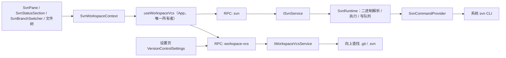
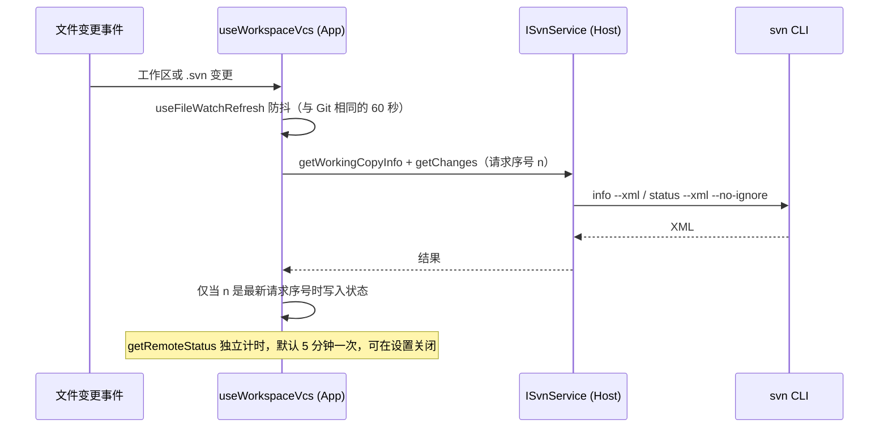
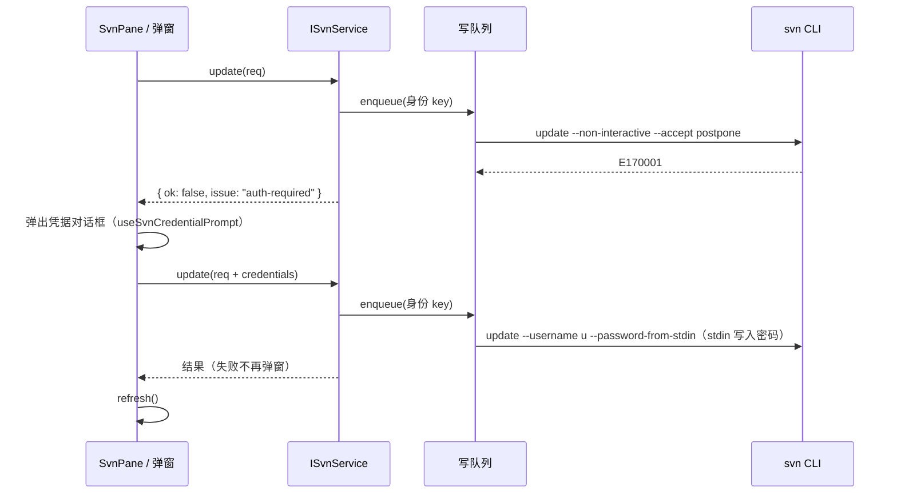

# SVN 架构设计

## 相关文档

- [SVN 需求设计](./requirements.md)
- [SVN UI 设计](./ui.md)
- [Git 架构设计](../git/architecture.md)

## 设计目标

- SVN 能力在本地、远程、Web 三种运行方式下沿用与 Git 相同的服务链路
- Git 现有 `IGitService`、类型、Rust 复刻与差分测试保持不变
- VCS 类型判定只有一个所有者
- 每个工作副本的写操作在 Host 内串行，状态以 svn 命令结果为唯一事实来源

## 核心判断

### 1. 新增并列的 `ISvnService`，不重构 Git

不引入 `ISourceControlService` 加 provider 的统一抽象。SVN 与 Git 在暂存、提交、推送、分支、历史结构上差异很大，合并会让接口充满可选字段和“不支持”分支，并迫使 Git 的 18 个方法、约 45 个类型与 Rust 复刻一起回归。

只在以下几处做与 VCS 无关的抽取：

| 抽取点       | 调整                                                                                                                                                                                             |
| ------------ | ------------------------------------------------------------------------------------------------------------------------------------------------------------------------------------------------ |
| VCS 类型判定 | 新增 `IWorkspaceVcsService`（`getWorkspaceVcsInfo` / `setWorkspaceVcsOverride`），唯一判定入口；判定规则 `resolveDetectedVcsKind` 放在 `packages/shared/src/vcs.ts`，Host、Agent 共用            |
| 提交信息生成 | 沿用 `GitCommitMessageGenerator` 同一实例，输入类型收窄为与 VCS 无关的 `CommitMessageFileInput` / `CommitMessageDiffInput`（只含 kind、路径、增删行数与 patch），Git 与 SVN 各自读取 diff 后调用 |
| 自动刷新     | Git 自动刷新中的“监听路径 + 防抖触发”抽为 `packages/ui/src/hooks/useFileWatchRefresh.ts`，Git 与 SVN 只各自计算监听路径                                                                          |
| 变更卡片     | SVN 面板复用 `GitPaneChangeCard` 与 diff 展示，由 `svn/svnDisplay.ts` 把 SVN 改动映射为卡片输入                                                                                                  |
| 文件树标记   | 文件树数据 hook 在 SVN workspace 下直接使用 SVN 状态生成 `{path → status}`，不调用 Git 命令                                                                                                      |

### 2. SVN 是标准业务服务，不放进 `IPlatformService`

与 Git 相同：svn 必须在 workspace 所在环境执行。远程 workspace 下远端 server 运行同一份 TS 服务，svn 在远端执行。

### 3. 调用系统 svn CLI

- 所有命令带 `--non-interactive`；读命令尽量带 `--xml`，避免依赖本地化文本。
- 不引入 JavaHL、SharpSVN 或 libsvn 绑定，不打包 svn 二进制。XML 由 `repo/svnXml.ts` 中的最小解析器处理（svn 输出只含元素、属性、文本和标准实体），不新增依赖。

## 高层结构



本地与远程的区别只在服务实现的来源：UI 通过 `useWorkspaceServices` / `useWorkspaceServicesResolution` 按 `workspaceIdentity` / `remoteSessionId` 选择本地服务或远程代理，与 Git 一致。

## 分层设计

### Types

- `packages/shared/src/vcs.ts`：`WorkspaceVcsKind`、`WorkspaceVcsOverride`、`WorkspaceVcsInfo`、`getWorkspaceVcsKey`（身份 key：`workspaceIdentity?.trim() || workspacePath`）、`resolveDetectedVcsKind`。
- `packages/shared/src/svn.ts`：SVN 请求与结果类型，以及纯函数 `deriveSvnBranchRef`、`getSvnRelativeRepositoryPath`。

所有请求携带 `workspacePath` 与可选 `workspaceIdentity`；`SvnFileChange.path` 相对 **workspacePath**（命令以 workspace 为 cwd、目标为 `.`，天然限定在 workspace 范围内）。

可预期的业务失败统一以结果联合返回，不抛异常：

```ts
type SvnResult<T> = ({ ok: true } & T) | { ok: false; issue: SvnIssueCode; message: string };

type SvnIssueCode =
  | "svn-unavailable" // 未找到 svn 或版本低于 1.8
  | "not-working-copy" // E155007 / E155010
  | "working-copy-locked" // E155004 / E155037 / E200033
  | "out-of-date" // E155011 / E160024 / E160028 / E160042 / E170004
  | "auth-required" // E170001 / E215004（E170013 仅在伴随认证错误码时）
  | "unresolved-conflicts" // E155015
  | "nothing-to-commit"
  | "invalid-request"
  | "unsupported-host"
  | "cancelled"
  | "timeout"
  | "unknown";
```

错误归类只依赖 `E\d{6}` 错误码（`repo/svnErrors.ts`），不解析本地化文本。

### Service 接口

#### `IWorkspaceVcsService`（channel `"workspace-vcs"`）

| 方法                      | 说明                                                                                   |
| ------------------------- | -------------------------------------------------------------------------------------- |
| `getWorkspaceVcsInfo`     | 返回 `{ kind, source: detected \| override, override, root? }`                         |
| `setWorkspaceVcsOverride` | 把 `auto \| git \| svn \| none` 写入所在 Host 设置的 `workspaceVcsOverrides[身份 key]` |

- 探测只做异步 `stat`：从 workspace 向上分别找最近的 `.git`（目录或 worktree 文件）与 `.svn` 目录，按 `resolveDetectedVcsKind` 裁决，不调用 git / svn 二进制。
- 覆盖为某类型但目录不是对应仓库时，`kind` 仍为覆盖值、`root` 缺省，界面提示“不是工作副本”，不回退到另一种 VCS。

#### `ISvnService`（channel `"svn"`）

| 方法                          | 读 / 写    | svn 命令                                                                                                                             |
| ----------------------------- | ---------- | ------------------------------------------------------------------------------------------------------------------------------------ |
| `getWorkingCopyInfo`          | 读         | `--version --quiet`、`info --xml`；返回可用性、URL、修订号、分支与 `canSwitch`                                                       |
| `getChanges`                  | 读         | `status --xml --no-ignore`；冲突项再 `info --xml` 取冲突详情；可 diff 项一次 `diff --depth empty` 统计行数（超过 200 个文件不统计）  |
| `getDiff({ path })`           | 读         | 已纳入版本控制：`diff --internal-diff --depth empty`；未纳入版本控制：服务端合成“全部新增” patch                                     |
| `getDiff({ path, revision })` | 读（远端） | `diff --internal-diff -c <rev> ^/<path>@<rev>`                                                                                       |
| `getLog`                      | 读（远端） | `log --xml -v --limit <n+1> -r <start\|HEAD>:1 <workspace URL>@<peg>`                                                                |
| `getFileLog`                  | 读（远端） | `info --xml <path>` 取文件 URL，再 `log --xml -v --limit <n+1> -r <start\|HEAD>:1 <file URL>@<peg>`                                  |
| `getBlame`                    | 读         | `blame --xml [-r <rev>] -- <path>`；解析每行修订、作者与内容，最多 5000 行                                                           |
| `getBranchGraph`              | 读（远端） | `list --xml` 取 trunk/branches/tags；每个分支 `log --xml -v --stop-on-copy` 取 copyfrom；`propget --xml -R svn:mergeinfo` 取合并关系 |
| `getExternals`                | 读         | `propget --xml -R svn:externals -- .`；解析 `[-r N] URL[@PEG] PATH`                                                                  |
| `getRemoteStatus`             | 读（远端） | `status --xml -u -q`：统计过期条目数与 `against` 修订号                                                                              |
| `listBranches`                | 读（远端） | `list --xml <root>`、`list --xml <root>/branches`                                                                                    |
| `commit`                      | 写         | 未纳入版本控制项 `add --parents`，丢失项 `delete`，再 `commit --depth empty -F <tmp> --encoding UTF-8`                               |
| `update`                      | 写         | `update --accept postpone .`                                                                                                         |
| `revert`                      | 写         | `revert --depth infinity`（不加 `--remove-added`，撤销 add 后文件保留在磁盘）                                                        |
| `resolve`                     | 写         | `resolve --accept mine-full\|theirs-full\|working`                                                                                   |
| `switchBranch`                | 写         | 在 wcRoot 执行 `switch --accept postpone <root>/<relativePath>@HEAD .`；仅 `canSwitch` 时允许                                        |
| `lock`                        | 写         | `lock [-m <msg>] -- <paths>`；按身份 key 串行                                                                                        |
| `unlock`                      | 写         | `unlock [--force] -- <paths>`                                                                                                        |
| `listShelves`                 | 本地       | 读取 `wcRoot/.svn/escode-shelves/*.json`                                                                                             |
| `shelve`                      | 写         | `diff --internal-diff --depth infinity` + 未纳入版本控制 patch → 写 shelf → `revert` 并删除本地新增文件                              |
| `unshelve`                    | 写         | `patch <wcRoot>/.svn/escode-shelves/<name>.patch`                                                                                    |
| `deleteShelf`                 | 本地       | 删除 shelf 的 `.patch` 与 `.json`                                                                                                    |
| `merge`                       | 写         | 在 wcRoot 执行 `merge --accept postpone [-c N \| -r start-1:end] <root>/<relativeSourcePath>@HEAD .`；仅 `canSwitch` 时允许          |
| `cleanup`                     | 写         | 在 wcRoot 执行 `cleanup`                                                                                                             |
| `setBinaryPath`               | 设置       | 写入所在 Host 设置 `svnBinaryPath`                                                                                                   |
| `generateCommitMessage`       | 读         | 读取所选路径的改动与 diff（最多 8 个），交给共享的提交信息生成器                                                                     |

说明：

- **路径参数**：路径包含 `@` 时追加一个 `@`，避免被解析为 peg revision；`.` 不追加（`.@` 会被解析成名为 `@` 的子节点）。所有写操作拒绝绝对路径和包含 `..` 的路径。
- **提交范围**：`--depth empty` 精确提交勾选项，避免勾选目录（如只改了属性的 `.`）时连带提交整棵树；新加入的目录展开其子项一起提交。
- **remote status 而不是比较修订号**：自己刚提交的修订不会被误报为“服务器有新修订”。
- **历史读取 URL 而不是工作副本**：工作副本默认只显示到 BASE，提交后未更新时会漏掉新修订。
- **单文件历史**：`getFileLog` 先对工作副本路径执行 `info --xml` 取文件 URL（缺失/已删除文件仍可从 WC 元数据读到 URL），再按该 URL 读取历史；返回 `repositoryPath`（`/trunk/...`）供修订 diff 使用。文件 URL 的历史页与工作副本历史共用同一份以 `(uuid, URL, start, limit)` 为键的缓存。
- **Blame**：`blame --xml` 逐行返回 `entry` 的修订与作者；svn 1.14 不输出行文本，行内容由同一修订（缺省 `BASE`）的 `cat` 输出补齐。超过 5000 行标记 `truncated` 并丢弃其余行，避免大文件一次性灌入渲染器。二进制文件由 svn 自身报错。
- **分支图谱**：标准布局下列出 `trunk`、`^/branches/*`、`^/tags/*`；每个非 trunk 节点用 `log --stop-on-copy` 取首个修订及其 `copyfrom-path`，生成 `copy` 边。`propget --xml -R svn:mergeinfo` 返回的路径按“仓库根后的第一段 / 前两段”映射回分支根（`/trunk/src` → `trunk`，`/branches/x/src` → `branches/x`），同一对 `(from, to)` 的修订区间聚合成一条 `merge` 边。非标准布局只返回当前节点。节点上限 200，copyfrom 探测并发上限 4。
- **外部定义**：`propget --xml -R svn:externals -- .` 读取工作副本本地属性（包含未提交修改）；target 的绝对本地路径转成 workspace 相对路径。定义行支持 `-r N URL PATH`、`URL@PEG PATH`、`^/` 与 `//host/` 形式；只读展示，不写属性。
- **锁定**：`svn status --xml` 的 `<lock>` 提供 owner/comment/created，直接并入改动列表；`lock` / `unlock` 进入同一写队列。他人锁默认解锁失败，`force` 才追加 `--force`。
- **暂存架**：svn 1.14 已移除实验性的 `svn shelve`，因此用 `svn diff`（文本与属性）+ 未纳入版本控制文件的合成 patch 生成完整补丁，保存在 `wcRoot/.svn/escode-shelves/<name>.patch`，元数据在同名 `.json`。缺失文件先 `svn delete --force` 再 diff；暂存成功后 `revert --depth infinity` 并删除 scheduled add / unversioned 文件。二进制与 unversioned 目录拒绝暂存；应用使用 `svn patch`，冲突时保留 shelf 并返回 svn 输出。
- **`canSwitch`**：工作副本根的 URL 正好是 `trunk` / `branches/*` / `tags/*` 的根时为 true；工作副本根是仓库根或非标准布局时不允许切换。
- **合并**：只允许在 `canSwitch` 为 true 时执行，目标固定为 wcRoot 与 `.`；默认依赖 mergeinfo 合并源的全部可用修订，指定范围时按闭区间语义转换：单个修订执行 `-c N`，多修订执行 `-r start-1:end`（起始为 1 时下界取 1）。合并只修改工作副本，不创建修订、不自动提交；`--accept postpone` 让冲突进入现有冲突分组。`mergedFileCount` 取 merge 输出中的状态行数（与 update 同一计数规则）。

### Runtime 与 Provider

目录：`packages/services/src/svn/`。

| 文件                                  | 职责                                                                  |
| ------------------------------------- | --------------------------------------------------------------------- |
| `svn.ts`                              | `ISvnService` 接口与 descriptor                                       |
| `svnService.ts`                       | 组装；工作副本信息、设置 svn 路径、生成提交信息                       |
| `svnRuntime.ts`                       | 二进制解析与版本检查、执行（凭据参数、日志脱敏、错误归类）、写队列    |
| `svnReads.ts`                         | info / status / 改动列表 / diff                                       |
| `svnHistory.ts`                       | log（带不可变页缓存）/ remote status / 分支列表                       |
| `svnGraph.ts`                         | 分支拓扑（copyfrom + mergeinfo）                                      |
| `svnExternals.ts`                     | `svn:externals` 只读解析                                              |
| `svnShelf.ts`                         | 可移植暂存架（diff/patch、元数据、应用与删除）                        |
| `svnWrites.ts`                        | commit / update / revert / resolve / switch / lock / unlock / cleanup |
| `svnPaths.ts`                         | 路径参数、diff 拆分、未纳入版本控制文件统计与 patch 合成              |
| `repo/svnXml.ts`、`repo/svnParse.ts`  | XML 解析与 info / status / log / list 解析，纯函数                    |
| `repo/svnErrors.ts`                   | 错误码到 `SvnIssueCode` 的映射                                        |
| `providers/svnCommandProvider.ts`     | 进程启动、超时、输出上限、终止升级、stdin 写入                        |
| `providers/svnEnvironmentProvider.ts` | 二进制查找与版本探测（按手动路径缓存，未找到不缓存）                  |
| `../vcs/workspaceVcsService.ts`       | `IWorkspaceVcsService` 实现                                           |

**二进制查找**：设置中的 `svnBinaryPath` → 环境变量 `ESCODE_SVN_BINARY` → `PATH` 中的 `svn` → Windows TortoiseSVN 默认目录。版本低于 1.8 返回 `unsupported-version`。

**环境变量**：

- 移除 `SVN_EDITOR`、`SVN_MERGE`、`VISUAL`、`EDITOR`，并把 `SVN_EDITOR` 设为必然失败的命令，防止意外打开编辑器；保留 `SVN_SSH`。
- 不能用 `LC_ALL=C`：svn 会因无法转换非 ASCII 路径报错。Unix 下移除 `LC_ALL`，`LC_CTYPE` 保持已有 UTF-8 locale（否则 Linux 用 `C.UTF-8`、macOS 用 `en_US.UTF-8`），`LC_MESSAGES=C` 让消息固定为英文，便于解析 commit 修订号与 update 变更行。Windows 上 svn 使用 UTF-16 API，不改 locale。

**超时**：普通命令 15 秒；本地 diff 20 秒；访问远端的读命令 30 秒；commit / update / switch 10 分钟；cleanup 2 分钟。

## 状态所有者与事件顺序

### 所有者

| 状态               | 所有者                                            | 说明                                                                      |
| ------------------ | ------------------------------------------------- | ------------------------------------------------------------------------- |
| VCS 覆盖值         | 所在 Host 的 `IWorkspaceVcsService`（设置持久化） | 设置页写入后广播 `escode:workspace-vcs-changed`，不传递状态本身           |
| VCS 判定结果镜像   | App 中的 `useWorkspaceVcs`                        | 经 `SvnWorkspaceProvider` 下发；收到变更通知或 workspace 切换时重新读取   |
| 工作副本状态、改动 | 工作副本本身（`svn status`）                      | `ISvnService` 不缓存；UI 只镜像最近一次读取结果，不做乐观修改             |
| 历史               | 仓库（`svn log`）                                 | `ISvnService` 缓存以数字修订为起点的历史页（修订不可变），HEAD 首页不缓存 |
| 写操作串行         | `SvnRuntime.enqueueWrite`（Host）                 | key 为 `workspaceIdentity?.trim() \|\| workspacePath`；读操作不排队       |
| 勾选、展开等       | 各 UI 组件局部状态                                | 不回写服务端                                                              |
| 凭据               | svn 自身缓存                                      | ESCode 只在单次命令内持有，不落盘、不写日志                               |
| 暂存架             | `wcRoot/.svn/escode-shelves/` 下的 patch + JSON   | 每个 shelf 一个 `.patch` 与 `.json`；应用/删除经同一写队列                |

### 自动刷新



- 监听路径：非 Linux 递归监听 workspace；Linux 递归监听代价高，只监听 workspace 根与 wcRoot 下的 `.svn`（svn 操作会改写其中的 `wc.db`）。
- 打开面板时读取一次；面板提供手动刷新；写操作完成后由 UI 主动刷新，不依赖文件事件。
- 请求序号丢弃过期响应，不用超时掩盖竞态。

### 写操作与凭据重试



- 重试由 UI 发起且只重试一次，`ISvnService` 无状态，不在服务端挂起等待用户输入，远程 workspace 不需要反向 RPC。
- svn < 1.10 时退回 `--password`；`storeInSvnCache` 为 false 时附加 `--no-auth-cache`。
- 锁冲突（`working-copy-locked`）原样返回，不重试、不自动 cleanup；cleanup 由用户触发且同样进入写队列。Agent 在 bash 中执行 svn 与 Host 写队列之间不做跨进程协调。

## 远程 workspace 与 Web

- `ISvnService` 与 `IWorkspaceVcsService` 在 `packages/services/src/node.ts` 中与 `IGitService` 一同注册；远程部署的 server bundle 使用同一入口。
- `packages/client/src/remoteServiceAccess.ts` 为两个 channel 增加代理；`IServiceAccessor` 中两者为可选字段。
- `remoteWorkspaceServiceCollection.ts`、`remoteConnectionServiceCollection.ts`、`packages/server/src/http.ts` 通过新增的 `ServiceCollection.registerOptional` 登记，旧远端缺失时不注册。
- `remoteWorkspaceSessionServices.ts` 把两者指向远端服务，远端缺失时保持 undefined，不回落到本机。
- 旧 Host 没有 `workspace-vcs` 时 UI 按 Git 处理（保持旧行为）；`svn` 调用失败时 UI 显示“当前 Host 暂不支持 SVN”。

## Rust Host

- `workspace-vcs` channel 在 `apps/escode-host/crates/host-rpc/src/domains_workspace_vcs.rs` 实现，规则与 TS 一致，并登记到 `inventory_implemented.rs`。
- `svn` channel 在 `domains_svn.rs`（方法表与参数解包）与 `host-services/src/svn/`（服务层）实现全部 25 个成员，并登记到 `inventory_implemented.rs`。服务层与 TS 同构：`runtime.rs` 负责二进制探测、命令执行、凭据与写队列，`reads.rs` / `history.rs` / `writes.rs` 负责读面、历史与写面，`xml.rs` + `parse.rs` 解析 svn XML，`errors.rs` 只按错误码归类。
- `generateCommitMessage` 复用 Git 的 prompt 构造与输出校验（`escode-host-services::git::commit_message_prompt`），只替换输入收集。
- 差分测试 `packages/desktop/test/rustHostSvn.test.ts`：用 `svnadmin create` 建仓库后 `svnadmin hotcopy` 复制两份（UUID 与修订号一致），TS 服务与 Rust Host 按同一脚本执行读面、提交、更新冲突与解决、切换、清理，归一化根路径与提交时间后全等；运行环境缺少 svn 时显式 skip。

## Agent 集成

### System prompt 快照

| 运行时   | 实现                                                                                                                                       |
| -------- | ------------------------------------------------------------------------------------------------------------------------------------------ |
| TS CLI   | `adapters/src/context/svn-snapshot.ts` 收集；`EnvInfo.svn`；`core/src/context/sections/env-info.ts` 的 `buildSvnSystemContextSection` 渲染 |
| Rust CLI | `crates/host/src/context_svn.rs` 收集；`PromptSnapshot.svn`；`crates/domain/src/prompt.rs` 渲染，文案与 TS 一致                            |

- 判定：与 `workspace-vcs` 相同规则；是 SVN 时不收集 Git 快照。环境段追加 `Is an SVN working copy: yes`。
- 内容：仓库 URL、当前分支、工作副本修订号、`svn status`（截断 2000 字符）、最近 5 条日志。
- 每条命令 3 秒超时；日志访问服务器，超时或失败时省略，不阻塞会话启动。

### Bash 策略

- TS：`core/src/tool/handlers/bash-readonly-policy-multiword-svn.ts` 把 `svn status/st/stat/info/log/diff/di/cat/list/ls/blame/praise/annotate/proplist/pl/propget/pg` 登记为只读，只放行白名单 flag；`--diff-cmd`、`--diff3-cmd`、`-x`、`--config-option`、`--config-dir` 等不在白名单，出现即需要审批。
- 其余子命令（commit、update、revert、merge、switch、resolve、cleanup、add、delete 等）不在只读表，走需要审批的路径。
- Rust：`bash_policies.json` 与 `tests/fixtures/bash_readonly_corpus.json` 由 `scripts/generate-escode-cli-rust-bash-policies.mjs`、`scripts/generate-escode-cli-rust-bash-readonly-corpus.mjs`（`node --import tsx`）从 TS 表生成，语料对账测试保证两边一致。

## 测试

| 层             | 内容                                                                                                                                                  |
| -------------- | ----------------------------------------------------------------------------------------------------------------------------------------------------- |
| 解析与归类单测 | `packages/services/test/svnParse.test.ts`                                                                                                             |
| 服务集成测试   | `packages/services/test/svnService.test.ts`：`svnadmin create` + `file://` 夹具；缺少 svn 时 skip 并输出原因                                          |
| 合并           | 同上：干净合并与冲突合并、修订范围校验、mergeinfo 提交                                                                                                |
| 文件历史/Blame | 同上：文件 URL 历史分页、缺失文件历史、Blame 行号/修订/作者与截断                                                                                     |
| 分支图谱       | 同上：copyfrom 复制边、mergeinfo 合并边聚合、非标准布局与节点上限                                                                                     |
| 外部定义/锁定  | 同上：externals 两种定义格式解析、lock/unlock 与 status 锁定状态                                                                                      |
| 暂存架         | 同上：修改/删除/属性/新增文件暂存后恢复干净、应用还原、二进制与目录拒绝、shelf-not-found                                                              |
| 写队列与凭据   | 同上（模拟命令）：同 key 写串行、不同 key 并行、读不排队；stdin 传密码与旧版本回退                                                                    |
| VCS 判定       | `packages/services/test/workspaceVcsService.test.ts`；Rust `domains_workspace_vcs.rs` 单测                                                            |
| Rust Host      | `packages/desktop/test/rustHostSvn.test.ts`：TS / Rust 差分；Rust `host-services/src/svn/svn_tests.rs` 解析、路径与错误归类单测                       |
| UI 单测        | `packages/ui/test/svnDisplay.test.ts`：分组、勾选、提交禁用条件、diff 映射、文件树标记、监听路径                                                      |
| E2E            | `packages/desktop/test/e2e/git/manual-review/svn-workflow-ui-flow.test.ts`（待人工审阅后提升）                                                        |
| Agent          | TS `context-builder.test.ts`、`bash-permission.test.ts`、`adapters/tests/svn-snapshot.test.ts`；Rust `prompt.rs`、`context_svn.rs` 单测与只读语料对账 |

## 日志

- 使用 `createServiceLogger("svn")`。
- `debug`：子命令名、退出码、耗时（不记录参数，参数可能含用户名、密码或路径）。
- `info`：commit / update / switch / cleanup 完成（身份 key、修订号、文件数）。
- `warn`：锁冲突、认证失败、工作副本过期。
