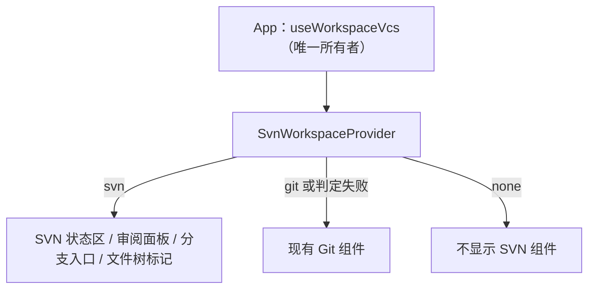

# SVN UI 设计

## 相关文档

- [SVN 需求设计](./requirements.md)
- [SVN 架构设计](./architecture.md)
- [Git UI 开发现状](../git/ui-shell.md)

## 设计原则

- 入口位置与 Git 一致，用户在两种工作副本间切换时位置不变。
- 容器组件各自独立：`SvnPane`、`SvnStatusSectionContent`、`SvnBranchSwitcher`、`SvnCommitDialog`、`SvnHistoryDialog`、`SvnMergeDialog`（`packages/ui/src/svn/`）。
- 展示复用 Git：变更卡片与 diff 直接复用 `GitPaneChangeCard`，由 `svnDisplay.ts` 把 SVN 改动和 diff 映射成卡片输入；Git 组件本身不改。
- 遵守 `DESIGN.md`，复用已有组件；兼顾桌面与 Web 布局、双主题与中英文。
- 组件只通过 hooks 访问服务。

## VCS 分发



- `useWorkspaceVcs` 调用 `IWorkspaceVcsService.getWorkspaceVcsInfo`，同时持有 SVN 状态镜像，经 `SvnWorkspaceProvider` 下发。
- `ConversationStatusPanel`、`AnimatedSidePanePanel`（审阅 tab）、`WorkspaceShellLayout`（输入区分支入口）与文件树数据 hook 只读取 context，不各自判断。
- 旧 Host 不提供 `workspace-vcs` 时按 Git 处理，保持旧行为。

## 1. 会话状态面板的环境区

位置与 Git 环境区相同（`ConversationStatusPanel`）。SVN workspace 下环境区显示三行：

| 行   | 展示与交互                                                                       |
| ---- | -------------------------------------------------------------------------------- |
| 改动 | `+/-` 汇总；有冲突时显示冲突数；点击打开右侧审阅 tab（内容为 SVN 面板）          |
| 分支 | `SvnBranchSwitcher`                                                              |
| 提交 | 打开 `SvnCommitDialog`，范围为面板默认勾选项；有冲突或无可提交项时禁用并提示原因 |

## 2. 分支入口：`SvnBranchSwitcher`

出现在状态面板环境区与输入区（位置同 `GitBranchSwitcher`）。

- 显示当前分支：`trunk`、分支名、`tag: 名称`，非标准布局显示相对路径。
- 处于 tag 时显示提示（SVN 允许向 tag 提交，但这通常是误操作）。
- 下拉列表：`trunk` + `^/branches` 下的分支；首次展开时加载，访问远端失败显示错误，并提供“输入路径切换”。
- 非标准布局时只提供“输入路径切换”（相对仓库根）。
- 工作副本根不是分支根（`canSwitch` 为 false）时只显示说明，不提供切换。
- 有本地改动时，切换前确认：SVN 会带着改动切换，可能产生冲突。
- 第一期不提供创建分支。

## 3. SVN 面板：`SvnPane`

### 3.1 结构

```
┌ SVN ─────────────────────────── [更新] [历史] [×] ┐
│ trunk · r1234                    ↻ 服务器 r1240    │
│ ⚠ 工作副本被锁定                       [清理]      │  ← 仅锁定时显示
├────────────────────────────────────────────────────┤
│ ▾ 冲突 (2)                                          │
│   ☐ src/a.ts   文本冲突  [用我的][用他们的][打开][标记已解决] │
│   ☐ docs/b     树冲突    本地已删除，传入编辑。请在命令行处理 │
│ ▾ 改动 (5)                                          │
│   ☑ M src/c.ts               +12 −3                 │
│   ☑ A src/d.ts               +40                    │
│ ▸ 未纳入版本控制 (3)                                 │
│   ☐ ? tmp/e.log                                     │
├────────────────────────────────────────────────────┤
│ [提交 (2)]                          [还原所选]       │
└────────────────────────────────────────────────────┘
```

### 3.2 分组与勾选

| 分组           | 包含状态                                                     | 默认展开           | 默认勾选 |
| -------------- | ------------------------------------------------------------ | ------------------ | -------- |
| 冲突           | conflicted                                                   | 是（有内容时置顶） | 不可勾选 |
| 改动           | modified / added / deleted / replaced / missing / 仅属性修改 | 是                 | 勾选     |
| 未纳入版本控制 | unversioned                                                  | 否                 | 不勾选   |

- `ignored` 不在面板显示，只在文件树中置灰。
- `missing`（已纳入版本控制但磁盘上不存在）提交时按删除处理，行内提示“文件已丢失，提交将删除”。
- `external` 只读展示，第一期不支持对 externals 操作。
- 勾选状态是 UI 局部状态，刷新后保留仍存在的路径的勾选，新出现的路径按默认值。

### 3.3 文件行

- 行首为勾选框与状态字母（M / A / D / R / ? / ! / C / X / ~），其后复用 `GitPaneChangeCard`：路径、`+/-`，展开后显示 inline diff。
- 右键菜单与 Git 一致：在文件管理器中显示、复制绝对 / 相对路径、在文件树中显示。还原通过勾选后的“还原所选”完成。
- 第一期 diff 只展示文本差异，`Property changes on:` 属性段从 diff 中去掉（共享 diff 组件只解析文本 hunk）；只改属性的条目显示为 M。

### 3.4 冲突动作

| 冲突类型 | 动作                                                                                |
| -------- | ----------------------------------------------------------------------------------- |
| 文本冲突 | 用我的（`mine-full`）、用他们的（`theirs-full`）、打开文件、标记已解决（`working`） |
| 属性冲突 | 只读说明 + “请在命令行处理”                                                         |
| 树冲突   | 只读说明（来自 `svn status --xml` 的 tree-conflict 描述）+ “请在命令行处理”         |

“用我的 / 用他们的”执行前确认，说明会整文件覆盖。

### 3.5 底部操作

- **提交 (n)**：n 为勾选数；为 0 或存在未解决冲突时禁用，悬浮提示原因。点击打开 `SvnCommitDialog`。
- **还原所选**：确认框列出路径，说明“新增的文件会撤销 add，但保留在磁盘上”。

### 3.6 顶部操作

- **更新**：执行期间按钮显示进度且禁用；完成后 toast 显示“已更新到 r{n}，{k} 个文件变更”；产生冲突时 toast 显示冲突数并展开冲突分组。
- **合并**：打开 `SvnMergeDialog`（§11）。工作副本根不是分支根时禁用。
- **历史**：打开 `SvnHistoryDialog`。
- 服务器有新修订时，修订号右侧显示“服务器 r{n}”，点击即更新。

### 3.7 异常状态

| 状态                                        | 展示                                                                                                    |
| ------------------------------------------- | ------------------------------------------------------------------------------------------------------- |
| 未找到 svn                                  | 安装指引（Windows / macOS / Linux），并可在面板内直接填写 svn 路径（保存到 workspace 所在 Host 的设置） |
| 版本低于 1.8                                | 显示当前版本与最低要求                                                                                  |
| 旧 Host（未实现 `svn` channel）             | “当前 Host 暂不支持 SVN”                                                                                |
| 非工作副本（覆盖为 svn 但目录不是工作副本） | 说明 + 提示在“设置 → 通用 → 版本控制”修改类型                                                           |
| 工作副本被锁定                              | 顶部警示条 + 清理按钮                                                                                   |
| 工作副本过期（提交时）                      | 错误提示 + “更新”按钮                                                                                   |

## 4. 提交弹窗：`SvnCommitDialog`

沿用 Git 提交弹窗的紧凑布局：

- 顶部：当前分支、修订号、本次勾选范围的 `+/-` 统计。
- 中部：提交信息输入框，带生成按钮；生成只参考勾选的文件。第一期不附带会话上下文（Git 状态区入口同样未传入）。
- 勾选中包含未纳入版本控制的文件时，显示提示“将先添加 {n} 个新文件”。
- 底部：只有一个主按钮“提交到服务器”，没有“提交并推送”。
- 信息为空时点击提交：与 Git 一致，先生成再提交。
- 成功：toast 显示“已提交 r{n}”，关闭弹窗并刷新面板。
- 失败：
  - `out-of-date`：保留弹窗与输入，提示先更新，提供“更新”按钮。
  - `auth-required`：弹出凭据对话框，成功后自动重试一次。
  - 其他：显示 svn 错误信息。

## 5. 历史弹窗：`SvnHistoryDialog`

```
┌ 历史 · trunk ───────────────────────── [×] ┐
│ [筛选作者或关键词…]                          │
├───────────────┬────────────────────────────┤
│ r1240 alice   │ r1238 · bob · 2026-10-20     │
│ 修复登录超时   │ 调整缓存策略                 │
│ r1239 carol   │                              │
│ ▶ r1238 bob   │ M /trunk/src/cache.ts        │
│ ...           │ A /trunk/src/lru.ts          │
│ [加载更多]     │ ── diff ──                   │
└───────────────┴────────────────────────────┘
```

- 左侧单线列表（第一期不画分支拓扑），每页 100 条，底部“加载更多”。
- 筛选只作用于已加载的条目，输入框下方提示“在已加载的 {n} 条中筛选”。
- 右侧为修订详情：完整提交信息、变更路径（含 A/M/D/R 与 copyfrom），点击文件路径用共享 `DiffViewer` 显示该修订的 diff（目录不可点击）。
- 窄屏（`md` 以下）改为列表与详情两级导航，详情顶部有“返回”。

## 6. 凭据对话框

- 字段：仓库地址（只读）、用户名、密码、“让 svn 记住凭据”复选框（默认勾选）。
- 提交后重试原操作一次；失败显示错误，并关闭对话框，不再自动弹出。
- 密码输入框不回填，组件卸载时清空。

## 7. 文件树标记

- 文件树沿用现有标记集合（M / A / D / R / U 与忽略置灰），SVN workspace 下由 `buildSvnFileTreeDecorations` 从 SVN 状态生成，Git 命令不再调用。
- 映射：修改 / 替换 / 属性修改 / 冲突 → M（冲突的具体处理在 SVN 面板）；新增 → A；删除 / 丢失 → D；未纳入版本控制 → U；`svn:ignore` 命中 → 置灰。
- 数据来自与面板同一次 `getChanges` 结果，不额外发起命令。

## 8. 会话状态面板

- `ConversationStatusPanel` 环境区在 SVN 下使用 `getChanges` 的统计（见 §1）。
- Git 审阅面板的“上一轮更改”来源目前在 Git 中也只是空态骨架（`useGitRepository` 注明待 v4 逐轮变更面接入后回填），SVN 面板第一期不提供该来源，届时与 Git 一并接入。
- Git 专属的“已暂存”“全部分支更改”来源在 SVN 下不存在。

## 9. 设置

在“设置 → 通用”中新增“版本控制”分组（`settings/VersionControlSettings.tsx`）：

| 设置                                  | 作用域                                         | 默认           |
| ------------------------------------- | ---------------------------------------------- | -------------- |
| 版本控制类型（自动 / Git / SVN / 无） | workspace（身份 key）                          | 自动           |
| svn 可执行文件路径                    | 所在 Host（在 SVN 面板“未找到 svn”状态中填写） | 空（自动查找） |
| 自动检查服务器新修订                  | 全局                                           | 开启，5 分钟   |

## 10. 文案

| key 含义               | 中文                   | English                               |
| ---------------------- | ---------------------- | ------------------------------------- |
| 提交                   | 提交                   | Commit                                |
| 提交到服务器           | 提交到服务器           | Commit to server                      |
| 更新                   | 更新                   | Update                                |
| 还原                   | 还原                   | Revert                                |
| 切换                   | 切换                   | Switch                                |
| 合并                   | 合并                   | Merge                                 |
| 标记已解决             | 标记已解决             | Mark as resolved                      |
| 用我的                 | 用我的                 | Use mine                              |
| 用他们的               | 用他们的               | Use theirs                            |
| 清理                   | 清理                   | Cleanup                               |
| 未纳入版本控制         | 未纳入版本控制         | Unversioned                           |
| 工作副本被锁定         | 工作副本被锁定         | Working copy is locked                |
| 服务器有新修订         | 服务器有新修订 r{n}    | Server has new revision r{n}          |
| 当前 Host 暂不支持 SVN | 当前 Host 暂不支持 SVN | SVN is not supported on this host yet |

## 11. 合并弹窗：`SvnMergeDialog`

```
┌ 合并到当前分支 ─────────────────────────── [×] ┐
│ 当前：trunk                                     │
│ 源分支  [branches/feature          ▾]           │
│ ☐ 指定修订范围   [起始 r] : [结束 r]            │
│ 合并会修改工作副本，完成后请审阅并提交。          │
│                          [取消] [合并到当前分支] │
└─────────────────────────────────────────────────┘
```

- 入口在 `SvnPane` 顶部操作；`canSwitch` 为 false（工作副本根不是分支根）时按钮禁用。
- 源分支来自 `listBranches`，排除当前分支；非标准布局改为手动输入相对仓库根的路径。
- 默认合并源的全部可用修订（`svn merge <root>/<source>@HEAD .`，依赖 mergeinfo 去重）；勾选“指定修订范围”后使用 `-r start:end`，两端必填、正整数且 start ≤ end。
- 执行期间按钮显示进度；成功后关闭弹窗、toast 显示合并文件数与冲突数，并刷新面板；有冲突时展开冲突分组。
- 失败时保留弹窗与选择；`auth-required` 走凭据弹窗并重试一次；其他错误显示 svn 原始信息。
- 合并本身不创建修订，也不自动提交。

## 12. E2E 场景

用例文件：`packages/desktop/test/e2e/git/manual-review/svn-workflow-ui-flow.test.ts`（manual-review 待审，人工审阅通过后按 E2E 生命周期提升为正式用例）。运行环境需提供 svn / svnadmin（可用 `ESCODE_SVN_BINARY` / `ESCODE_SVNADMIN_BINARY` 指定），缺失时显式跳过。

1. **SVN-UI-01 修改 → 勾选 → 提交**：修改已纳入版本控制的文件并新建文件；在面板勾选新文件后提交；断言两者从面板消失，且服务器最新修订包含提交信息与新文件。
2. **SVN-UI-02 更新冲突 → 用我的 → 提交**：另一个工作副本先提交同一行；本地修改后点击更新；断言出现冲突分组且提交按钮禁用；执行“用我的”并确认后冲突消失、文件内容为本地版本，再提交成功。
3. **SVN-UI-03 切换分支**：夹具包含 `branches/feature`；通过 `SvnBranchSwitcher` 切换；断言工作副本 URL 为 `^/branches/feature`，入口显示 feature。
4. **SVN-UI-04 合并分支**：在 `branches/feature` 提交一个新文件；切回 trunk 后通过 `SvnMergeDialog` 合并 feature；断言新文件出现在改动列表（自动 add），提交后服务器修订包含该文件与合并信息。
